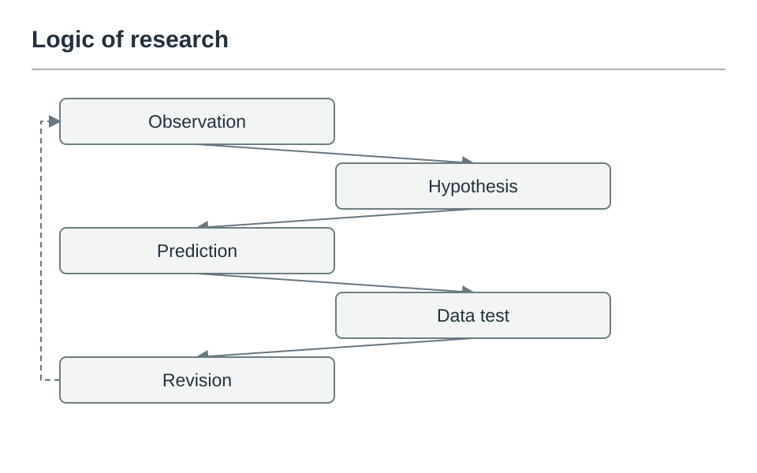

# M1-L1 – Biological questions and models {#L1}

**Course area:** M1 – Scientific Practice and Bioethics

**Level:** Bachelor

**Prerequisites:** School biology; basic understanding of measured quantities and diagrams.

**Learning objective:** Turn an observation into a testable hypothesis, a quantitative prediction and a suitable test.

## Introduction {#S1}

Two plants of the same species grow at different rates. One is near a window, the other in a darker place. This comparison alone does not establish that light causes the difference: temperature, water availability and initial size may differ as well. A biological research question must specify the organism, the explanatory variable and the outcome.

## Principles and model {#S2}

### From observation to explanation

An **observation** describes what is found under particular conditions. A hypothesis is a testable explanation or a precise expectation about relationships. A model specifies which parts of a system are represented and which are initially omitted. A mechanistic model describes a proposed process; a statistical model summarizes relationships in data without establishing a mechanism by itself.

Inductive reasoning develops a general idea from multiple observations. Deductive reasoning derives a specific prediction from that idea. Both directions complement each other: a contradiction of a prediction may indicate an incorrect hypothesis, unsuitable measurements or false auxiliary assumptions. Research therefore does not always proceed in a straight line.

### Operationalization

“Growth” is not a single unambiguous measurement. Changes in dry mass, leaf area and shoot length are different measured quantities. Operationalization specifies what is measured and under which conditions. In an experiment the explanatory variable is deliberately varied; in an observational study existing differences are recorded. Controlled variation supports causal inference if confounding factors are adequately addressed.

*Figure: Observation, model prediction and testing with feedback.*

## Application {#S3}

An illustrative, fictional example uses two groups of independent plants. Mean changes in leaf area over seven days are assumed to be 4 and 6 cm². The observed difference is $6-4=2\,\mathrm{cm^2}$. This describes an effect, not its statistical certainty. Sample size, variability and the precise design are still missing.

The hypothesis is that greater light availability increases the mean change in leaf area under otherwise comparable conditions. A prediction is a positive difference in group means. Equal or smaller mean growth would be inconsistent with this simple expectation; however, a single discrepant measurement does not immediately refute it.

## Self-assessment {#S4}

### Exercises

1. Distinguish observation and hypothesis in the plant example.
2. Name two plausible confounders and explain how they could affect the analysis.
3. Why is the difference of 2 cm² not yet proof of an effect of light?

::: {.lc-solutions data-lc-section="S4"}
1. The different leaf areas are an observation; the proposed dependence on light availability is a testable hypothesis.
2. Temperature affects metabolism and growth; different initial size can alter absolute growth. Both should be comparable or recorded.
3. Variability, the independent sample size and comparability of conditions are unknown. The observed difference may reflect chance or confounding factors.
:::

## Assumptions and limitations {#S5}

A model is a deliberate simplification. Successful predictions support its use within the range investigated but do not exclude other explanations. Evolutionary and ecological questions cannot always be addressed experimentally; independent observations and competing models are then especially important.

## Summary and transition {#S6}

Biological research connects observation, modelling, measurement and critical revision. The next lesson considers the ethical and scientific conditions that make this process responsible.

**Continue:** [M1-L2](M1-L2.md)

## Sources {#S7}

- [OpenStax – Biology 2e, 1.1 The Science of Biology](https://openstax.org/books/biology-2e/pages/1-1-the-science-of-biology) · The Process of Science; Scientific Reasoning · Last accessed: 2026-11-25
- [NIH – Principles and Guidelines for Reporting Preclinical Research](https://grants.nih.gov/policy-and-compliance/policy-topics/reproducibility/principles-guidelines-reporting-preclinical-research) · Transparency; Replicates; Randomization; Blinding; Inclusion and exclusion · Last accessed: 2026-11-25

