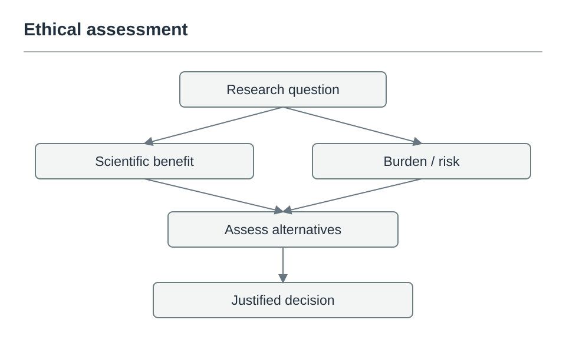

# M1-L2 – Research ethics and scientific integrity {#L2}

**Course area:** M1 – Scientific Practice and Bioethics

**Level:** Bachelor

**Prerequisites:** [M1-L1](M1-L1.md): hypotheses and scientific tests.

**Learning objective:** Reason about ethical trade-offs and assess scientific documentation, authorship and transparent corrections.

## Introduction {#S1}

A research group studies how an environmental condition affects plant growth. Some data contradict the hypothesis. The issue is not merely statistical: may the group omit those data? Scientific integrity requires that others can trace how a finding was obtained.

## Principles and model {#S2}

### Two levels of responsibility

Research ethics concerns justified aims and means. Biological studies may affect people, animals, ecosystems, genetic information or communities. Applicable duties and approvals depend on the project and jurisdiction. Scientific integrity concerns the reliability of knowledge production: do not invent data or manipulate findings; acknowledge other people's contributions and disclose conflicts of interest.

An ethical assessment first describes expected scientific benefits and potential burdens. Less burdensome alternatives are then considered. For animal research the 3Rs – Replacement, Reduction and Refinement – provide guidance: appropriate alternatives, scientifically justified reduction in animal numbers, and reduced burdens. An excessively small sample is not automatically more ethical if the study consequently cannot produce informative evidence.

### Integrity in daily research

A traceable record includes discrepant findings, documented changes and predefined exclusion criteria. Authorship rests on an identifiable scientific contribution and shared responsibility, not simply on a hierarchical position. Honest mistakes must be distinguished from deliberate fabrication; transparent correction matters in either case. Access to data may be restricted by privacy, consent or legitimate protection interests.

*Figure: Scientific benefit and possible burdens are assessed alongside alternatives.*

## Application {#S3}

In a fictional project twelve independent measurements were planned. Two findings contradict the expectation; one is uninterpretable because of a documented instrument failure, while the other is technically valid. The instrument failure is recorded under the predefined quality criteria and its treatment in the analysis is justified. The valid result remains in the analysis. A supplementary sensitivity analysis can show how strongly the decision about the instrument failure affects the conclusion.

## Self-assessment {#S4}

### Exercises

1. Which of the two measurements must not be excluded simply because of its value?
2. Why does leading a research group not automatically establish authorship?
3. Give an example of an ethical conflict between open data and duties of protection.

::: {.lc-solutions data-lc-section="S4"}
1. The technically valid measurement; contradicting a hypothesis is not a quality defect.
2. Authorship requires a genuine scientific contribution and responsibility for the publication.
3. Individually identifiable genetic information may reveal facts about people or their relatives; disclosure requires appropriate legal grounds and safeguards.
:::

## Assumptions and limitations {#S5}

Ethical reasoning is not a substitute for approval. This lesson provides principles, not individual legal advice. The responsible authorities and institutional rules must be established before actual research begins.

## Summary and transition {#S6}

Good research is scientifically traceable and takes responsibility for its consequences. Practical implementation starts with laboratory safety and responsibility.

**Continue:** [M1-L3](M1-L3.md)

## Sources {#S7}

- [DFG – Leitlinie 12: Dokumentation](https://www.wissenschaftliche-integritaet.de/de/ll-12-389682) · Dokumentation / Documentation · Last accessed: 2026-11-25
- [DFG – Leitlinie 14: Autorschaft](https://www.wissenschaftliche-integritaet.de/de/ll-14-389686) · Autorschaft / Authorship · Last accessed: 2026-11-25
- [DFG – Leitlinie 10: Rechtliche und ethische Rahmenbedingungen](https://www.wissenschaftliche-integritaet.de/de/ll-10-389674) · Recht und Ethik / Law and ethics · Last accessed: 2026-11-25
- [NC3Rs – The 3Rs](https://nc3rs.org.uk/who-we-are/3rs) · Definitions of the 3Rs · Last accessed: 2026-11-25

