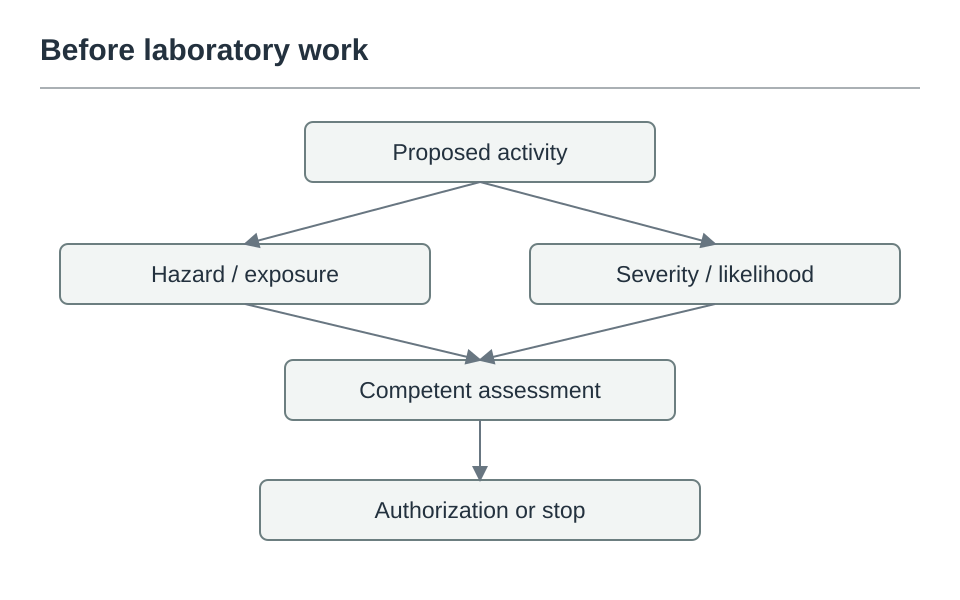

# M1-L3 – Laboratory safety and responsibility {#L3}

**Course area:** M1 – Scientific Practice and Bioethics

**Level:** Bachelor

**Prerequisites:** [M1-L2](M1-L2.md): responsibility and research ethics.

**Learning objective:** Distinguish hazard, risk and safety responsibility and recognize when laboratory work must not start.

## Introduction {#S1}

Laboratories may contain hazardous substances, biological material, sharp instruments, electrical devices or intense optical radiation. A seemingly harmless sample is not necessarily safe. What matters is the actual activity, material, possible routes of exposure and environment.

## Principles and model {#S2}

### Risk assessment and responsibility

A hazard is the potential for harm. Risk also considers the likelihood and severity of possible consequences. Two activities involving the same material may present different risks. Competent assessment must therefore address the specific activity before work begins. In Germany, § 14 of the Biological Agents Ordinance (BioStoffV) generally requires employers, for activities within its scope, to provide operating instructions based on risk assessment and to train workers; paragraph 1 includes a limited exception for specified activities involving risk group 1 alone. Applicable local requirements remain decisive.

Where appropriate, the protection strategy prioritizes avoiding hazardous activities and materials, followed by technical and organizational measures, over relying solely on personal protective measures. Personal protective equipment does not replace a suitable working environment. A containment level assigned to an activity and the risk group of a biological agent are not identical. Selection of appropriate measures requires competent oversight.

### Stop and report

Anyone lacking training or authorization, or encountering an unknown sample, must not devise their own experimental instructions. Inform the responsible supervisor. Incidents are governed by institutional emergency and reporting procedures; improvisation may create further hazards. This course uses scenarios, models and existing data for such topics only.

*Figure: Safety relies on activity-specific assessment and authorization.*

## Application {#S3}

A fictional teaching laboratory has two tasks: analysing a supplied digital microscopy image and examining an unlabelled biological container. Image analysis can be carried out in ordinary self-study. The second task lacks information and supervision and must not begin. An assumption about the contents is not a risk assessment.

## Self-assessment {#S4}

### Exercises

1. Why may a hazard matter even when the likelihood of harm is low?
2. Why is personal protective equipment alone not a safety system?
3. What is the appropriate decision when an unknown sample is encountered without training?

::: {.lc-solutions data-lc-section="S4"}
1. Potential consequences may be severe; risk also depends on the magnitude of harm.
2. It does not remove the hazard or replace technical and organizational measures or training.
3. Do not start the work and inform the responsible supervisor; do not investigate independently.
:::

## Assumptions and limitations {#S5}

The diagram is a teaching model, not an official safety matrix or operating procedure. Actual work is governed by current law, institutional risk assessment, training and authorization. US CDC recommendations provide scientific guidance, not German law.

## Summary and transition {#S6}

Safe research requires documented responsibilities and competent authorization. The next lesson addresses locating and evaluating scientific information.

**Continue:** [M1-L4](M1-L4.md)

## Sources {#S7}

- [Bundesministerium der Justiz – BioStoffV § 14](https://www.gesetze-im-internet.de/biostoffv_2013/__14.html) · Abs. 1–3 / paragraphs 1–3; Germany · Last accessed: 2026-11-25
- [CDC – Biosafety in Microbiological and Biomedical Laboratories, 6th edition](https://www.cdc.gov/labs/bmbl/) · Risk assessment; advisory guidance, not German law · Last accessed: 2026-11-25
- [DFG – Leitlinie 10: Rechtliche und ethische Rahmenbedingungen](https://www.wissenschaftliche-integritaet.de/de/ll-10-389674) · Recht und Ethik / Law and ethics · Last accessed: 2026-11-25

