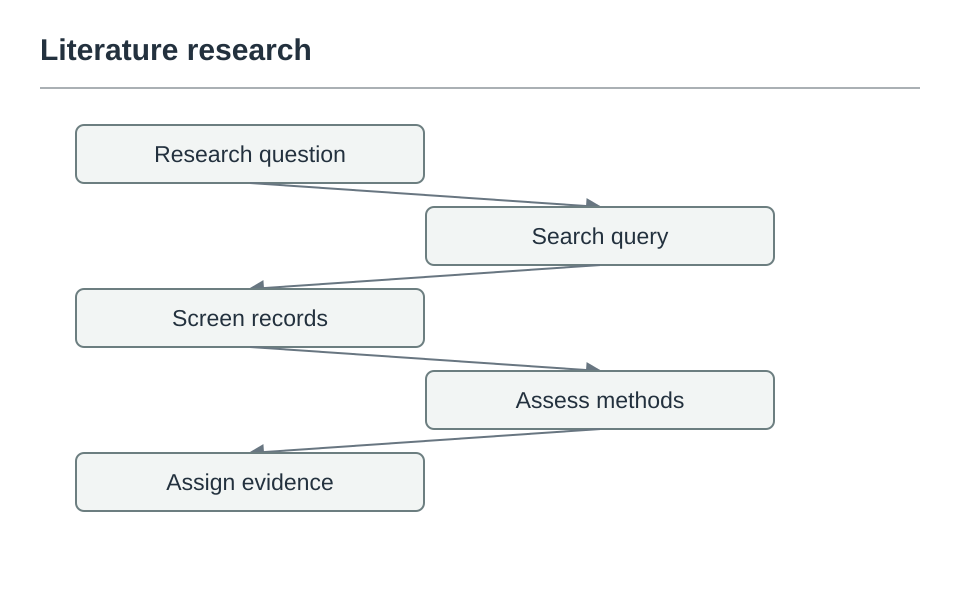

# M1-L4 – Scientific literature and citation {#L4}

**Course area:** M1 – Scientific Practice and Bioethics

**Level:** Bachelor

**Prerequisites:** [M1-L1](M1-L1.md) and [M1-L2](M1-L2.md): research questions and integrity.

**Learning objective:** Formulate a traceable literature search, distinguish publication types and relate scientific claims to the evidence that actually supports them.

## Introduction {#S1}

A new paper claims that an environmental factor affects plant growth. An abstract may summarize the direction of an effect, but it replaces neither the methods nor the analysis. Scientific literature is not merely a collection of answers; it is a network of traceable claims and investigations.

## Principles and model {#S2}

### From a research question to selection

Break the question into core terms, synonyms and scientific species names where applicable. Databases differ in subject coverage. PubMed is particularly useful for biomedical and life-science literature, but it is not a comprehensive database of all ecological and botanical research. `AND` combines terms and `OR` includes alternatives. A filter changes the visible set of records and must be documented.

Primary literature reports original investigations. Reviews contextualize findings from multiple studies; systematic reviews use explicit search and selection methods. A preprint may contain valuable new findings but is not equivalent to completed peer review. Peer review also does not guarantee correct conclusions. Assess the question, sample, controls, analyses, data availability and potential conflicts of interest.

### Assigning evidence correctly

A citation documents the origin of an idea, method or result. A paraphrase also requires attribution. Bibliographic information includes authors, title, publication year, journal or publisher and an identifier where available. A DOI or PMID identifies a publication; it is not a quality seal. Cite the source actually consulted and check for corrections or retractions before relying on its results.

*Figure: A documented search and assessment process connects claims to sources.*

## Application {#S3}

An initial, unexecuted search draft for light and leaf area would be: `(plant OR Arabidopsis) AND (light OR irradiance) AND (leaf area OR growth)`. The query is deliberately broad. A search log records the database, actual search date, query, filters, eligibility criteria and number of records. Subsequent screening asks whether studies really use leaf area as an outcome or merely other growth indicators. An unexecuted search must not be assigned an invented result count.

## Self-assessment {#S4}

### Exercises

1. What distinguishes a primary study from a systematic review?
2. Why does a DOI alone not establish that a result is correct?
3. How can a literature search be documented so that it can later be examined?

::: {.lc-solutions data-lc-section="S4"}
1. A primary study produces original research data; a systematic review collects and assesses existing studies using explicit selection methods.
2. A DOI identifies a publication; it evaluates neither study design nor data quality.
3. Record database, date, complete query, filters, number of results and inclusion and exclusion criteria; uniquely identify the publications used.
:::

## Assumptions and limitations {#S5}

Databases change, result counts depend on time, and not all studies are freely available. Depending on the topic, a comprehensive review requires several databases and search strategies. The example query is a draft, not a completed review.

## Summary and transition {#S6}

Scientific evidence should be traceable and relevant. The next lesson connects literature work to a defensible experimental design.

**Continue:** [M1-L5](M1-L5.md)

## Sources {#S7}

- [National Library of Medicine – PubMed User Guide](https://pubmed.ncbi.nlm.nih.gov/help/) · Search field tags; publication types; citation status · Last accessed: 2026-11-25
- [DFG – Leitlinie 12: Dokumentation](https://www.wissenschaftliche-integritaet.de/de/ll-12-389682) · Dokumentation / Documentation · Last accessed: 2026-11-25
- [DFG – Leitlinie 14: Autorschaft](https://www.wissenschaftliche-integritaet.de/de/ll-14-389686) · Autorschaft / Authorship · Last accessed: 2026-11-25

