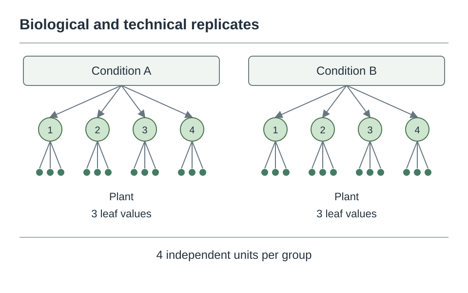

# M1-L5 – Experimental planning and reproducibility {#L5}

**Course area:** M1 – Scientific Practice and Bioethics

**Level:** Bachelor

**Prerequisites:** [M1-L1](M1-L1.md) to [M1-L4](M1-L4.md): hypotheses, documentation and literature research.

**Learning objective:** Distinguish independent experimental units, technical replicates, randomization, blinding and controls in a study design.

## Introduction {#S1}

In a study of leaf area, a researcher measures ten leaves from each of two plants. Is this twenty independent plant measurements? No: leaves from the same plant share genetic, physiological and environmental influences. The unit to which a treatment is independently assigned determines the experiment's structure.

## Principles and model {#S2}

### Experimental design

The independent variable is the deliberately varied condition; the dependent variable is the measured outcome. A control group provides an appropriate comparison. Randomization distributes known and unknown confounders between groups in expectation; it does not guarantee perfect balance in small groups. Blinding the assessor reduces the possibility that expectations unintentionally influence measurements.

Biological replicates are independent biological units within the particular design; technical replicates assess measurement variability within a unit. When a shared vessel determines the treatment of all organisms within it, the vessel rather than the organism may be the experimental unit. Treating dependent measurements as independent creates pseudoreplication. Hierarchical models can account for nested observations.

### Reproducibility and replication

Before collecting data, specify the outcome, planned analysis, inclusion and exclusion criteria and sample size. Exploratory analyses remain useful but must be identified as such. In this course, computational reproducibility means that the same data and documented analysis yield the same result; replication means a new independent investigation. Terminology varies across disciplines. Raw data, metadata, software versions and analytical decisions must remain traceable for authorized review.

*Figure: Eight independently treated plants and 24 nested leaf measurements.*

## Application {#S3}

Teaching model: eight plants are independently assigned to two conditions, four per group. Three leaves are measured on every plant. There are 24 leaf values but only eight independent treatment units. Taking the mean for each plant allows a simple comparison based on four units per group. If instead all four plants in each group occupy a single jointly treated chamber, with only one chamber per condition, the chamber effect cannot be separated from the treatment effect.

## Self-assessment {#S4}

### Exercises

1. How many independent treatment units are there in the first example?
2. Why must 24 not be treated as the independent sample size?
3. What distinguishes reanalysis of the same data from an independent repeat of the experiment?

::: {.lc-solutions data-lc-section="S4"}
1. Eight in total, four per group, provided that treatment was genuinely assigned independently.
2. The three leaves of a plant are nested measurements of the same unit. Their dependence cannot be ignored.
3. Reanalysis tests computational reproducibility; an independent investigation tests replication and robustness of the finding.
:::

## Assumptions and limitations {#S5}

Randomization, controls and blinding address different problems. Large numbers of technical measurements cannot compensate for missing independent units. Required sample size depends on expected effect size, variability, design and desired precision; universal minimum numbers are not meaningful.

## Summary and transition {#S6}

The first module connects research questions, responsibility, evidence and methodological planning. Mathematical and statistical models in M2 build on these foundations.

**Continue:** [M2-L1](M2-L1.md)

## Sources {#S7}

- [NIH – Principles and Guidelines for Reporting Preclinical Research](https://grants.nih.gov/policy-and-compliance/policy-topics/reproducibility/principles-guidelines-reporting-preclinical-research) · Transparency; Replicates; Randomization; Blinding; Inclusion and exclusion · Last accessed: 2026-11-25
- [DFG – Leitlinie 12: Dokumentation](https://www.wissenschaftliche-integritaet.de/de/ll-12-389682) · Dokumentation / Documentation · Last accessed: 2026-11-25

