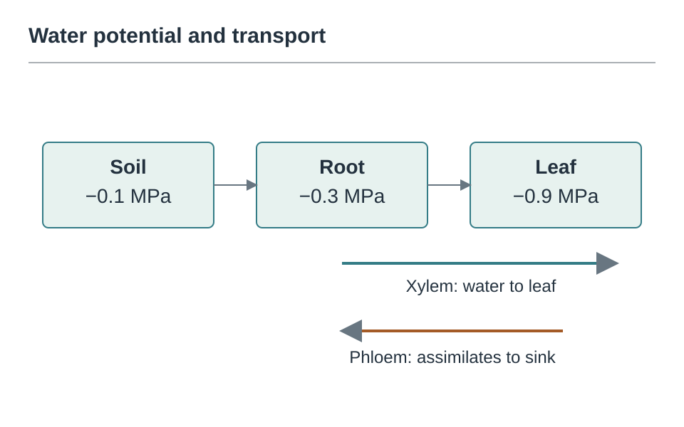

# M10-L1 – Water relations and mineral uptake {#L1}

**Course area:** M10 – Plant Physiology

**Level:** Bachelor

**Prerequisites:** [M3-L4](M3-L4.md): transport; [M4-L2](M4-L2.md): membranes; [M7-L1](M7-L1.md): plant tissues.

**Learning objective:** Calculate water potential, distinguish xylem and phloem transport, and explain the energetics of mineral uptake.

## Introduction {#S1}

A plant can wilt even in moist soil, for example when dissolved salts reduce water availability. Water content alone is not decisive; the thermodynamic driving force for water movement matters.

## Principles and model {#S2}

### Water potential and vascular tissues

Water potential $\Psi_w$ is expressed in pressure units. For a single cell, $\Psi_w=\Psi_s+\Psi_p$ is often sufficient: osmotic potential $\Psi_s$ is negative when solutes are present, and pressure potential $\Psi_p$ can represent positive turgor. In soils and tall trees, matric and gravitational components also matter. For an ideal dilute solution, $\Psi_s=-iCRT$ approximately, where $i$ is the particle factor, $C$ concentration and $T$ absolute temperature. Water moves passively towards lower total potential.

Evaporation from leaf cell walls generates tension in the xylem. Cohesion transmits tension along continuous water columns; gas bubbles can reduce conductivity. Guard cells regulate gas exchange and hence transpiration. Root pressure may contribute under particular conditions but does not explain all long-distance transport.

### Minerals and assimilates

Root hairs increase exchange area. Membrane transporters enable selective ion uptake; proton pumps establish electrochemical gradients. The endodermis restricts uncontrolled apoplastic transport. Nitrogen, phosphorus and potassium are important, for instance, in biomolecules, energy transfer and osmotic regulation. Phloem transports dissolved assimilates from sources to consuming or storage organs through pressure gradients coupled to loading and unloading. Direction depends on the particular source–sink relationship.

*Figure: Three compartments with decreasing water potential; water moves towards the leaf, assimilates towards the root in the example.*

## Application {#S3}

Fictional potentials in MPa: soil −0.1; root −0.3; leaf −0.9. Water can flow towards the leaf along this gradient. In a root cell with $\Psi_s=-0.7$ MPa and $\Psi_p=0.4$ MPa, the result is −0.3 MPa. Relative to a saline soil solution at −0.6 MPa, passive flow would reverse if all other components remained constant.

## Self-assessment {#S4}

### Exercises

1. What is the role of cohesion in the xylem?
2. Calculate water potential for −0.8 MPa osmotic and +0.3 MPa pressure potential.
3. Why can phloem transport also occur towards the root?

::: {.lc-solutions data-lc-section="S4"}
1. It enables transmission of tension along the water column.
2. −0.8 + 0.3 = −0.5 MPa.
3. Roots can be sinks for assimilates from photosynthetically active leaves.
:::

## Assumptions and limitations {#S5}

Potentials are illustrative model values; flow rates additionally require hydraulic conductivities. Concentration alone determines neither nutrient availability nor uptake. The diagram is not to scale.

## Summary and transition {#S6}

Water and material transport connect roots and leaves; M10-L2 explores carbon gain.

**Continue:** [M10-L2](M10-L2.md)

## Sources {#S7}

- [OpenStax – Biology 2e, 30.5 Transport of Water and Solutes in Plants](https://openstax.org/books/biology-2e/pages/30-5-transport-of-water-and-solutes-in-plants) · Water potential, xylem, stomata and phloem · Last accessed: 2026-11-25
- [OpenStax – Biology 2e, 31.1 Nutritional Requirements of Plants](https://openstax.org/books/biology-2e/pages/31-1-nutritional-requirements-of-plants) · Essential nutrients and plant nutrition · Last accessed: 2026-11-25

