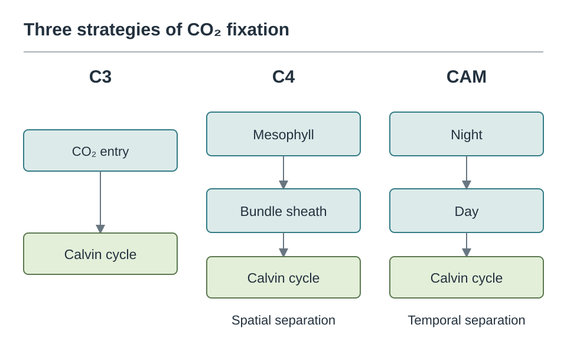

# M10-L2 – Photosynthesis and assimilation {#L2}

**Course area:** M10 – Plant Physiology

**Level:** Bachelor

**Prerequisites:** [M5-L5](M5-L5.md): photosynthesis; [M10-L1](M10-L1.md): water transport.

**Learning objective:** Compare C3, C4 and CAM metabolism and interpret net assimilation and water-use efficiency.

## Introduction {#S1}

In hot and dry conditions, open stomata can support high carbon uptake but also cause water loss. Plants differ in how they regulate this trade-off.

## Principles and model {#S2}

### Carbon concentration

Rubisco catalyses carboxylation of ribulose-1,5-bisphosphate in the Calvin cycle. Its competing oxygenase activity leads to photorespiration, which consumes energy and releases some previously fixed carbon as CO₂. The ratio of these reactions depends on CO₂, O₂ and temperature, among other factors.

C3 plants fix CO₂ directly via Rubisco; the first stable carboxylation product contains three carbon atoms. In many C4 plants, PEP carboxylase initially fixes bicarbonate in mesophyll cells. C4 acids transport carbon to bundle sheath cells, where CO₂ is released and processed in the Calvin cycle. This spatial concentration mechanism consumes additional energy. CAM plants predominantly separate initial fixation and the Calvin cycle in time: organic acids are stored at night and release CO₂ during the day, when stomata are often closed. Intermediate forms and facultative CAM exist.

### Gas exchange and balance

A leaf chamber measures net CO₂ exchange per leaf area and time. Net assimilation is not equivalent to total photochemical activity; respiration and photorespiration affect the balance. Instantaneous water-use efficiency can be expressed as $A/E$, using net assimilation $A$ and transpiration $E$. It differs from integrated biomass production per water consumed.

*Figure: Comparison of direct C3 fixation, spatial carbon concentration in typical C4 plants, and temporal separation in CAM.*

## Application {#S3}

Fictional leaf A: net assimilation 12 µmol CO₂/(m² s), transpiration 3 mmol H₂O/(m² s). $A/E=4$ µmol/mmol = 4 mmol/mol. Leaf B: 8 and 1, giving 8 mmol/mol. B uses water more efficiently at that moment but assimilates less CO₂ per area. The measurement alone identifies no photosynthetic pathway.

## Self-assessment {#S4}

### Exercises

1. How does the C4 mechanism typically reduce photorespiration?
2. Why can CAM limit water loss?
3. Calculate $A/E$ for 15 µmol CO₂/(m² s) and 5 mmol H₂O/(m² s).

::: {.lc-solutions data-lc-section="S4"}
1. By raising CO₂ concentration at the site of Rubisco activity.
2. Much initial carbon uptake can occur at night when evaporative demand is lower.
3. 3 µmol/mmol = 3 mmol/mol.
:::

## Assumptions and limitations {#S5}

Individual measurements depend on temperature, light and humidity. The strategies shown are idealised; not every C4 plant has the same anatomy. Higher instantaneous $A/E$ does not automatically establish higher yield or drought tolerance.

## Summary and transition {#S6}

Photosynthesis depends on environmental conditions and regulation. M10-L3 examines hormonal signals.

**Continue:** [M10-L3](M10-L3.md)

## Sources {#S7}

- [OpenStax – Biology 2e, 8.3 Using Light Energy to Make Organic Molecules](https://openstax.org/books/biology-2e/pages/8-3-using-light-energy-to-make-organic-molecules) · Calvin cycle and carbon concentration strategies · Last accessed: 2026-11-25
- [OpenStax – Biology 2e, 30.5 Transport of Water and Solutes in Plants](https://openstax.org/books/biology-2e/pages/30-5-transport-of-water-and-solutes-in-plants) · Water potential, xylem, stomata and phloem · Last accessed: 2026-11-25

