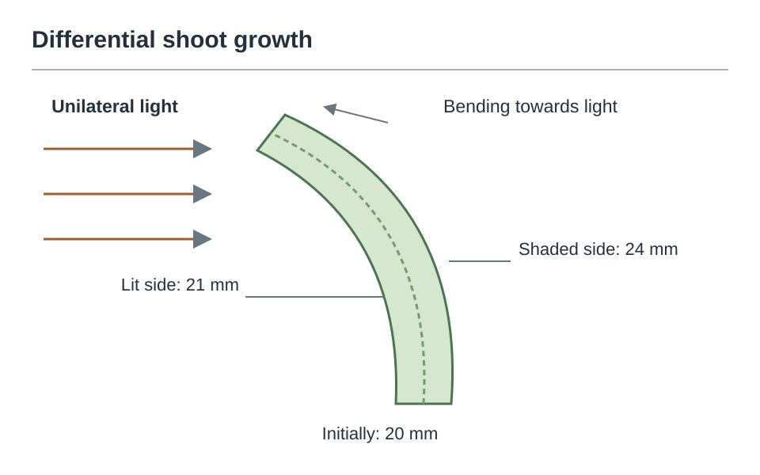

# M10-L3 – Plant hormones and development {#L3}

**Course area:** M10 – Plant Physiology

**Level:** Bachelor

**Prerequisites:** [M4-L5](M4-L5.md): signalling; [M7-L2](M7-L2.md): plant organisation.

**Learning objective:** Classify important plant hormones by function and explain directional growth responses through differential cell growth.

## Introduction {#S1}

A seedling bends its shoot towards unilateral light. Curvature arises from unequal growth of the two sides rather than muscle movement.

## Principles and model {#S2}

### Hormones as interconnected signals

Auxin influences cell elongation, organ formation and apical dominance, among other processes; its distribution is regulated by transport proteins. Cytokinins influence cell division and developmental decisions. Gibberellins promote germination and shoot elongation at suitable developmental stages. Abscisic acid (ABA) participates in seed dormancy and regulation of water relations. Ethylene acts in processes including fruit ripening and stress responses. Jasmonates and salicylic acid participate in defence networks, brassinosteroids in growth and development. Effects depend on receptors, tissue, concentration and interactions.

### Environmental perception and growth

Phototropins perceive blue light; in a typical positively phototropic shoot, asymmetric auxin distribution favours stronger elongation on the shaded side. Phytochromes mediate responses including those to red and far-red light. Gravity perception in specialised cells influences auxin distribution; roots and shoots respond differently to that distribution. In roots, higher auxin concentration can inhibit elongation. Tropisms (direction depends on stimulus direction) differ from nastic responses, whose direction is determined by organ structure.

*Figure: Schematic shoot with stronger elongation on the shaded side and bending towards the light source.*

## Application {#S3}

A fictional shoot segment initially measures 20 mm on both sides. Later, the illuminated side measures 21 mm and the shaded side 24 mm. Relative elongations are 5% and 20%. The difference of 15 percentage points qualitatively explains bending towards the shorter illuminated side. The angle additionally depends on geometry.

## Self-assessment {#S4}

### Exercises

1. Name two functions of ABA.
2. Why does auxin concentration alone not reliably predict growth direction?
3. Calculate relative elongation from 30 to 33 mm.

::: {.lc-solutions data-lc-section="S4"}
1. Regulation of seed dormancy and water relations, for example stomata.
2. Tissue-specific sensitivity, transport, developmental stage and other signals affect the response.
3. (33−30)/30 = 10%.
:::

## Assumptions and limitations {#S5}

The model simplifies a spatially and temporally dynamic signalling network. The figure does not show measured auxin concentrations; demonstration requires independent measurements and controls.

## Summary and transition {#S6}

Hormones connect environmental information to development. M10-L4 extends this account to stress responses.

**Continue:** [M10-L4](M10-L4.md)

## Sources {#S7}

- [OpenStax – Biology 2e, 30.6 Plant Sensory Systems and Responses](https://openstax.org/books/biology-2e/pages/30-6-plant-sensory-systems-and-responses) · Photoreceptors, hormones and tropisms · Last accessed: 2026-11-25

