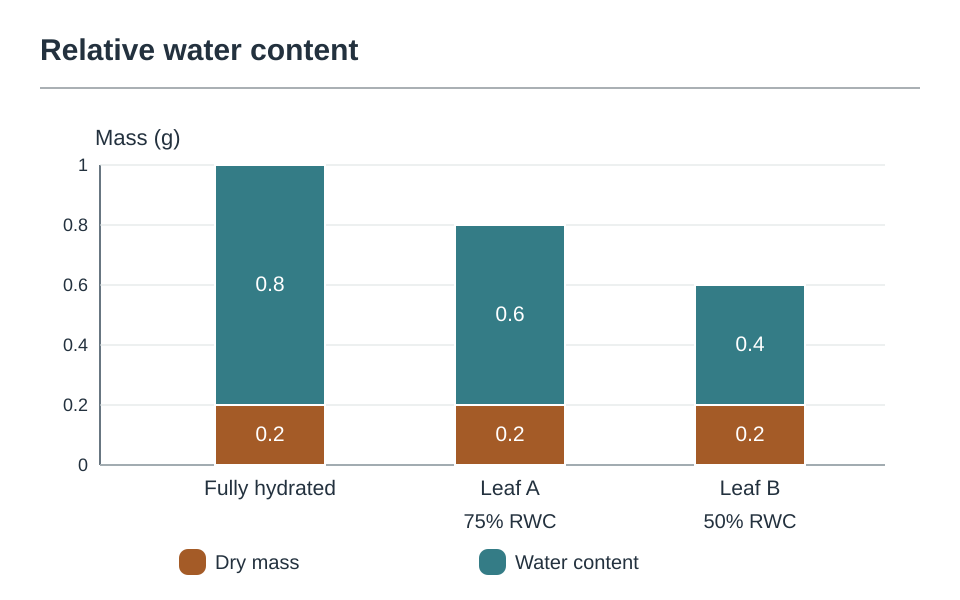

# M10-L4 – Stress and environmental responses {#L4}

**Course area:** M10 – Plant Physiology

**Level:** Bachelor

**Prerequisites:** [M10-L1](M10-L1.md): water potential; [M10-L3](M10-L3.md): hormones.

**Learning objective:** Distinguish abiotic stress factors, cellular responses and limits of physiological tolerance; calculate relative water content.

## Introduction {#S1}

Two plants may survive the same dry period yet exhibit very different growth losses. Survival, recovery and productivity are distinct outcomes.

## Principles and model {#S2}

### Stress perception and response

Drought reduces water availability; salinity combines osmotic stress with possible ion-specific damage. Flooding may restrict root oxygen supply. Heat can destabilise proteins and membranes, while cold changes membrane properties and reaction rates, among other effects. Responses depend on intensity, duration, organ and developmental stage.

Calcium signals, protein kinases, hormonal regulation and reactive oxygen species (ROS) connect perception with gene expression and metabolism. ROS are both signals and potential causes of damage. Antioxidant systems limit excessive oxidation. ABA-dependent stomatal closure can conserve water but often also restricts carbon uptake. Osmotic adjustment through appropriate solutes can stabilise turgor; producing and maintaining protective systems consumes resources. Some stress responses are reversible; other damage is not.

### Measurements and comparison

Relative water content $RWC=100(F-D)/(T-D)$ relates fresh mass $F$ and dry mass $D$ to mass $T$ after defined full hydration. It is a dimensionless percentage, not a direct measure of water potential. Acclimation refers to physiological adjustment within an individual; evolutionary adaptation concerns heritable traits of populations over generations.

*Figure: Stacked bars show 0.2 g dry mass and water masses of 0.8, 0.6 and 0.4 g.*

## Application {#S3}

Fictional leaf: $F=0.8$ g, $T=1.0$ g, $D=0.2$ g. $RWC=100\cdot0.6/0.8=75$%. A second leaf with $F=0.6$ g and the same reference masses has 50%. Lower values indicate lower relative hydration, but without further data do not establish its cause or the probability of survival.

## Self-assessment {#S4}

### Exercises

1. Which two components distinguish salinity stress from water deficit alone?
2. Why can stomatal closure be both beneficial and disadvantageous?
3. Calculate RWC for F=0.9 g, T=1.1 g and D=0.3 g.

::: {.lc-solutions data-lc-section="S4"}
1. Osmotic stress and ion-specific effects; water deficit alone does not necessarily include the second component.
2. It reduces water loss but may limit CO₂ uptake and growth.
3. 100·0.6/0.8 = 75%.
:::

## Assumptions and limitations {#S5}

RWC depends on the hydration and drying reference selected. A value above 100% or a nonpositive denominator indicates noncomparable references or measurement errors. The figure uses teaching masses, not observations.

## Summary and transition {#S6}

Stress physiology requires complementary measurements. M10-L5 connects them with experimental design.

**Continue:** [M10-L5](M10-L5.md)

## Sources {#S7}

- [Abiotic stress responses in plants (2022), Nature Reviews Genetics](https://www.nature.com/articles/s41576-021-00413-0) · Review: perception and signalling of drought, salinity and temperature stress · Last accessed: 2026-11-25
- [OpenStax – Biology 2e, 30.6 Plant Sensory Systems and Responses](https://openstax.org/books/biology-2e/pages/30-6-plant-sensory-systems-and-responses) · Photoreceptors, hormones and tropisms · Last accessed: 2026-11-25
- [OpenStax – Biology 2e, 30.5 Transport of Water and Solutes in Plants](https://openstax.org/books/biology-2e/pages/30-5-transport-of-water-and-solutes-in-plants) · Water potential, xylem, stomata and phloem · Last accessed: 2026-11-25
- [Life on the dry side: a roadmap to understanding desiccation tolerance and accelerating translational applications (2025), Nature Communications](https://www.nature.com/articles/s41467-025-58656-y) · Relative Water Content: definition, equation and distinction from water potential · Last accessed: 2026-11-25

