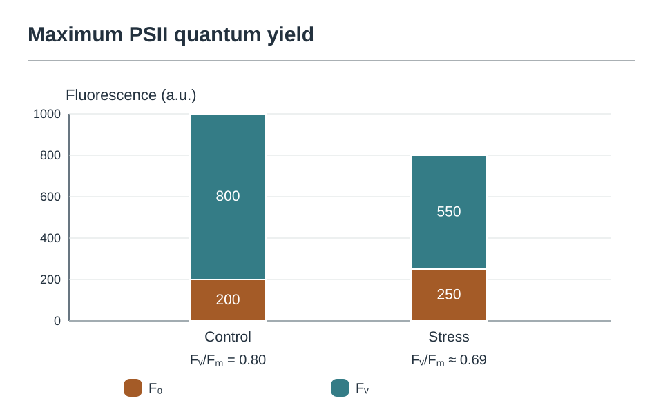

# M10-L5 – Physiological experiments {#L5}

**Course area:** M10 – Plant Physiology

**Level:** Bachelor

**Prerequisites:** [M2-L5](M2-L5.md): experimental design; [M10-L2](M10-L2.md): assimilation; [M10-L4](M10-L4.md): stress.

**Learning objective:** Design a plant physiology experiment and connect chlorophyll fluorescence with gas exchange and biological replication.

## Introduction {#S1}

A research group asks whether water deficit changes photosynthetic performance. Rather than assessing leaf colour alone, it plans several independent types of physiological measurement.

## Principles and model {#S2}

### Measurement principles

Light energy can enter photochemical reactions, be dissipated as heat or appear as chlorophyll fluorescence. These processes compete. After appropriate dark adaptation, $F_0$ denotes minimal and $F_m$ maximal fluorescence under a saturating light pulse. $F_v=F_m-F_0$; the ratio $F_v/F_m$ characterises the maximum photochemical quantum yield of photosystem II under these measurement conditions. It is not a direct measure of net CO₂ assimilation. Gas exchange measurements complement the information; water status and leaf area support mechanistic interpretation.

### Design and analysis

The research question defines organism, stress treatment, duration and outcome. Independent plants are randomly assigned to treatments; spatial gradients can be addressed through blocking. Repeated measurements of the same plant are not independent biological replicates. If an entire chamber receives a treatment, the chamber is the experimental unit for that factor; plants within it are not independent treatment replicates. A prespecified analysis plan defines exclusion criteria and the primary endpoint. Calibration, dark adaptation and measurement time are documented. Individual values and uncertainty should accompany means.

*Figure: Stacked bars for fictional minimum and variable fluorescence yield maxima of 1000 and 800 and ratios of 0.80 and 0.6875.*

## Application {#S3}

Fictional fluorescence values (arbitrary units): control $F_0=200$, $F_m=1000$; stress $F_0=250$, $F_m=800$. This gives $(1000-200)/1000=0.80$ and $(800-250)/800=0.6875$. The stress-minus-control difference is −0.1125. This illustrates a comparison between two leaves, not statistical evidence of a treatment effect.

## Self-assessment {#S4}

### Exercises

1. Calculate $F_v/F_m$ for $F_0=180$ and $F_m=900$.
2. Why are ten leaves from the same plant not ten independent plants?
3. Which complementary measure helps investigate stomatal limitation of CO₂ uptake?

::: {.lc-solutions data-lc-section="S4"}
1. (900−180)/900 = 0.80.
2. Leaves share genotype, environment and treatment history; the independent unit here is the plant if treatment was assigned at plant level.
3. For example, stomatal conductance alongside net assimilation and controlled environmental conditions.
:::

## Assumptions and limitations {#S5}

Fluorescence values are simulated. A lower ratio can have various causes, such as photoinhibition or incomplete dark adaptation. No universal diagnostic threshold follows from the example. Practical instrument use requires training and an appropriate experimental protocol.

## Summary and transition {#S6}

Physiological conclusions depend on measurement principles, design and uncertainty analysis. M11 transfers this perspective to animal and human physiology.

**Continue:** [M11-L1](M11-L1.md)

## Sources {#S7}

- [Murchie & Lawson (2013), Chlorophyll fluorescence analysis: a guide to good practice](https://doi.org/10.1093/JXB/ERT208) · Principles of fluorescence and dark-adapted PSII efficiency · Last accessed: 2026-11-25
- [Maxwell & Johnson (2000), Chlorophyll fluorescence—a practical guide](https://pubmed.ncbi.nlm.nih.gov/10938857/) · Abstract; fluorescence as a physiological measurement · Last accessed: 2026-11-25
- [OpenStax – Introductory Statistics 2e, 1.2 Data, Sampling, and Variation in Data and Sampling](https://openstax.org/books/introductory-statistics-2e/pages/1-2-data-sampling-and-variation-in-data-and-sampling) · Random, stratified and cluster sampling; variation in samples · Last accessed: 2026-11-25

