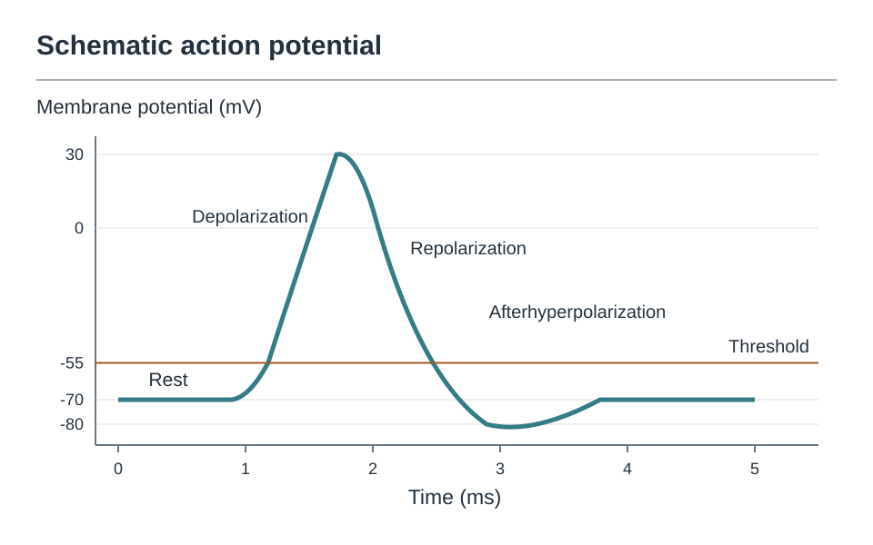

# M11-L1 – Neurons and signal transmission {#L1}

**Course area:** M11 – Animal and Human Physiology and Behaviour

**Level:** Bachelor

**Prerequisites:** [M4-L2](M4-L2.md): electrochemical gradients; [M4-L5](M4-L5.md): signals.

**Learning objective:** Explain action potentials and synaptic integration; estimate conduction velocity from latencies.

## Introduction {#S1}

A reflex connects sensory input to a motor response. The interval from stimulus to movement includes several processes, not all of which are electrical signal propagation.

## Principles and model {#S2}

### Excitable membrane

Membrane potential is the voltage inside relative to outside. Ionic gradients and selective conductances determine resting potential. The Na⁺/K⁺-ATPase maintains gradients over time, while rapid voltage changes arise mainly from ion channels. Above threshold in an excitable membrane region, regenerative opening of voltage-dependent Na⁺ channels can depolarize the membrane. Na⁺ channel inactivation and delayed K⁺ channel opening repolarize it. No further action potential can be initiated during the absolute refractory period; a stronger stimulus is needed during the relative period.

Local currents excite neighbouring membrane regions. Myelin reduces capacitive loading and leakage; in myelinated axons the signal is regenerated predominantly at nodes of Ranvier. Suprathreshold stimulus intensity is often encoded by firing frequency and the population of active neurons rather than proportionally larger action potentials.

### Synapses and networks

At chemical synapses, presynaptic Ca²⁺ entry can trigger vesicle fusion. Transmitters modify postsynaptic conductance or signalling pathways. Excitation or inhibition depends on receptor, reversal potential and current membrane potential. Spatial and temporal summation influence initiation at the axon initial segment. Electrical synapses connect cells through gap junctions, usually with little delay. Glial cells support processes including ionic balance and myelination.

*Figure: Voltage trace with rest, depolarization, repolarization and afterhyperpolarization.*

## Application {#S3}

A fictional conduction experiment records action potentials at two sites of one axon with latencies of 2 and 5 ms from a common stimulus. Separation is 0.12 m. Velocity is $v=0.12/(0.005-0.002)=40$ m/s. Subtraction cancels a common constant initiation delay. Total reaction time would not be appropriate here.

## Self-assessment {#S4}

### Exercises

1. Why is the Na⁺/K⁺-ATPase important despite its slower action?
2. Recording sites are 0.09 m apart and latency differs by 3 ms. Calculate velocity.
3. Why does the transmitter name alone not establish excitation?

::: {.lc-solutions data-lc-section="S4"}
1. It maintains gradients that allow rapid channel currents.
2. 0.09 / 0.003 = 30 m/s.
3. Receptor, conductance and reversal potential determine the effect.
:::

## Assumptions and limitations {#S5}

The graph is a schematic single action potential, not a measured trace. Real neurons differ in channels and signal shapes; the method assumes matching signals at both recording sites.

## Summary and transition {#S6}

Ionic currents generate electrical signals, and synapses integrate information. M11-L2 connects excitation with mechanical work.

**Continue:** [M11-L2](M11-L2.md)

## Sources {#S7}

- [OpenStax – Biology 2e, 35.2 How Neurons Communicate](https://openstax.org/books/biology-2e/pages/35-2-how-neurons-communicate) · Membrane potentials, action potentials and synaptic integration · Last accessed: 2026-11-25

