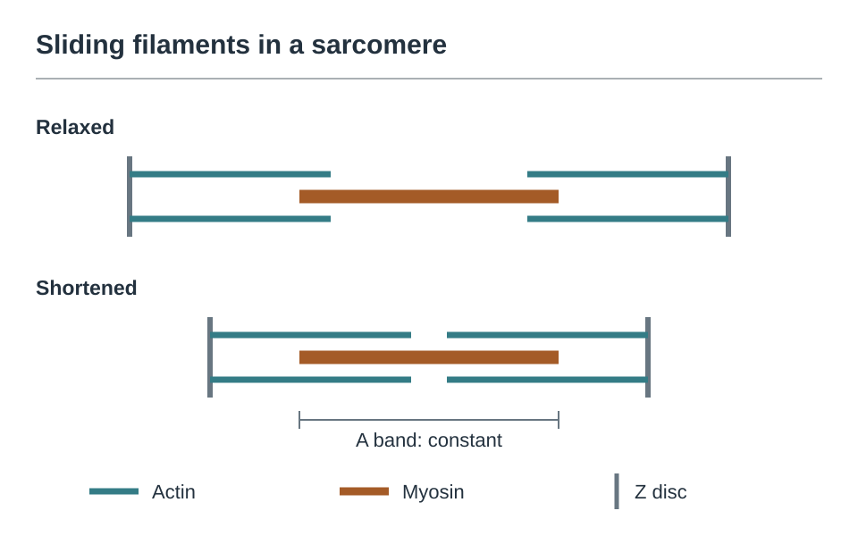

# M11-L2 – Muscle and movement {#L2}

**Course area:** M11 – Animal and Human Physiology and Behaviour

**Level:** Bachelor

**Prerequisites:** [M11-L1](M11-L1.md): excitation; [M5-L4](M5-L4.md): ATP; [M8-L2](M8-L2.md): levers.

**Learning objective:** Explain sliding filaments, excitation-contraction coupling and force regulation; calculate mechanical work.

## Introduction {#S1}

Muscle can produce force without shortening. Mechanical work and energy expenditure must therefore be distinguished.

## Principles and model {#S2}

### Sarcomeres and cross-bridges

Skeletal muscle fibres contain myofibrils with repeated sarcomeres between Z discs. Thin actin and thick myosin filaments slide relative to each other without substantially shortening themselves. During shortening, the I band and H zone decrease while A-band length remains approximately constant. Myosin heads bind actin, change conformation and generate force. ATP binding releases myosin from actin; hydrolysis prepares the head for the next cycle.

### Coupling and force

A motor neuron releases acetylcholine at the neuromuscular junction. The muscle action potential propagates along the membrane and T tubules. Voltage-dependent sensors activate Ca²⁺ release from the sarcoplasmic reticulum. Ca²⁺ binds troponin C, displacing the actin-binding-site blockade through the troponin–tropomyosin complex. Ca²⁺ pumps enable relaxation. Smooth muscle instead relies mainly on Ca²⁺–calmodulin and myosin light-chain regulation.

A motor unit comprises one motor neuron and its innervated fibres. Recruitment and firing frequency regulate total force; force also depends on sarcomere length, shortening velocity and fatigue. Isometric action maintains overall length; concentric action shortens active muscle, while eccentric action lengthens it under tension.

*Figure: Two sarcomeres show greater overlap with unchanged myosin and actin filament lengths.*

## Application {#S3}

A simplified muscle exerts a constant 60 N over 0.05 m in the direction of force. External work is $W=Fs=3$ J. Over 0.25 s, mean power is $P=W/t=12$ W. During isometric holding, external displacement is zero but metabolic energy is still consumed.

## Self-assessment {#S4}

### Exercises

1. Which sarcomere region stays approximately constant in length during shortening?
2. Calculate external work for 80 N over 0.04 m in the direction of force.
3. Why cannot ATP absence simply relax cross-bridges?

::: {.lc-solutions data-lc-section="S4"}
1. The A band, because thick filament length remains constant.
2. 80 × 0.04 = 3.2 J.
3. ATP binding is required for myosin detachment.
:::

## Assumptions and limitations {#S5}

The sliding-filament diagram is not to scale and depicts filament overlap only. External work differs from chemical energy expenditure. The force model ignores angles, elasticity and temporal force variation.

## Summary and transition {#S6}

Muscle force emerges from coordinated cross-bridge activity. M11-L3 addresses the supply of active tissues.

**Continue:** [M11-L3](M11-L3.md)

## Sources {#S7}

- [OpenStax – Biology 2e, 38.4 Muscle Contraction and Locomotion](https://openstax.org/books/biology-2e/pages/38-4-muscle-contraction-and-locomotion) · Excitation-contraction coupling and sliding filaments · Last accessed: 2026-11-25

