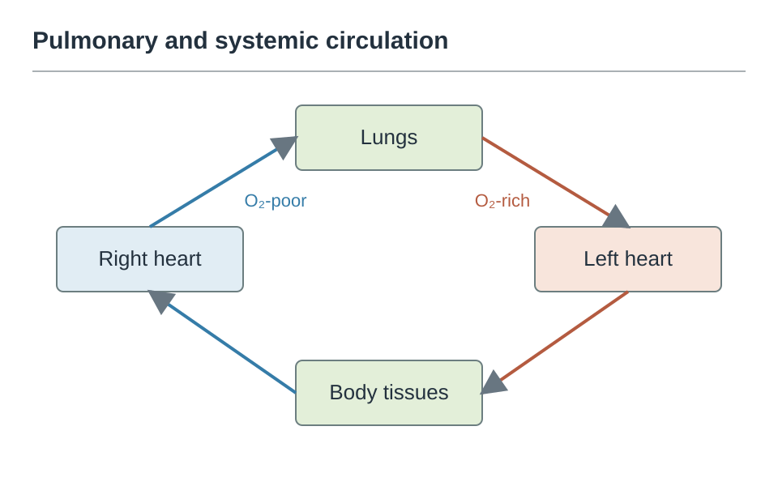

# M11-L3 – Circulation and respiration {#L3}

**Course area:** M11 – Animal and Human Physiology and Behaviour

**Level:** Bachelor

**Prerequisites:** [M3-L4](M3-L4.md): transport; [M8-L3](M8-L3.md): adaptations; [M11-L2](M11-L2.md): muscle.

**Learning objective:** Explain circulation and gas exchange as coupled transport processes; calculate cardiac output and alveolar ventilation.

## Introduction {#S1}

High blood flow alone does not ensure high oxygen delivery. Ventilation, diffusion, haemoglobin binding and perfusion must work together.

## Principles and model {#S2}

### Circulation and material transport

Open circulatory systems allow haemolymph to bathe organ spaces; closed systems transport blood mainly within vessels. Fish usually have a single circuit through gills and body. Mammals have distinct pulmonary and systemic circuits: right heart → lungs → left heart → body → right heart. Valves limit backflow. Arteries carry blood away from the heart and veins towards it, regardless of oxygen content. Exchange occurs predominantly in capillaries.

Cardiac output $Q=f_H V_S$ relates heart rate and stroke volume. At steady state, mean ejection volumes of right and left ventricles match. Flow depends on pressure difference and resistance. For ideal laminar tube flow, resistance is proportional to $1/r^4$; real vessels are elastic and regulated.

### Respiration and oxygen transport

Ventilation renews the medium at exchange surfaces; diffusion follows partial pressure gradients. Thin barriers and large areas facilitate exchange. Fish gills often exploit countercurrent flow, mammalian lungs alveolar exchange surfaces. Haemoglobin increases oxygen carrying capacity; saturation depends on oxygen partial pressure, pH and temperature, among other factors. Much CO₂ is transported as bicarbonate. Alveolar ventilation in a simple model equals breathing frequency times the difference between tidal volume and physiological dead space. The Fick relationship connects oxygen consumption to blood flow and the arteriovenous oxygen content difference.

*Figure: Closed circulation through right heart, lungs, left heart and body tissues.*

## Application {#S3}

Fictional steady-state model organism: $f_H=75$ per minute, $V_S=64$ mL; $Q=4800$ mL/min = 4.8 L/min. At 12 breaths/min, 500 mL tidal volume and 150 mL dead space, alveolar ventilation is $12(500-150)=4200$ mL/min. With an arteriovenous content difference of 50 mL O₂/L blood, $4.8\cdot50=240$ mL O₂/min.

## Self-assessment {#S4}

### Exercises

1. Is the pulmonary artery a vein because it carries oxygen-poor blood?
2. Calculate Q for 80 beats/min and 75 mL/beat.
3. Calculate alveolar ventilation for 15 breaths/min, 400 mL tidal volume and 100 mL dead space.

::: {.lc-solutions data-lc-section="S4"}
1. No, flow away from the heart defines an artery.
2. 6000 mL/min = 6 L/min.
3. 15 × 300 = 4500 mL/min = 4.5 L/min.
:::

## Assumptions and limitations {#S5}

All values are illustrative, not clinical reference values. The model assumes steady state and constant dead space. Oxygen content and partial pressure are different quantities.

## Summary and transition {#S6}

Ventilation, diffusion and blood flow form a transport chain. M11-L4 addresses water and material balances.

**Continue:** [M11-L4](M11-L4.md)

## Sources {#S7}

- [OpenStax – Anatomy and Physiology 2e, 19.4 Cardiac Physiology](https://openstax.org/books/anatomy-and-physiology-2e/pages/19-4-cardiac-physiology) · Cardiac output and stroke volume · Last accessed: 2026-11-25
- [OpenStax – Biology 2e, 39.2 Gas Exchange across Respiratory Surfaces](https://openstax.org/books/biology-2e/pages/39-2-gas-exchange-across-respiratory-surfaces) · Partial pressure gradients and gas exchange · Last accessed: 2026-11-25

