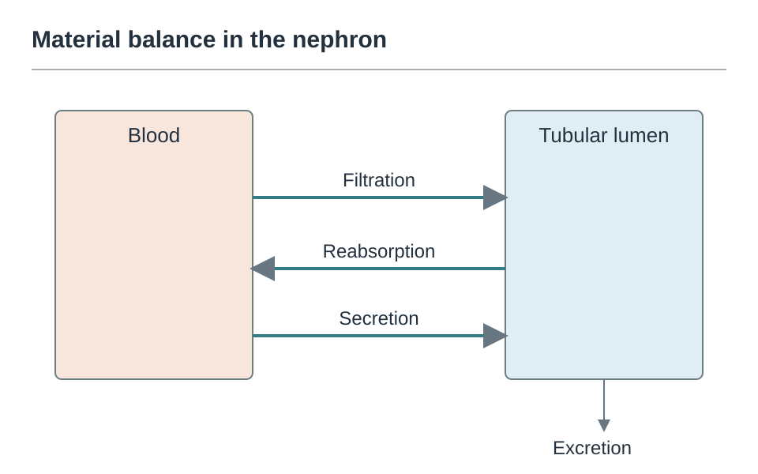

# M11-L4 – Osmoregulation and excretion {#L4}

**Course area:** M11 – Animal and Human Physiology and Behaviour

**Level:** Bachelor

**Prerequisites:** [M4-L2](M4-L2.md): osmosis; [M11-L3](M11-L3.md): circulation.

**Learning objective:** Relate osmoregulation to excretion; distinguish filtration, reabsorption and secretion quantitatively.

## Introduction {#S1}

Freshwater fish and marine bony fish face different water and salt fluxes. Their metabolism must stabilize the balance even as environments change.

## Principles and model {#S2}

### Comparative osmoregulation

Osmoregulators maintain body fluid composition within limits partly independently of their surroundings. Osmoconformers more closely match ambient total osmolarity but can actively regulate individual ions. Many freshwater fish gain water osmotically and lose salts; marine bony fish lose water and gain salts. Gills, gut and kidneys act together. Ammonia, urea and uric acid differ in water requirement, toxicity and synthesis costs; excretory forms vary among species and life stages.

### Nephron and material balance

In a mammalian nephron, glomerular filtration moves fluid into Bowman's capsule; blood cells and most large proteins remain in the vasculature. The proximal tubule reabsorbs a large proportion of filtered substances. The loop of Henle contributes to the medullary gradient through differential water and salt permeability. Distal tubule and collecting duct regulate final composition. ADH increases water permeability of particular collecting duct cells through aquaporin-2; aldosterone affects Na⁺ reabsorption and K⁺ secretion among other processes. Countercurrent mechanisms contribute to maintaining the medullary gradient.

For a substance in a steady-state balance model: excretion rate = filtration rate − reabsorption rate + secretion rate. Filtered amount per time depends on glomerular filtration rate and filterable concentration; it is not urine flow rate.

*Figure: Arrows distinguish filtration and secretion into the lumen, reabsorption to blood and excretion.*

## Application {#S3}

A fictional freely filtered substance has plasma concentration 2 mmol/L and filtration rate 0.1 L/min. Filtered amount: 0.2 mmol/min. If 0.15 mmol/min is reabsorbed and 0.02 mmol/min secreted, excretion is $0.2-0.15+0.02=0.07$ mmol/min. At 0.002 L/min urine flow, urine concentration is 35 mmol/L.

## Self-assessment {#S4}

### Exercises

1. In which direction does secretion occur in the tubule model?
2. Calculate excretion for filtration 0.4 mmol/min, reabsorption 0.3 and secretion 0.05.
3. Why can an osmoconformer still regulate ions?

::: {.lc-solutions data-lc-section="S4"}
1. From blood or interstitium into the tubular lumen.
2. 0.4 − 0.3 + 0.05 = 0.15 mmol/min.
3. Equal total osmolarity does not mean equal concentration of each ion.
:::

## Assumptions and limitations {#S5}

Values and nephron diagram are illustrative models, not diagnostic guidance. The balance assumes steady state and consistent substance units; it does not describe individual kidney function.

## Summary and transition {#S6}

Osmoregulation requires coupled membrane transport and hormonal control. M11-L5 explores such feedback loops.

**Continue:** [M11-L5](M11-L5.md)

## Sources {#S7}

- [OpenStax – Biology 2e, 41.2 The Kidneys and Osmoregulatory Organs](https://openstax.org/books/biology-2e/pages/41-2-the-kidneys-and-osmoregulatory-organs) · Nephron and comparative excretory organs · Last accessed: 2026-11-25
- [OpenStax – Biology 2e, 41.5 Hormonal Control of Osmoregulatory Functions](https://openstax.org/books/biology-2e/pages/41-5-hormonal-control-of-osmoregulatory-functions) · Hormonal regulation of water and electrolytes · Last accessed: 2026-11-25

