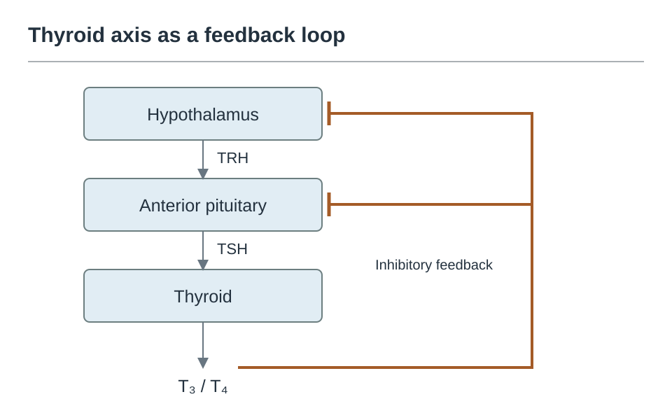

# M11-L5 – Endocrinology and homeostasis {#L5}

**Course area:** M11 – Animal and Human Physiology and Behaviour

**Level:** Bachelor

**Prerequisites:** [M4-L5](M4-L5.md): signalling pathways; [M11-L4](M11-L4.md): osmoregulation.

**Learning objective:** Distinguish hormone classes and negative feedback; interpret a simple stability model.

## Introduction {#S1}

Homeostasis does not mean a physiological variable never changes. Regulation maintains functional ranges, while time of day, developmental stage and activity can shift the operating point.

## Principles and model {#S2}

### Hormonal communication

Endocrine cells release signals into body fluids; paracrine signals act mainly locally, autocrine signals on the producing cell or similar cells. Peptide hormones generally act at membrane receptors; many steroid and thyroid hormones regulate gene expression through intracellular receptors. Response time and effect depend not only on chemical class but also on receptors, amplification and degradation. Hormones may act synergistically or antagonistically.

### Feedback systems

In the thyroid axis, hypothalamic TRH stimulates TSH release from the anterior pituitary; TSH promotes thyroid hormone production. Thyroid hormones inhibit upstream stages through feedback. In glucose regulation, insulin and glucagon influence tissue-specific uptake, storage and mobilization of energy substrates. Negative feedback opposes deviations; positive feedback amplifies changes until limited, as in particular processes during childbirth.

A simplified dynamic model describes deviation $x$ from an operating point by $dx/dt=-kx$, where $k>0$. Without external disturbance, $x(t)=x(0)e^{-kt}$. Half-life is $\ln(2)/k$. Delays, saturation and competing feedback loops may substantially alter real behaviour.

*Figure: TRH and TSH stimulate downstream stages; thyroid hormones inhibit both upstream stages.*

## Application {#S3}

An artificial regulation model starts with a deviation of 8 units and $k=0.2$ min⁻¹. After 5 min, $8e^{-1}\approx2.94$ units remain; half-life is about 3.47 min. A larger constant accelerates recovery in this model but does not establish better biological regulation.

## Self-assessment {#S4}

### Exercises

1. Why do only appropriate target cells respond to a given hormone?
2. Determine half-life for $k=0.1$ min⁻¹.
3. How does negative feedback affect the original disturbance?

::: {.lc-solutions data-lc-section="S4"}
1. They possess matching receptors and downstream signalling mechanisms.
2. ln(2)/0.1 ≈ 6.93 min.
3. It produces an opposing response that reduces deviation.
:::

## Assumptions and limitations {#S5}

The exponential model is a linearized assumption, not a prediction of hormone concentrations. Regulated quantities are dynamic; laboratory values or symptoms are not clinically interpreted here.

## Summary and transition {#S6}

Feedback links molecular signals to regulation of whole organs. M11-L6 extends the perspective to behaviour.

**Continue:** [M11-L6](M11-L6.md)

## Sources {#S7}

- [OpenStax – Biology 2e, 37.4 Regulation of Hormone Production](https://openstax.org/books/biology-2e/pages/37-4-regulation-of-hormone-production) · Endocrine stimuli and feedback · Last accessed: 2026-11-25
- [OpenStax – Biology 2e, 37.2 How Hormones Work](https://openstax.org/books/biology-2e/pages/37-2-how-hormones-work) · Hormone receptors and signalling · Last accessed: 2026-11-25

