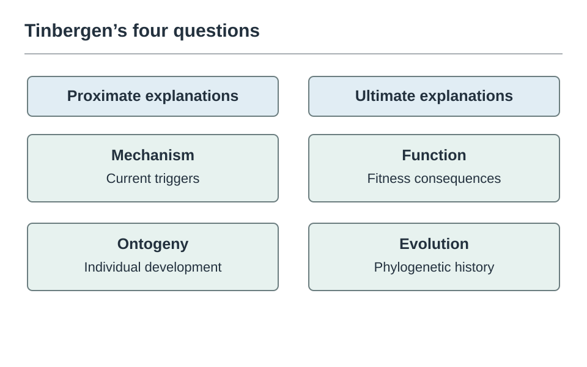

# M11-L6 – Behavioural biology and Tinbergen’s questions {#L6}

**Course area:** M11 – Animal and Human Physiology and Behaviour

**Level:** Bachelor

**Prerequisites:** [M1-L5](M1-L5.md): experimental design; [M8-L4](M8-L4.md): phylogeny; [M11-L1](M11-L1.md): neural signals.

**Learning objective:** Distinguish Tinbergen's four questions and evaluate behavioural observations with appropriate independent samples.

## Introduction {#S1}

Why does a bird sing? This may ask about neural causes, individual learning experiences, consequences for reproduction or phylogenetic origins. None of these answers replaces the others.

## Principles and model {#S2}

### Four levels of explanation

Tinbergen distinguishes mechanism, ontogeny, function and evolution. Mechanism investigates current triggers and physiological processes. Ontogeny asks how behaviour develops across an individual's life. Function examines consequences for survival and reproduction in a given context; evolution investigates the emergence and modification of the trait across lineages. The first two are often called proximate explanations, the last two ultimate explanations. A functional hypothesis cannot be established simply from the existence of a behaviour.

### Observation, learning and decision

An ethogram operationalizes observable categories such as vocalization, movement and rest. Focal sampling follows selected individuals; scan sampling records states at predetermined times. Observer agreement, blinding, time of day and context matter. Multiple observations of one individual are not automatically independent replicates.

Habituation is a decreasing response to repeated innocuous stimuli; sensory fatigue is a competing explanation. Associative learning links stimuli or behaviour and consequences. Inherited dispositions and experience can jointly shape behavioural development. Cost-benefit models produce testable hypotheses about choices but do not assume conscious optimization by animals.

*Figure: Four complementary explanatory levels grouped into proximate and evolutionary questions.*

## Application {#S3}

Fictional ethogram: four different individuals under condition A spend 2, 4, 6 and 8 minutes foraging during a 20-minute observation. Mean duration is 5 minutes, or 25% of observation time. Under condition B, four other individuals spend 3, 5, 7 and 9 minutes: mean 6 minutes or 30%. The difference is 5 percentage points; without randomization and uncertainty analysis, a causal conclusion is unwarranted.

## Self-assessment {#S4}

### Exercises

1. Which of Tinbergen's questions investigates how song changes during maturation?
2. Calculate the proportion of time spent foraging for 7 minutes out of 20.
3. Why are ten observations of one bird not equivalent to ten independent birds?

::: {.lc-solutions data-lc-section="S4"}
1. Ontogeny or individual development.
2. 7/20 = 35%.
3. Repeated observations share individual characteristics and may be correlated.
:::

## Assumptions and limitations {#S5}

Example data are simulated; percentages are descriptive. Observation should avoid disturbing animals; interventions require relevant ethical and legal approvals. Tinbergen's questions complement each other and are not a hierarchy.

## Summary and transition {#S6}

Behaviour connects mechanism, development, function and history. M11-L7 addresses sensory processing and temporal organization.

**Continue:** [M11-L7](M11-L7.md)

## Sources {#S7}

- [OpenStax – Biology 2e, 45.7 Behavioral Biology](https://openstax.org/books/biology-2e/pages/45-7-behavioral-biology-proximate-and-ultimate-causes-of-behavior) · Behaviour, learning and proximate/ultimate explanations · Last accessed: 2026-11-25
- [Tinbergen (1963), On aims and methods of Ethology, 20, 410–433](https://doi.org/10.1111/j.1439-0310.1963.tb01161.x) · Four questions; bibliographic record and historical context · Last accessed: 2026-11-25
- [Tinbergen’s four questions: an appreciation and an update (2013)](https://pubmed.ncbi.nlm.nih.gov/24144467/) · Abstract: complementary levels of explanation · Last accessed: 2026-11-25

