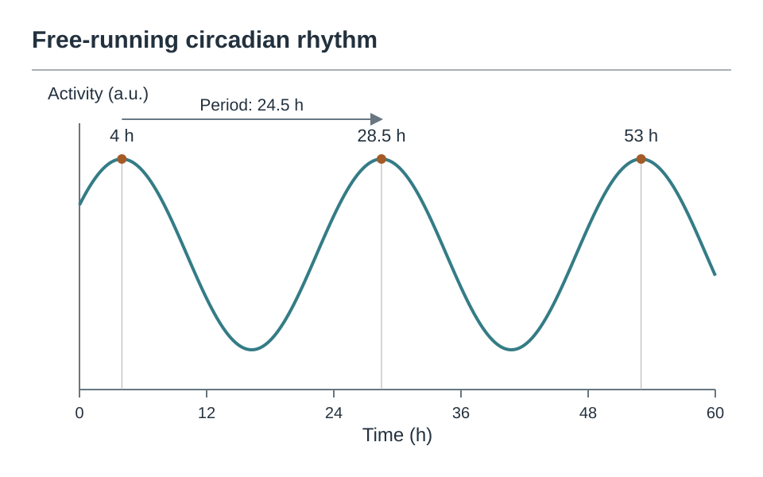

# M11-L7 – Sensory systems and biological rhythms {#L7}

**Course area:** M11 – Animal and Human Physiology and Behaviour

**Level:** Bachelor

**Prerequisites:** [M11-L1](M11-L1.md): neural coding; [M11-L5](M11-L5.md): feedback; [M11-L6](M11-L6.md): behaviour.

**Learning objective:** Explain sensory transduction and adaptation; estimate circadian periods and phases from time series.

## Introduction {#S1}

Sensory organs detect only a subset of physical and chemical environmental stimuli. Interpretation also depends on internal state and biological time.

## Principles and model {#S2}

### Sensory modalities and coding

Mechanoreceptors detect mechanical changes, chemoreceptors chemical stimuli and photoreceptors light. Transduction converts stimulus energy into an electrical receptor potential or altered transmitter release. A stronger stimulus may change firing frequency and the number of active sensory neurons. Receptive fields describe spatial regions where stimulation influences a particular sensory unit. Adaptation reduces some receptors' responses to sustained input; others continue responding. Central processing compares spatial and temporal patterns. Perception is therefore not an unchanged copy of the sensory environment.

### Biological time

Circadian rhythms have an endogenous period of approximately 24 hours. They may free-run under constant conditions; external time cues such as light entrain phase. Molecular feedback loops generate rhythmic gene expression and protein activity in many organisms. In mammals, the suprachiasmatic nucleus coordinates peripheral clocks; melatonin signals convey information about biological night, among other functions. Not every daily fluctuation is endogenous: an immediate effect of light or temperature can mimic or mask rhythmicity.

A simple model is $y(t)=M+A\cos(2\pi(t-\phi)/T)$ with mean $M$, amplitude $A$, period $T$ and phase $\phi$ as time of a maximum modulo $T$. Frequency and period are reciprocals. Reliable estimation requires multiple cycles, sufficient temporal resolution and known recording conditions.

*Figure: Model curve with three maxima separated by 24.5 hours.*

## Application {#S3}

A fictional activity time series under constant conditions shows maxima at 4, 28.5 and 53 hours. Two intervals of 24.5 hours give $T=24.5$ h. Relative to a 24-hour cue, such a free-running rhythm would drift 0.5 h later per cycle in the absence of entrainment. Three maxima suffice for demonstration but not robust uncertainty analysis.

## Self-assessment {#S4}

### Exercises

1. Why does one measurement at the same time of day not establish an endogenous rhythm?
2. Estimate mean period from maxima at 3, 26 and 49 h.
3. What distinguishes sensory adaptation from circadian entrainment?

::: {.lc-solutions data-lc-section="S4"}
1. It does not distinguish endogenous oscillation from immediate environmental effects or capture periodicity.
2. (49 − 3)/2 = 23 h.
3. Adaptation changes the stimulus response; entrainment aligns the phase of a biological oscillator with a time cue.
:::

## Assumptions and limitations {#S5}

The figure shows model maxima, not clinical sleep measurements. Real rhythms need not be sinusoidal; sampling intervals, trends and masking can distort period estimates.

## Summary and transition {#S6}

Sensory processing and internal time connect environment with physiological regulation. M12 examines how these biological systems develop.

**Continue:** [M12-L1](M12-L1.md)

## Sources {#S7}

- [OpenStax – Biology 2e, 36.1 Sensory Processes](https://openstax.org/books/biology-2e/pages/36-1-sensory-processes) · Sensory transduction and integration · Last accessed: 2026-11-25
- [NIGMS – Circadian Rhythms](https://www.nigms.nih.gov/education/fact-sheets/Pages/circadian-rhythms) · Biological clocks, environmental entrainment and feedback · Last accessed: 2026-11-25

