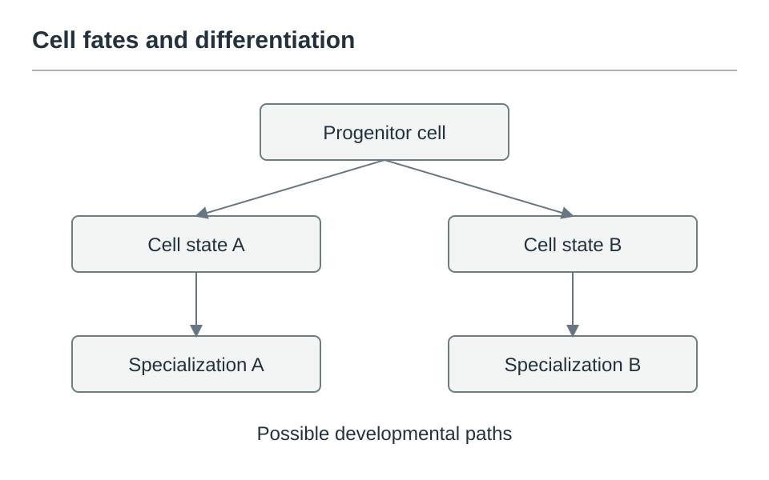

# M12-L1 – Cell differentiation {#L1}

**Course area:** M12 – Developmental and Cell Biology

**Level:** Bachelor

**Prerequisites:** [M6-L6](M6-L6.md): gene regulation and epigenetics; [M4-L5](M4-L5.md): cell cycle and signalling.

**Learning objective:** Distinguish cell identity, potency, specification and differentiation; interpret expression and lineage evidence separately.

## Introduction {#S1}

A neuron and an epithelial cell of one individual may have the same chromosome complement yet perform distinct functions. Developmental biology investigates how such stable differences arise and how cells respond to their surroundings.

## Principles and model {#S2}

### From genome to cell state

Most nucleated somatic cells broadly retain the same genetic information. Exceptions include somatic mutations and programmed DNA rearrangements in certain immune cells. Identity is not simply produced by losing unused genes. Selective expression, regulatory networks, chromatin states and environmental signals determine which cellular functions develop. Transcription factors can promote or repress gene activity; feedback can stabilize expression states. RNA processing, protein turnover and cell mechanics also influence phenotype.

### Developmental decisions and evidence

Potency describes the range of possible cell fates. A specified cell preferentially follows a developmental route under neutral conditions but may still respond to other cues. Determination denotes a more stable commitment that can be investigated in suitable transplantation experiments. Differentiation means acquisition of specialized traits and functions. These transitions are not sharply defined in every tissue.

An expression marker indicates a state, not necessarily its origin. Lineage tracing identifies labelled starting cells and their descendants. Single-cell RNA measurements instead provide snapshots of transcript abundance. Computational pseudotime orders related states but cannot establish ancestry or actual elapsed developmental time without independent evidence. Functional tests complement markers: a neuronal marker alone does not establish functional synapses.

*Figure: Schematic progenitor with two possible differentiation paths.*

## Application {#S3}

In a fictional dataset, 48 of 80 labelled descendants express marker A after a signal, compared with 20 of 80 controls. The proportions are 60% and 25%; the difference is 35 percentage points and the ratio 2.4. This suggests an association with the signal. Selective survival or altered proliferation might also change proportions. Independent biological replicates and absolute cell counts are required before claiming a causal effect on differentiation.

## Self-assessment {#S4}

### Exercises

1. How do potency and differentiation differ?
2. A marker occurs in 36 of 60 descendants. Calculate the proportion.
3. Why is a pseudotime curve insufficient evidence of ancestry?

::: {.lc-solutions data-lc-section="S4"}
1. Potency describes possible fates; differentiation is the acquisition of specialized properties.
2. 36/60 = 0.60 = 60%.
3. It orders similarities between states but does not directly observe genealogical connections between cells.
:::

## Assumptions and limitations {#S5}

The branching diagram models possible states, not a universal lineage map. Markers may be transient; cell states can be reversible or reprogrammable. Without replication, the fictional proportions provide no reliable uncertainty estimate.

## Summary and transition {#S6}

Cell identity arises through regulated gene expression and environmental signals. M12-L2 examines how spatial distributions of signals generate patterns.

**Continue:** [M12-L2](M12-L2.md)

## Sources {#S7}

- [OpenStax – Biology 2e, 16.1 Regulation of Gene Expression](https://openstax.org/books/biology-2e/pages/16-1-regulation-of-gene-expression) · Levels of gene regulation · Last accessed: 2026-11-25
- [OpenStax – Biology 2e, 16.3 Eukaryotic Epigenetic Gene Regulation](https://openstax.org/books/biology-2e/pages/16-3-eukaryotic-epigenetic-gene-regulation) · Chromatin accessibility and epigenetic regulation · Last accessed: 2026-11-25
- [OpenStax – Biology 2e, 43.7 Organogenesis and Vertebrate Axis Formation](https://openstax.org/books/biology-2e/pages/43-7-organogenesis-and-vertebrate-axis-formation) · Germ layers, induction and axis formation · Last accessed: 2026-11-25
- [Connecting past and present: single-cell lineage tracing (2022)](https://pmc.ncbi.nlm.nih.gov/articles/PMC9237189/) · Pseudotime and lineage history; indexed text · Last accessed: 2026-11-25

