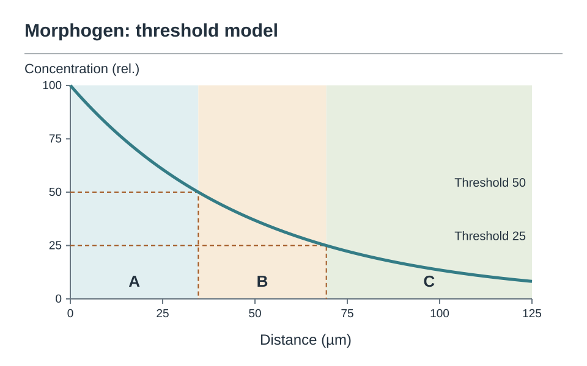

# M12-L2 – Pattern formation and signalling pathways {#L2}

**Course area:** M12 – Developmental and Cell Biology

**Level:** Bachelor

**Prerequisites:** [M4-L5](M4-L5.md): signalling; [M12-L1](M12-L1.md): cell fates; [M2-L1](M2-L1.md): exponential functions.

**Learning objective:** Explain induction, morphogens and local cell communication; calculate positional boundaries in a simple gradient model.

## Introduction {#S1}

Tissues must not only produce diverse cell types but also arrange them spatially. A signal may favour one developmental programme near its source and another farther away.

## Principles and model {#S2}

### Positional information and competence

During induction, one group of cells influences the development of another. Receiving cells must be competent to respond, for example by possessing appropriate receptors and regulatory factors. Wnt, BMP and Hedgehog pathways operate in many developmental contexts; their effects depend on tissue, timing and signal dynamics. Morphogens can elicit distinct responses depending on concentration. A simple threshold model assigns concentration ranges to different cell states.

An idealized one-dimensional steady profile arises from diffusion with coefficient $D$ and first-order removal at rate $k$. For a constant source at $x=0$ in an extended domain, $c(x)=c_0\exp(-x/\lambda)$, with $\lambda=\sqrt{D/k}$. The model assumes spatially constant parameters and a sufficiently long domain. The length scale is the distance at which concentration falls to roughly 37% of its initial value. A threshold $T$ occurs at $x=\lambda\ln(c_0/T)$ provided $0<T<c_0$.

### Other patterning mechanisms

Notch–Delta communication between neighbours can favour different states through lateral inhibition. Reaction–diffusion models explore conditions in which local activation and longer-range inhibition may produce regular patterns. Growth, directed cell movement and mechanical forces also change patterns. An observed gradient is therefore not automatically the sole cause of patterning.

*Figure: Exponential model gradient with boundaries at 34.66 and 69.31 µm.*

## Application {#S3}

A fictional gradient has $c_0=100$ relative units and $\lambda=50$ µm. Thresholds of 50 and 25 units occur at $50\ln(2)=34.66$ µm and $50\ln(4)=69.31$ µm. Three model regions arise: A before the first boundary, B between boundaries, C beyond. Doubling the removal rate at constant $D$ reduces $\lambda$ by a factor of $1/\sqrt{2}$, shifting the boundaries closer to the source.

## Self-assessment {#S4}

### Exercises

1. Why can two cells exposed to the same signal concentration respond differently?
2. Calculate the distance to threshold 20 with $c_0=100$ and $\lambda=50$ µm.
3. What observation would challenge a purely concentration-dependent threshold model?

::: {.lc-solutions data-lc-section="S4"}
1. Their receptors, transcription factors or developmental histories may differ.
2. $50\ln(5)=80.47$ µm.
3. For example, reproducibly different states at the same concentration and identical other model conditions.
:::

## Assumptions and limitations {#S5}

The gradient is a mathematical illustration, not a measured signal profile. Time dependence, feedback, geometry, cell movement and noise may change real boundary positions. Thresholds are fictional and do not imply an experimental dosing instruction.

## Summary and transition {#S6}

Patterns arise from spatial information and dynamic cell interactions. M12-L3 connects these mechanisms with embryonic tissue formation.

**Continue:** [M12-L3](M12-L3.md)

## Sources {#S7}

- [Patterning principles of morphogen gradients (2022)](https://pmc.ncbi.nlm.nih.gov/articles/PMC9579920/) · Positional information and threshold models; abstract and indexed excerpt · Last accessed: 2026-11-25
- [OpenStax – Biology 2e, 43.7 Organogenesis and Vertebrate Axis Formation](https://openstax.org/books/biology-2e/pages/43-7-organogenesis-and-vertebrate-axis-formation) · Germ layers, induction and axis formation · Last accessed: 2026-11-25

