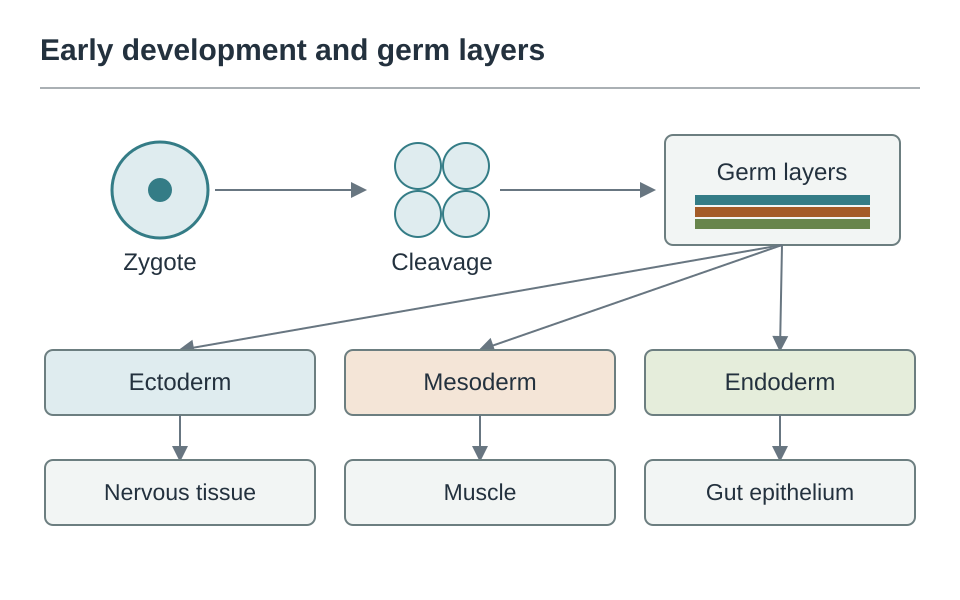

# M12-L3 – Embryonic development {#L3}

**Course area:** M12 – Developmental and Cell Biology

**Level:** Bachelor

**Prerequisites:** [M6-L7](M6-L7.md): inheritance; [M8-L4](M8-L4.md): evolutionary history; [M12-L2](M12-L2.md): pattern formation.

**Learning objective:** Distinguish cleavage, gastrulation and organogenesis; explain major germ-layer derivatives and the limits of an idealized division model.

## Introduction {#S1}

Early development in multicellular animals combines cell division, spatial organization and differentiation. The processes are comparable across organisms, but their morphology and timing differ among species.

## Principles and model {#S2}

### Fertilization and cleavage

During sexual reproduction in many animals, haploid parental genomes combine in a zygote. Cleavage partitions existing cellular material through early divisions. Blastomere number increases while average size often decreases initially. Yolk quantity and distribution affect cleavage geometry. The blastula is an early organizational form; the mammalian blastocyst includes an inner cell mass and trophectoderm, among other features. A blastocyst is not simply a cluster of cells.

### Gastrulation, axes and organ formation

During gastrulation, groups of cells change positions and form ectoderm, mesoderm and endoderm in triploblastic animals. Ectoderm contributes, for example, epidermis and nervous tissue; mesoderm produces muscle, connective tissue and much of the circulatory system; endoderm contributes the epithelium of many digestive and respiratory passages. Organs often contain contributions from several layers. In vertebrates neurulation organizes the neural tube; neural crest cells contribute to many additional structures. Somites partition parts of the mesoderm into repeated units. Induction, cell adhesion, directed migration, shape changes and programmed cell death contribute to organogenesis. Developmental axes describe spatial relations, not a hierarchy of organs.

*Figure: Zygote and cleavage stage followed by three schematic germ layers with example derivatives.*

## Application {#S3}

In a fictional synchronous cleavage model, a spherical zygote starts with a volume of 512,000 µm³. After four complete doublings, $2^4=16$ cells exist. With constant total cellular volume, mean volume is 32,000 µm³. For geometrically similar cells, relative linear size is $16^{-1/3}\approx0.397$. The model excludes growth and loss; real divisions can be asynchronous and unequal.

## Self-assessment {#S4}

### Exercises

1. Which processes distinguish gastrulation from cleavage?
2. How many cells result from five synchronous doublings from one cell? What is the mean volume fraction?
3. Why can an organ not always be assigned to one germ layer?

::: {.lc-solutions data-lc-section="S4"}
1. Cleavage primarily increases cell number; gastrulation includes spatial rearrangement and germ-layer formation.
2. 32 cells; each has 1/32 of the original volume in the model.
3. Epithelium, connective tissue, vessels and other components may originate in different germ layers.
:::

## Assumptions and limitations {#S5}

The figure is a simplified triploblastic animal diagram, not a human staging chart. Development varies greatly among animal groups. Volumes and cell counts are constructed for teaching and support no clinical inference.

## Summary and transition {#S6}

Early cell divisions and tissue rearrangements establish an organized body. M12-L4 examines stem cell populations and later tissue renewal.

**Continue:** [M12-L4](M12-L4.md)

## Sources {#S7}

- [OpenStax – Biology 2e, 43.6 Fertilization and Early Embryonic Development](https://openstax.org/books/biology-2e/pages/43-6-fertilization-and-early-embryonic-development) · Fertilization, cleavage and gastrulation · Last accessed: 2026-11-25
- [OpenStax – Biology 2e, 43.7 Organogenesis and Vertebrate Axis Formation](https://openstax.org/books/biology-2e/pages/43-7-organogenesis-and-vertebrate-axis-formation) · Germ layers, induction and axis formation · Last accessed: 2026-11-25

