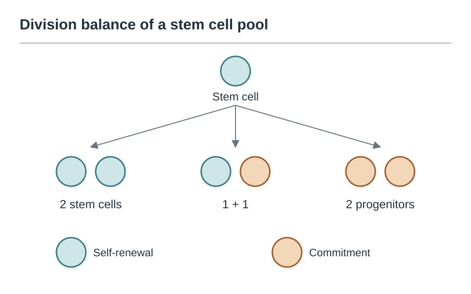

# M12-L4 – Stem cells and tissue regeneration {#L4}

**Course area:** M12 – Developmental and Cell Biology

**Level:** Bachelor

**Prerequisites:** [M12-L1](M12-L1.md): cell identity and potency; [M4-L5](M4-L5.md): cell cycle.

**Learning objective:** Distinguish self-renewal, stem cell potency and regeneration; evaluate a simplified stem cell balance and identify model limitations.

## Introduction {#S1}

Intestinal epithelium and blood are continually renewed throughout life. Other tissues have limited regenerative capacities. Cell division alone is insufficient: maintenance and differentiation of descendants must be coordinated.

## Principles and model {#S2}

### Potency and the stem cell niche

Stem cells combine self-renewal with the capacity to generate differentiated descendants. In the usual mammalian context, totipotency includes the potential to produce embryonic and extraembryonic tissues required for complete development. Pluripotent cells can form cell types from all three germ layers but cannot independently produce a complete organism. Multipotent stem cells have a narrower range, as in blood-forming stem cells producing different blood lineages. Induced pluripotent stem (iPS) cells are produced by reprogramming somatic cells; their properties require individual validation.

The niche includes neighbouring cells, extracellular matrix, soluble signals and mechanical conditions. A stem cell division may yield two stem cells, one stem cell and a more committed progenitor, or two committed descendants. The balance of these events stabilizes the pool. Transit-amplifying progenitors can undergo additional divisions before terminal differentiation.

### Regeneration and models

Regeneration requires not only appropriate cells but tissue organization, supply and integration. Scar formation and functional restoration are distinct outcomes. Organoids reproduce selected tissue properties in vitro. They may lack blood vessels, immune cells, mature cell states or physiological mechanical influences, for example. Provenance, consent, genetic stability and experimental model quality are important areas of assessment. ISSCR international recommendations do not replace national legal requirements or institutional oversight.

*Figure: Three possible division outcomes with stem cells and committed progenitors.*

## Application {#S3}

A fictional pool contains 100 stem cells dividing once each. Twenty-five divisions yield two stem cells each, 50 yield one and 25 yield none. The new pool contains 2 × 25 + 50 = 100 stem cells; another 100 descendants are more committed. The pool remains constant even though every starting cell divided. Shifts in these proportions alter pool size.

## Self-assessment {#S4}

### Exercises

1. Why does self-renewal not mean every daughter remains a stem cell?
2. Of 100 divisions, 30 yield two stem cells, 50 yield one and 20 yield none. How large is the new pool?
3. Why does an organoid of the expected shape not establish complete organ function?

::: {.lc-solutions data-lc-section="S4"}
1. Self-renewal can coexist with production of differentiating descendants.
2. 2 × 30 + 50 = 110 stem cells, an increase of 10%.
3. Functional maturity, cell composition, supply and system integration may differ from the organ.
:::

## Assumptions and limitations {#S5}

The balance assumes one simultaneous division without cell death or immigration. It predicts no human therapeutic outcome. Findings in cell models are not equivalent to clinically demonstrated efficacy or safety.

## Summary and transition {#S6}

Stem cells maintain tissues through regulated division and differentiation decisions. M12-L5 compares developmental mechanisms across organisms.

**Continue:** [M12-L5](M12-L5.md)

## Sources {#S7}

- [NIH – Stem Cell Basics](https://stemcells.nih.gov/info/basics/stc-basics/) · Self-renewal and differentiation potential · Last accessed: 2026-11-25
- [ISSCR – Guidelines for Stem Cell Research and Clinical Translation](https://www.isscr.org/resources/guidelines-for-stem-cell-research) · Ethical oversight and clinical translation; overview · Last accessed: 2026-11-25
- [ISSCR – Section 4: Stem Cell-based Model Systems](https://www.isscr.org/basic-research-standards/stem-cell-based-model-systems) · Model fidelity, morphological and functional characterization · Last accessed: 2026-11-25

