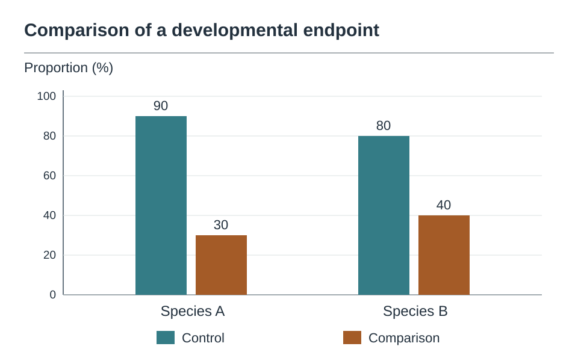

# M12-L5 – Comparative developmental systems {#L5}

**Course area:** M12 – Developmental and Cell Biology

**Level:** Bachelor

**Prerequisites:** [M7-L2](M7-L2.md): plant body plan; [M8-L4](M8-L4.md): development and evolutionary history; [M12-L3](M12-L3.md): embryonic development.

**Learning objective:** Select developmental models for specific questions; critically compare conserved mechanisms, homology and species-specific differences.

## Introduction {#S1}

Developmental biology uses different organisms because not every question can be investigated in one system. A model organism is a deliberately selected biological system, not a miniature version of every other organism.

## Principles and model {#S2}

### Complementary systems

Drosophila melanogaster is useful for investigating genetic patterning and segment identity. The nematode Caenorhabditis elegans is particularly useful for observing many well-defined cell lineages. Transparent early zebrafish (Danio rerio) stages permit observation of vertebrate organ development. Xenopus species are used, among other purposes, to examine induction and axis formation; mice are important mammalian models. Arabidopsis thaliana is used to study plant developmental programmes, including meristem function and organ formation. Plants produce many organs after embryogenesis from meristems; cell walls restrict migration, making directional growth and division particularly important.

### Conservation and experimental logic

Hox genes illustrate how related regulatory genes participate in spatial organization across many animals. Homologous genes share ancestry. Orthologues arise through speciation and paralogues through duplication; sequence resemblance alone does not establish identical function. Conserved pathways can perform distinct roles in different tissues. Loss of a function can indicate necessary contributions if confounding effects and genetic background are considered. A restoration (rescue) effect complements such evidence but does not automatically demonstrate identical mechanisms across species. Comparable stages should be defined through morphological or molecular features, not simply hours after fertilization.

*Figure: Fictional proportions of 90 and 30 percent for species A and 80 and 40 percent for species B.*

## Application {#S3}

A fictional comparison examines the same defined developmental endpoint in two species. In species A, 18 of 20 controls and 6 of 20 comparison individuals reach it; in species B, the counts are 24 of 30 and 12 of 30. Absolute proportion differences are −0.60 and −0.40. The observed direction agrees across species but effect sizes differ. A robust comparison would require aligned endpoints, replication and uncertainty intervals.

## Self-assessment {#S4}

### Exercises

1. Which model mentioned is especially suited to studying meristems?
2. In a third model, 15/20 controls and 9/20 comparison individuals reach the endpoint. Calculate the proportion difference.
3. Why does an orthologous gene not establish identical developmental function?

::: {.lc-solutions data-lc-section="S4"}
1. Arabidopsis thaliana.
2. 9/20 − 15/20 = −0.30, or −30 percentage points.
3. Regulation, interaction partners and tissue context can change during evolution.
:::

## Assumptions and limitations {#S5}

The comparative data are simulated; they refer to neither a real intervention nor a specific species. Organism and organoid models require validation for each question; ethical and legal requirements must be considered.

## Summary and transition {#S6}

Comparative developmental biology separates conserved principles from species-specific implementations. The next module, M13, extends the perspective to evolution, systematics and phylogenetics.

**Continue:** [M13-L1](M13-L1.md)

## Sources {#S7}

- [OpenStax – Biology 2e, 27.1 Features of the Animal Kingdom](https://openstax.org/books/biology-2e/pages/27-1-features-of-the-animal-kingdom) · Conserved developmental genes and animal body plans · Last accessed: 2026-11-25
- [OpenStax – Biology 2e, 43.7 Organogenesis and Vertebrate Axis Formation](https://openstax.org/books/biology-2e/pages/43-7-organogenesis-and-vertebrate-axis-formation) · Germ layers, induction and axis formation · Last accessed: 2026-11-25
- [OpenStax – Biology 2e, 30.1 The Plant Body](https://openstax.org/books/biology-2e/pages/30-1-the-plant-body) · Meristematic and differentiated tissues · Last accessed: 2026-11-25
- [ISSCR – Section 4: Stem Cell-based Model Systems](https://www.isscr.org/basic-research-standards/stem-cell-based-model-systems) · Model fidelity, morphological and functional characterization · Last accessed: 2026-11-25
- [NHGRI – Zebrafish](https://www.genome.gov/genetics-glossary/Zebrafish) · Vertebrate developmental model · Last accessed: 2026-11-25
- [NHGRI – Model Organism Databases](https://www.genome.gov/10001837/model-organism-databases) · Drosophila, C. elegans and zebrafish resources · Last accessed: 2026-11-25

