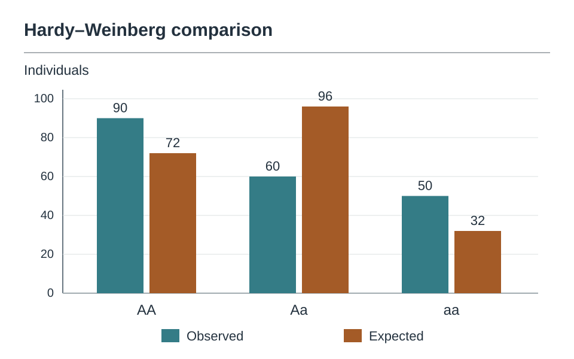

# M13-L1 – Population genetics {#L1}

**Course area:** M13 – Evolution, Systematics and Phylogenetics

**Level:** Bachelor

**Prerequisites:** [M6-L7](M6-L7.md): inheritance; [M2-L2](M2-L2.md): probability.

**Learning objective:** Calculate allele and genotype frequencies, derive Hardy–Weinberg expectations and evaluate departures from a null model.

## Introduction {#S1}

Evolution can be measured within a population: which inherited variants become more or less frequent over generations? A change in an individual organism is not the same as a change in the allele frequency of a population.

## Principles and model {#S2}

### Frequencies and random mating

At an autosomal diploid locus with two alleles $A$ and $a$, three genotypes are possible: $AA$, $Aa$ and $aa$. For $N$ individuals and their observed genotype counts, $p=(2n_{AA}+n_{Aa})/(2N)$ and $q=1-p$. A genotype frequency instead divides the count of that genotype by $N$. Independent union of gametes with identical allele frequencies produces expectations $p^2$, $2pq$ and $q^2$. The factor two accounts for both possible combinations of an A and an a gamete.

The Hardy–Weinberg model serves as a reference: random mating at the locus generates the expected genotype proportions under these conditions. Without directional effects of mutation, migration or selection, and in the limit of an infinitely large population, allele frequencies also remain constant. Finite populations experience sampling fluctuations. Nonrandom mating can alter genotype distributions without directly altering allele frequencies. Inbreeding, for example, reduces expected heterozygosity; with inbreeding coefficient $F$, it is $2pq(1-F)$ in the simple model.

### Testing a departure

Observed and expected genotype counts can be compared. If expected counts are sufficiently large, a Pearson test using $\chi^2=\sum (O-E)^2/E$ is possible. Three genotype classes and one allele frequency estimated from the data leave one degree of freedom. Rare alleles or small samples call for suitable exact methods. A departure does not necessarily indicate selection: population mixture, relatedness and genotyping errors are also plausible explanations.

*Figure: Fictional observed and expected genotype counts for AA, Aa and aa.*

## Application {#S3}

A fictional sample of 200 individuals contains 90 AA, 60 Aa and 50 aa. Thus $p=(180+60)/400=0.60$ and $q=0.40$. Hardy–Weinberg expectations are 72, 96 and 32 individuals. Observed heterozygosity is 0.30 rather than 0.48. Pearson's statistic is $18^2/72+36^2/96+18^2/32=28.125$. Under the test assumptions the departure is substantial, but a single sample cannot identify its mechanism. The figure compares genotype counts.

## Self-assessment {#S4}

### Exercises

1. Calculate p and q for 16 AA, 8 Aa and 16 aa.
2. Determine expected heterozygosity when p = 0.7.
3. Why is a heterozygote deficit not definitive evidence of selection?

::: {.lc-solutions data-lc-section="S4"}
1. p = (32 + 8)/80 = 0.5; q = 0.5.
2. 2 · 0.7 · 0.3 = 0.42.
3. Inbreeding, population structure and measurement errors can also create a deficit.
:::

## Assumptions and limitations {#S5}

The model concerns one diploid biallelic autosomal locus. Sex-linked inheritance, different gamete pools and overlapping generations require additional assumptions. The example data are fictional.

## Summary and transition {#S6}

Hardy–Weinberg provides a quantitative reference. M13-L2 examines mechanisms that change allele frequencies.

**Continue:** [M13-L2](M13-L2.md)

## Sources {#S7}

- [OpenStax – Biology 2e, 19.1 Population Evolution](https://openstax.org/books/biology-2e/pages/19-1-population-evolution) · Allele frequencies and Hardy–Weinberg model · Last accessed: 2026-11-25
- [OpenStax – Biology 2e, 19.2 Population Genetics](https://openstax.org/books/biology-2e/pages/19-2-population-genetics) · Genetic drift, gene flow and mutation · Last accessed: 2026-11-25

