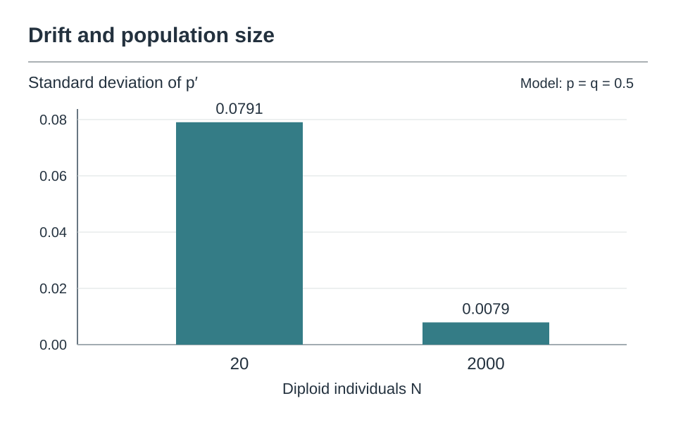

# M13-L2 – Selection and drift {#L2}

**Course area:** M13 – Evolution, Systematics and Phylogenetics

**Level:** Bachelor

**Prerequisites:** [M13-L1](M13-L1.md): allele frequencies; [M2-L2](M2-L2.md): binomial distribution.

**Learning objective:** Distinguish selection, drift, mutation and gene flow and calculate allele frequency after simple selection.

## Introduction {#S1}

An inherited variant may become more common because its carriers leave more descendants. It may also become more common by chance. Both processes change the same measurable quantity but have different causes.

## Principles and model {#S2}

### Relative fitness and selection

Fitness here denotes the expected contribution of a genotype to the next generation relative to a reference genotype. It is not a universal ranking of organisms. Consider a diploid randomly mating population with fitness values $w_{AA}$, $w_{Aa}$ and $w_{aa}$. Following viability selection, genotype proportions are proportional to $p^2w_{AA}$, $2pqw_{Aa}$ and $q^2w_{aa}$. Mean fitness is $\bar w=p^2w_{AA}+2pqw_{Aa}+q^2w_{aa}$. The allele frequency after selection is $p'=(p^2w_{AA}+pqw_{Aa})/\bar w$. This assumes surviving individuals subsequently contribute equally to reproduction.

For quantitative traits, selection in a particular environment can have directional, stabilizing or disruptive effects on phenotype distributions. An evolutionary response requires heritable differences. Dominance, environment and genetic correlations affect predictions.

### Random processes and exchange

In the idealized diploid Wright–Fisher model, $2N$ allele copies are independently sampled from the previous gene pool each generation. Without selection or other influences, $E(p')=p$ and $\operatorname{Var}(p')=pq/(2N)$. Drift is stronger in small populations and can drive even neutral alleles to fixation or loss. Effective population size describes the strength of particular random effects and may differ considerably from the census count. A bottleneck or founding by a few individuals alters gene-pool composition. Mutation introduces variants; gene flow can homogenize frequencies or introduce variants. For a fraction $m$ of incoming gene copies with frequency $p_m$, the mixing model gives $p'=(1-m)p+mp_m$.

*Figure: Standard deviation of allele frequency for N = 20 and N = 2000.*

## Application {#S3}

With $p=q=0.5$ and fictional fitness values 1, 1 and 0.6, mean fitness is 0.9. After selection, $p'=(0.25+0.25)/0.9\approx0.556$. Without selection, the next-generation allele frequency has standard deviation approximately 0.079 for N = 20 and 0.0079 for N = 2000. The figure shows these standard deviations as a measure of drift strength, not a prediction of a particular trajectory.

## Self-assessment {#S4}

### Exercises

1. Calculate mean fitness and p' for p = q = 0.5 with all fitness values equal to 1.
2. Calculate p' under gene flow with p = 0.4, p_m = 0.8 and m = 0.1.
3. Why can a beneficial allele disappear from a small population?

::: {.lc-solutions data-lc-section="S4"}
1. Mean fitness = 1; p' = 0.5.
2. p' = 0.9 · 0.4 + 0.1 · 0.8 = 0.44.
3. Random transmission can outweigh its selective advantage, especially while it is rare.
:::

## Assumptions and limitations {#S5}

The model isolates individual mechanisms. Real populations may experience selection, drift, spatial structure and nonrandom mating simultaneously. Fitness values are model parameters, not measurements or statements about human worth.

## Summary and transition {#S6}

Evolution combines deterministic and stochastic processes. M13-L3 investigates the formation of reproductively separated lineages.

**Continue:** [M13-L3](M13-L3.md)

## Sources {#S7}

- [OpenStax – Biology 2e, 19.2 Population Genetics](https://openstax.org/books/biology-2e/pages/19-2-population-genetics) · Genetic drift, gene flow and mutation · Last accessed: 2026-11-25
- [OpenStax – Biology 2e, 19.3 Adaptive Evolution](https://openstax.org/books/biology-2e/pages/19-3-adaptive-evolution) · Selection and fitness · Last accessed: 2026-11-25
- [OpenStax – Biology 2e, 19.1 Population Evolution](https://openstax.org/books/biology-2e/pages/19-1-population-evolution) · Allele frequencies and Hardy–Weinberg model · Last accessed: 2026-11-25

