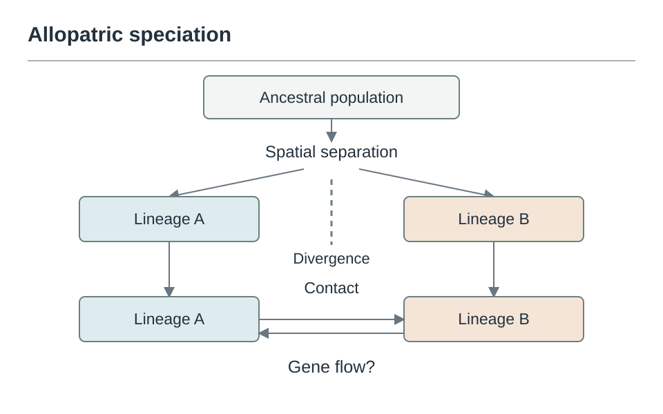

# M13-L3 – Speciation {#L3}

**Course area:** M13 – Evolution, Systematics and Phylogenetics

**Level:** Bachelor

**Prerequisites:** [M13-L2](M13-L2.md): evolutionary mechanisms; [M7-L2](M7-L2.md): reproduction.

**Learning objective:** Distinguish species concepts, spatial scenarios and reproductive barriers and cautiously interpret evidence about gene flow.

## Introduction {#S1}

When two populations diverge, they do not necessarily become two species. What matters is which processes maintain their evolutionary independence and which species concept is appropriate for the case.

## Principles and model {#S2}

### Species concepts and barriers

The biological species concept considers reproductive communities and isolation from other such groups. It is especially useful for contemporaneous, sexually reproducing populations. Fossils and asexual lineages require different criteria, such as diagnostic traits or independent evolutionary lineages. Morphological similarity alone may be misleading due to convergence; a single genetic distance threshold is not a universal species criterion either.

Prezygotic barriers act before a zygote forms, for example through different reproductive seasons, mate recognition or gamete incompatibility. Postzygotic barriers concern offspring, such as reduced viability or fertility. Barriers can be incomplete; even clearly differentiated species may occasionally exchange genes.

### Spatial and genetic scenarios

Allopatric speciation starts with spatial separation and reduced gene flow. In sympatric speciation, isolation develops without initial large-scale geographical separation, for example through ecological specialization with assortative mating. In plants, polyploidization can rapidly produce reproductive barriers. In parapatric scenarios, populations under different selection regimes are adjacent. Renewed contact may produce fusion, stable hybrid zones or reinforced prezygotic isolation. The outcome depends on hybrid fitness, gene flow and ecological conditions, among other factors.

*Figure: Schematic spatial separation, divergence and renewed contact with possible gene flow.*

## Application {#S3}

In a fictional observational dataset, 72 of 80 mating opportunities within a population succeed; 18 of 80 between-population opportunities succeed. Relative success is $(18/80)/(72/80)=0.25$. A purely descriptive isolation index $I=1-0.25=0.75$ describes reduction relative to the control. It is defined here, not a universal species threshold. Equal observation effort, comparable environments and independent units are necessary for meaningful comparison. Further evidence of offspring fertility and natural gene flow is needed.

## Self-assessment {#S4}

### Exercises

1. Classify different flowering seasons as a reproductive barrier.
2. Calculate I if 40% of between-population and 80% of within-population opportunities succeed.
3. Why does geographical separation alone not prove completed speciation?

::: {.lc-solutions data-lc-section="S4"}
1. Prezygotic temporal isolation.
2. I = 1 − 0.4/0.8 = 0.5.
3. Unrestricted gene flow may still occur after renewed contact.
:::

## Assumptions and limitations {#S5}

The example captures only one aspect of reproductive barriers. The fictional numbers justify neither a taxonomic description nor a particular speciation mechanism.

## Summary and transition {#S6}

Speciation is a process of lineage separation. M13-L4 examines traits used to reconstruct relationships.

**Continue:** [M13-L4](M13-L4.md)

## Sources {#S7}

- [OpenStax – Biology 2e, 18.2 Formation of New Species](https://openstax.org/books/biology-2e/pages/18-2-formation-of-new-species) · Reproductive barriers and speciation · Last accessed: 2026-11-25
- [OpenStax – Biology 2e, 19.2 Population Genetics](https://openstax.org/books/biology-2e/pages/19-2-population-genetics) · Genetic drift, gene flow and mutation · Last accessed: 2026-11-25

