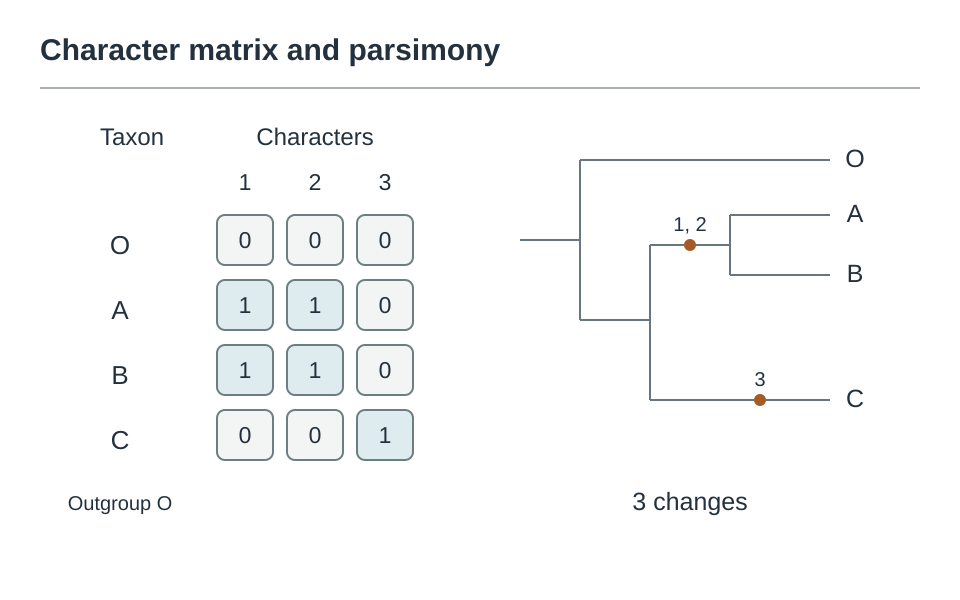

# M13-L4 – Systematic character analysis {#L4}

**Course area:** M13 – Evolution, Systematics and Phylogenetics

**Level:** Bachelor

**Prerequisites:** [M8-L4](M8-L4.md): evolutionary history; [M13-L3](M13-L3.md): speciation.

**Learning objective:** Distinguish homology and homoplasy, construct character matrices and compare alternative tree topologies using simple parsimony.

## Introduction {#S1}

Bird and bat wings enable powered flight, but wings alone do not establish an exclusive relationship. Their forelimbs share an evolutionary origin; the flight function developed independently in these lineages. The level at which a character is defined matters.

## Principles and model {#S2}

### Character coding

Homologous characters derive from a feature of a common ancestor. Homoplasies arise through independent evolution of similar states or through reversal. A synapomorphy is a shared derived homologous state that may support a clade. A shared ancestral state cannot by itself define an exclusive subgroup. An outgroup helps polarize states relative to the ingroup; it is not necessarily its direct ancestor.

A character matrix contains taxa as rows and defined characters as columns. States may be encoded as 0 and 1. These numbers denote categories, not evolutionary progress. Missing information is marked unknown, not interpreted as absence. Repeated coding of strongly dependent characters can create apparently independent evidence.

### Parsimony as a comparison rule

For unordered binary characters with equal costs, a tree can be evaluated by finding the minimum number of state changes for each character. In the Fitch procedure, an internal node receives the intersection of its child state sets if nonempty. Otherwise it receives their union and a change is counted. The sum across characters is the parsimony score. Shorter trees require fewer changes under these assumptions. Equal scores may yield multiple solutions.

*Figure: Binary character matrix for O, A, B and C beside a tree requiring three minimum changes.*

## Application {#S3}

The fictional matrix has three independent binary characters. Outgroup O: 000; A: 110; B: 110; C: 001. On tree (O,((A,B),C)), the first two characters each require one change and the third also requires one, for a total of three. On (O,((A,C),B)), the first two require two changes each and the third one, for a total of five. The figure shows the matrix and the first topology. This is a comparison under equal character costs, not proof of actual ancestry.

## Self-assessment {#S4}

### Exercises

1. What does a question mark rather than 0 mean in a character matrix?
2. A fourth character has O = 0, A = 0, B = 0, C = 1. How do the two scores change?
3. Why are two similar-looking structures not necessarily homologous?

::: {.lc-solutions data-lc-section="S4"}
1. The state is unknown; 0 would be a defined observed state.
2. Both increase by one change to four and six, respectively.
3. Similar selective conditions can lead to independent convergent evolution.
:::

## Assumptions and limitations {#S5}

Parsimony may yield misleading groupings when evolutionary rates differ substantially. Dependence, missing data and mistaken homology assumptions affect the matrix. Probabilistic approaches account for explicit evolutionary models but do not solve every problem either.

## Summary and transition {#S6}

Character analysis makes phylogenetic hypotheses testable. M13-L5 develops tree interpretation and statistical support.

**Continue:** [M13-L5](M13-L5.md)

## Sources {#S7}

- [OpenStax – Biology 2e, 20.2 Determining Evolutionary Relationships](https://openstax.org/books/biology-2e/pages/20-2-determining-evolutionary-relationships) · Homology, homoplasy and cladistics · Last accessed: 2026-11-25
- [Gregory (2008), Understanding Evolutionary Trees](https://doi.org/10.1007/s12052-008-0035-x) · Nodes, sister groups and rooting; indexed text · Last accessed: 2026-11-25

