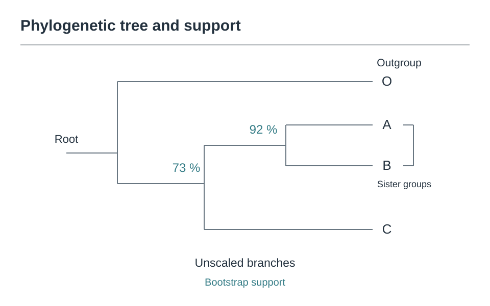

# M13-L5 – Phylogenetic trees and limitations {#L5}

**Course area:** M13 – Evolution, Systematics and Phylogenetics

**Level:** Bachelor

**Prerequisites:** [M13-L4](M13-L4.md): character matrices; [M2-L5](M2-L5.md): sampling.

**Learning objective:** Distinguish tree topology, root, branch lengths and node support and interpret bootstrap values appropriately.

## Introduction {#S1}

A phylogenetic tree is a hypothesis of ancestral relationships. Its graphical arrangement cannot be interpreted arbitrarily: the branching pattern, the root and, where applicable, the meaning of branch lengths matter.

## Principles and model {#S2}

### Topology and measures

In a rooted tree, an internal node denotes the inferred common ancestor of its descendants. Sister groups share an immediate common node; a clade comprises an ancestor and all its descendants. Rotating tips around internal nodes changes their order without altering topology. A polytomy with more than two direct descendants may indicate insufficient resolution or a modelled simultaneous split. Unrooted trees depict relationships without specifying the direction of ancestry.

In a cladogram, branch lengths encode no quantitative quantity. In a phylogram they may represent expected substitutions per sequence site; in a chronogram they represent time. Molecular dating requires calibrated models and uncertainty estimates. The physical distance between tips on a screen is not a measure of relatedness.

### Reconstruction and uncertainty

Maximum likelihood methods compare the probability of observed data under alternative trees and evolutionary parameters. Bayesian approaches estimate a posterior distribution conditional on the model and prior assumptions. Classical nonparametric phylogenetic bootstrapping resamples alignment columns with replacement, reanalyses the resulting matrices and counts the frequency of a clade. The value describes stability under this resampling, not directly the probability that a clade is true. Systematic model errors and dependent sites can persist even with high support.

A gene tree need not match the species tree. Incomplete lineage sorting, introgression and gene duplication can generate conflicts among loci. Horizontal gene transfer and hybridization are processes for which network models can provide additional information in suitable cases.

*Figure: Rooted model tree with bootstrap support of 92% and 73% for two clades.*

## Application {#S3}

In a fictional bootstrap run with 500 replicates, clade (A,B) occurs in 460 and the larger clade ((A,B),C) in 365. Their support is 92% and 73%, respectively. In the example tree (O,((A,B),C)), A and B are sister groups. A is more closely related to B than to C; all three belong to the ingroup. The figure shows topology and bootstrap support only, not a time axis. This is an illustration, not a real sequence analysis.

## Self-assessment {#S4}

### Exercises

1. Does swapping A and B at their shared node change topology?
2. Calculate support for 168 of 200 replicates.
3. Give one biological cause of conflict between a gene tree and a species tree.

::: {.lc-solutions data-lc-section="S4"}
1. No; branching relationships remain unchanged.
2. 168/200 = 0.84 = 84%.
3. For example, incomplete lineage sorting, introgression or gene duplication.
:::

## Assumptions and limitations {#S5}

Numerical node support does not replace model checking or independent datasets. The example contains no real species identification or dating. Inference depends on alignment, taxon sampling, model and analysis method.

## Summary and transition {#S6}

Phylogenetics connects data, models and uncertainty. M14 extends the study of lineages to populations and ecological communities.

**Continue:** [M14-L1](M14-L1.md)

## Sources {#S7}

- [Gregory (2008), Understanding Evolutionary Trees](https://doi.org/10.1007/s12052-008-0035-x) · Nodes, sister groups and rooting; indexed text · Last accessed: 2026-11-25
- [OpenStax – Biology 2e, 20.2 Determining Evolutionary Relationships](https://openstax.org/books/biology-2e/pages/20-2-determining-evolutionary-relationships) · Homology, homoplasy and cladistics · Last accessed: 2026-11-25
- [Felsenstein (1985), Confidence Limits on Phylogenies: An Approach Using the Bootstrap](https://pubmed.ncbi.nlm.nih.gov/28561359/) · Character resampling; abstract · Last accessed: 2026-11-25

