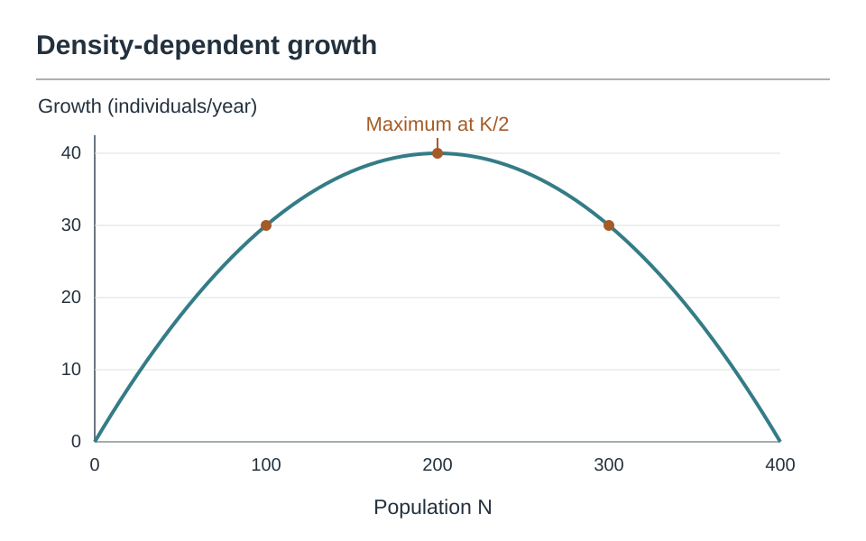

# M14-L1 – Populations and interactions {#L1}

**Course area:** M14 – Ecology and Conservation

**Level:** Bachelor

**Prerequisites:** [M2-L1](M2-L1.md): growth models; [M13-L2](M13-L2.md): selection and drift.

**Learning objective:** Construct population budgets, model density-dependent regulation and distinguish interactions between species.

## Introduction {#S1}

A population comprises individuals of the same species within a defined spatial and temporal boundary. This boundary must remain consistent when counting: a decline within the study area may result from death or emigration. Demography investigates the processes behind such changes.

## Principles and model {#S2}

### Population budgets and regulation

For a time interval, $N_{t+1}=N_t+B-D+I-E$, where B denotes births, D deaths, I immigration and E emigration. Per capita birth and death rates are not the same as absolute event counts. Age structure, delayed reproduction and spatial connectivity can influence population trajectories.

The continuous logistic model $dN/dt=rN(1-N/K)$ describes a closed population with intrinsic growth rate r and constant carrying capacity K. Near zero, growth is approximately exponential; at N = K, net growth vanishes. Maximum absolute growth occurs at K/2, where the derivative of the growth term with respect to N is zero. K is not an immutable property of a species: food, habitat and seasons alter resources. Density-dependent effects such as intraspecific competition depend on population density, whereas extreme weather, for example, can also act independently of it.

### Interactions

Competition can harm both species (−/−), predation and parasitism benefit one at the expense of the other (+/−), and mutualism benefits both (+/+). These signs describe net effects under specified conditions. A plant and its pollinator can benefit from one another without every individual interaction being favourable to both. Predator–prey models couple population changes; in the idealised Lotka–Volterra system, prey grow exponentially in the absence of predators, while predators decline without prey. Real systems often require additional terms for saturation, alternative food, refuges and environmental variation.

*Figure: Logistic growth rate for r = 0.4 per year and K = 400; maximum at 200 individuals.*

## Application {#S3}

A fictional population contains 100 individuals. In one year, 30 are born, 18 die, 7 immigrate and 9 emigrate: the final population is 110. Independently of this budget, set r = 0.4 per year and K = 400 in a continuous model. At N = 100, $dN/dt=0.4\cdot100\cdot0.75=30$ individuals per year; at N = 200 it is 40, and at N = 300 it is 30 again. The figure shows modelled instantaneous growth rates, not observed annual increments.

## Self-assessment {#S4}

### Exercises

1. Calculate the final population for N = 80, B = 12, D = 5, I = 3, E = 4.
2. Determine maximum absolute growth for r = 0.2 per year and K = 200.
3. Why is a positive association between predator and prey abundance not evidence of mutualism?

::: {.lc-solutions data-lc-section="S4"}
1. 80 + 12 − 5 + 3 − 4 = 86 individuals.
2. At N = K/2 = 100, rK/4 = 10 individuals per year.
3. Predators may increase with abundant prey even though they reduce prey survival. Correlation alone does not identify the direction of an effect.
:::

## Assumptions and limitations {#S5}

The logistic model ignores age structure, randomness and changing resources. Continuous rates cannot be treated as discrete annual increments without integration assumptions. The numbers are fictional.

## Summary and transition {#S6}

Population models explain changes in abundance under explicit assumptions. M14-L2 extends the analysis to ecological communities.

**Continue:** [M14-L2](M14-L2.md)

## Sources {#S7}

- [OpenStax – Biology 2e, 45.3 Environmental Limits to Population Growth](https://openstax.org/books/biology-2e/pages/45-3-environmental-limits-to-population-growth) · Exponential and logistic population models; indexed section · Last accessed: 2026-11-25
- [OpenStax – Biology 2e, 45.4 Population Dynamics and Regulation](https://openstax.org/books/biology-2e/pages/45-4-population-dynamics-and-regulation) · Density-dependent and density-independent factors; indexed section · Last accessed: 2026-11-25
- [OpenStax – Biology 2e, 45.6 Community Ecology](https://openstax.org/books/biology-2e/pages/45-6-community-ecology) · Species interactions and community dynamics; indexed section · Last accessed: 2026-11-25

