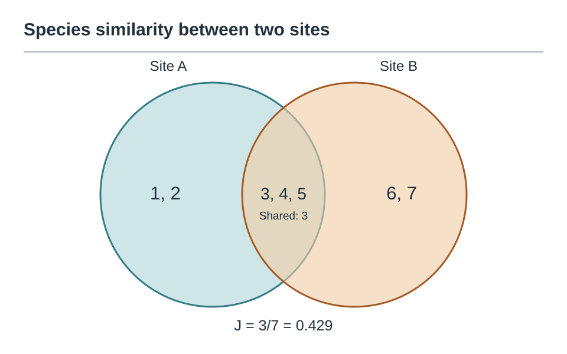

# M14-L2 – Community ecology {#L2}

**Course area:** M14 – Ecology and Conservation

**Level:** Bachelor

**Prerequisites:** [M14-L1](M14-L1.md): interactions; [M8-L5](M8-L5.md): diversity.

**Learning objective:** Explain ecological niches and food webs and assess species turnover and indirect effects using data.

## Introduction {#S1}

An ecological community consists of populations of different species within an area. Not only species richness but also abundances, functions and relationships determine its properties. Two meadows with the same number of species can form very different communities.

## Principles and model {#S2}

### Niches, coexistence and indirect effects

The fundamental niche describes conditions and resources under which a population could persist without restrictive biotic interactions; the realised niche accounts for these relationships. Competition may restrict resource use, while facilitation may extend the conditions that can be occupied. Species can coexist by partitioning resources in space or time. Similar resource use alone does not prove long-term competitive exclusion.

In food webs, directed edges connect resources to consumers. An omnivore can occupy multiple trophic levels. Indirect effects arise when one species affects a third through a second species. If a predator reduces herbivore numbers, plant biomass may increase; this trophic cascade nevertheless depends on other feeding pathways. Disturbances alter communities. Primary succession begins on a substrate without developed soil, secondary succession after disturbance where soil remains. The trajectory and final state can depend on dispersal, site history and recurring disturbances.

### Measuring species turnover

Alpha diversity describes local diversity; gamma diversity describes diversity across a larger region. Beta diversity characterises differences among communities. For species lists, Jaccard similarity is $J=a/(a+b+c)$, where a is the number shared, b the number found only at the first site and c the number found only at the second. Jaccard dissimilarity is 1 − J. This metric ignores abundances and does not automatically distinguish species replacement from nestedness (a poorer list is a subset of a richer list).

*Figure: Set diagram with two exclusive species per site and three shared species.*

## Application {#S3}

Two fictional sites have A = {1,2,3,4,5} and B = {3,4,5,6,7}. Both contain five species, with seven regionally. Three species are shared; J = 3/7 = 0.429 and dissimilarity is 4/7 = 0.571. The figure illustrates the difference despite equal local richness. A third site C with {1,2,3} contains only a subset of A; J(A,C) = 3/5 = 0.6. The lists do not reveal the cause of the differences.

## Self-assessment {#S4}

### Exercises

1. Calculate J for {1,2,3,4} and {2,3,5}.
2. Why might a trophic cascade be weaker than expected?
3. Name two factors affecting succession after a storm.

::: {.lc-solutions data-lc-section="S4"}
1. Two shared species, five in total: J = 2/5 = 0.4.
2. Alternative food, additional predators or plant defences can weaken the effect.
3. For example, the seed bank and soil conditions; repeated disturbances and dispersal also matter.
:::

## Assumptions and limitations {#S5}

Species lists depend on sampling effort, detectability and taxonomy. The fictional calculation does not replace standardised surveys; food webs change seasonally.

## Summary and transition {#S6}

Communities link diversity with functional interactions. M14-L3 examines energy and material flows in these systems.

**Continue:** [M14-L3](M14-L3.md)

## Sources {#S7}

- [OpenStax – Biology 2e, 45.6 Community Ecology](https://openstax.org/books/biology-2e/pages/45-6-community-ecology) · Species interactions and community dynamics; indexed section · Last accessed: 2026-11-25

