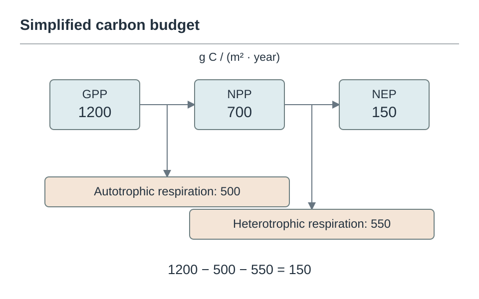

# M14-L3 – Ecosystem processes {#L3}

**Course area:** M14 – Ecology and Conservation

**Level:** Bachelor

**Prerequisites:** [M5-L4](M5-L4.md): cellular respiration; [M10-L2](M10-L2.md): photosynthesis.

**Learning objective:** Calculate primary production and trophic transfer, distinguish material cycles from energy flows and define system boundaries correctly.

## Introduction {#S1}

Ecosystems include communities and their abiotic environment. Organisms exchange water, elements and energy with air, soil and water bodies. Stocks (e.g. the mass of carbon in soil) must be distinguished from fluxes (mass per unit time).

## Principles and model {#S2}

### Production and energy transfer

Gross primary production (GPP) denotes total carbon fixation by primary producers per unit area and time. Subtracting their autotrophic respiration $R_a$ gives net primary production $NPP=GPP-R_a$. Subtracting heterotrophic respiration $R_h$ as well gives net ecosystem production $NEP=NPP-R_h$ in a simple carbon budget. Lateral carbon fluxes, fire and harvest are not included yet.

Net primary production is available to herbivores and detrital food pathways. Some is not consumed, some is not assimilated, and some assimilated energy is respired. Trophic transfer efficiency can be expressed as the ratio of production at successive trophic levels, provided the same area, time and units are used. It varies and is not a universal ten-percent rule. Energy is ultimately dissipated as heat, whereas elements may repeatedly move between organic and inorganic forms.

### Biogeochemical cycles

Carbon enters biomass through photosynthesis and returns to air or water via respiration, decomposition and combustion. Nitrogen fixation makes molecular nitrogen biologically available; mineralisation releases organically bound nitrogen, nitrification oxidises ammonium and denitrification returns gaseous nitrogen compounds under suitable conditions. Phosphorus cycles primarily through rocks, water, soil and organisms. Excess nutrient inputs can increase production and decomposition in water bodies, consuming oxygen and changing communities. Which nutrients are limiting depends on the site.

*Figure: Gross primary production 1200, net primary production 700 and net ecosystem production 150 in g C per m² per year.*

## Application {#S3}

For a fictional area, let GPP = 1200, $R_a$ = 500 and $R_h$ = 550 g C per m² per year. NPP = 700 and NEP = 150 g C per m² per year. The positive value indicates carbon accumulation in the simplified model; exports of 180 g C per m² per year would make the net balance −30. Separately, let plant energy production be 10000 and herbivore production 800 kJ per m² per year; transfer efficiency is 8%. The figure shows the carbon budget, not the energy budget.

## Self-assessment {#S4}

### Exercises

1. Calculate NPP and NEP when GPP = 900, Ra = 300 and Rh = 500.
2. What is transfer efficiency at 2400 and 360 kJ per m² per year?
3. Why must a carbon stock not be directly subtracted from an annual flux rate?

::: {.lc-solutions data-lc-section="S4"}
1. NPP = 600, NEP = 100 in the common flux units.
2. 360/2400 = 0.15 or 15%.
3. Mass and mass per time have different dimensions; the flux must be integrated over an appropriate interval.
:::

## Assumptions and limitations {#S5}

Budgets apply only to defined system boundaries. Measurement uncertainty, temporal variation and lateral transport can substantially affect the balance. The examples are fictional.

## Summary and transition {#S6}

Ecosystems connect biological production to global material cycles. M14-L4 examines changes in environmental conditions.

**Continue:** [M14-L4](M14-L4.md)

## Sources {#S7}

- [OpenStax – Biology 2e, 46.2 Energy Flow through Ecosystems](https://openstax.org/books/biology-2e/pages/46-2-energy-flow-through-ecosystems) · Primary production and trophic transfer; indexed section · Last accessed: 2026-11-25
- [OpenStax – Biology 2e, 46.3 Biogeochemical Cycles](https://openstax.org/books/biology-2e/pages/46-3-biogeochemical-cycles) · Carbon, nitrogen and phosphorus cycles; indexed section · Last accessed: 2026-11-25

