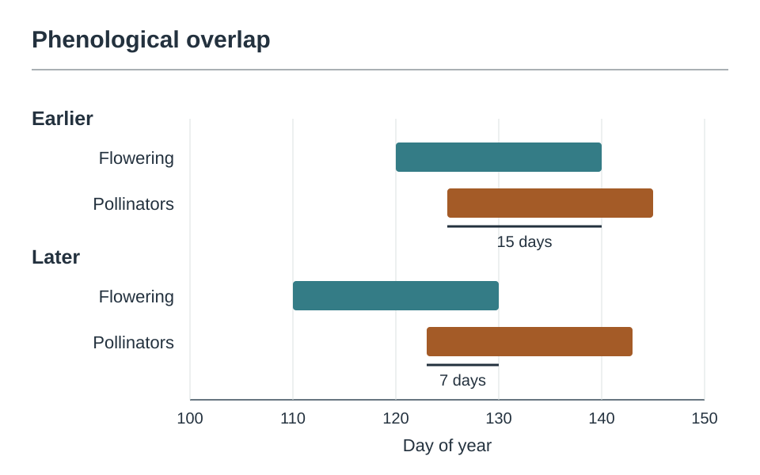

# M14-L4 – Environmental change {#L4}

**Course area:** M14 – Ecology and Conservation

**Level:** Bachelor

**Prerequisites:** [M10-L4](M10-L4.md): stress physiology; [M14-L3](M14-L3.md): ecosystem processes.

**Learning objective:** Analyse environmental change in terms of drivers, exposure and biological response and distinguish observed trends from causal claims.

## Introduction {#S1}

Environmental changes affect individuals, populations and entire ecosystems. The same temperature change may stress a cold-adapted species while temporarily providing favourable conditions for a warmth-adapted species. Changes must therefore be related to ecological niche and life history.

## Principles and model {#S2}

### Drivers and responses

Land-use change, direct exploitation of organisms, climate change, pollution and invasive alien species can harm biodiversity. These drivers may reinforce one another: fragmentation, for example, limits the ability to reach new habitats as climate shifts. Warming can alter distribution boundaries and the seasonal timing of biological events. In the ocean, oxygen depletion, acidification and marine heatwaves also act, among other factors. The IPCC assesses risks using observed and modelled effects; risk depends not only on hazard intensity but also on exposure and vulnerability.

Acclimatisation is a change in individual traits within a lifetime; evolutionary adaptation is heritable change across generations. Movement or dispersal shifts spatial distributions but is not always possible. Phenological changes may decouple events that were previously synchronised, such as flowering and the activity of particular pollinators. Whether reproduction declines depends on the duration and extent of overlap and alternative partners.

### Observation and attribution

A trend initially reveals temporal change, not an isolated cause. Long-term data, comparable sites and mechanistic experiments can narrow alternative explanations. Changes in observation methods, land use or species composition must be considered. For a management intervention, before–after comparisons with comparable untreated controls are often useful; multiple independent areas are essential to avoid confusing a single site with the treatment effect.

*Figure: Fictional flowering and pollinator activity windows with overlap of 15 days initially and 7 days later.*

## Application {#S3}

Fictional flowering and activity intervals (day of year, half-open intervals): originally flowering [120,140), pollinators [125,145); overlap 15 days. Later flowering [110,130), pollinators [123,143); overlap 7 days. The decrease is 8 days or 53.3% relative to the original overlap. The figure shows both pairs of time windows. An association with warming would be a hypothesis to test, not a cause established by these four intervals.

## Self-assessment {#S4}

### Exercises

1. Calculate the overlap of [100,118) and [112,130).
2. Why is a short-term physiological response not necessarily evolutionary adaptation?
3. What additional observation would help assess a pollination effect of reduced overlap?

::: {.lc-solutions data-lc-section="S4"}
1. 118 − 112 = 6 days.
2. Evolutionary adaptation requires heritable change across generations; individual plasticity alone is not evidence.
3. For example, standardised visit rates and seed or fruit set, as well as alternative pollinators and control sites.
:::

## Assumptions and limitations {#S5}

The windows are fictional teaching simplifications; in nature activity is continuous and depends on daily weather. Projections include scenario and model uncertainty.

## Summary and transition {#S6}

Environmental change is governed by multiple interconnected processes. M14-L5 translates this insight into monitoring and conservation planning.

**Continue:** [M14-L5](M14-L5.md)

## Sources {#S7}

- [IPCC (2023), AR6 Synthesis Report – Summary for Policymakers](https://www.ipcc.ch/report/ar6/syr/summary-for-policymakers/) · A.2 and C.3.6: impacts, conservation and adaptation; indexed report text · Last accessed: 2026-11-25
- [OpenStax – Biology 2e, 47.3 Threats to Biodiversity](https://openstax.org/books/biology-2e/pages/47-3-threats-to-biodiversity) · Threats to biodiversity; indexed section · Last accessed: 2026-11-25

