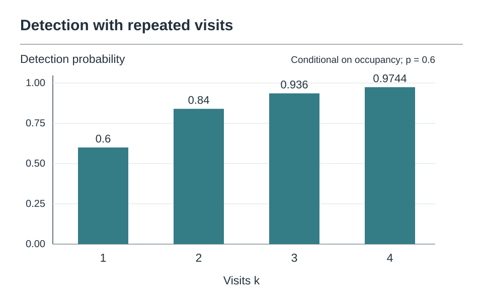

# M14-L5 – Biodiversity monitoring and conservation {#L5}

**Course area:** M14 – Ecology and Conservation

**Level:** Bachelor

**Prerequisites:** [M2-L5](M2-L5.md): experimental design; [M14-L2](M14-L2.md): diversity measures.

**Learning objective:** Operationalise monitoring objectives, account for detection probability and evaluate conservation interventions against measurable goals.

## Introduction {#S1}

A conservation programme requires a baseline survey, clearly defined objectives and repeated measurements. A species list alone reveals neither abundance nor whether populations are recovering. Monitoring evaluates biological change and the effectiveness of interventions.

## Principles and model {#S2}

### Sampling and imperfect detection

Standardised walks, plots, cameras and acoustic surveys support different conclusions. Samples should be spatially representative; habitat types can be stratified and sites randomly selected within strata. Effort, season, observers and methods must be documented. Rare or difficult-to-detect species require tailored approaches. Environmental DNA may indicate occurrence, but transport, persistence and contamination limit interpretation; a positive molecular detection is not automatically a population count.

Occupancy models separate site occupancy probability $\psi$ from conditional detection probability p. For k independent visits with equal p and unchanged occupancy status, an occupied site has $P(\text{at least one detection})=1-(1-p)^k$. For a random site, the corresponding probability in the absence of false positives is $\psi[1-(1-p)^k]$. Repeated surveys help distinguish occupancy and detection probability statistically. MacKenzie et al. (2002) established this approach; modern models can account for varying detection probabilities and additional processes.

### From data to decisions

Conservation interventions may reduce habitat loss, restore habitats, promote connectivity or control invasive species. Planning must consider objectives, costs, ecological side effects and the rights of affected people. A protected area is not effective solely because of its size: management quality, representativeness and connectivity matter. Adaptive management links action, monitoring, evaluation and revision. Predetermined outcomes and comparison sites help avoid confusing success with random variation.

*Figure: Conditional detection probabilities 0.6, 0.84, 0.936 and 0.9744 for one to four visits.*

## Application {#S3}

In fictional monitoring, let p = 0.6. After one visit, detection probability is 0.6; after three visits it is $1-0.4^3=0.936$. With occupancy $\psi=0.5$, among 100 randomly selected sites one expects on average 46.8 sites with at least one detection after three visits. This is an expected value, not an observed abundance. The figure shows conditional detection probability for one to four visits. Occupancy cannot simply be estimated by division from a single observation series with unknown p.

## Self-assessment {#S4}

### Exercises

1. Calculate conditional probability of at least one detection for p = 0.5 and k = 4.
2. Name two assumptions of the simple detection model.
3. Formulate a testable objective for a fictional restoration programme.

::: {.lc-solutions data-lc-section="S4"}
1. 1 − 0.5⁴ = 0.9375.
2. Constant occupancy during visits and independent detections with constant p; no false positives.
3. For example, increase estimated occupancy of a target species within five years relative to baseline and suitable comparison sites; define the target value and uncertainty criterion in advance.
:::

## Assumptions and limitations {#S5}

The numbers are fictional. The model does not automatically reveal individual abundance, habitat quality or causal management effects. Fieldwork may require permits and protection measures depending on location; sensitive occurrence locations should be protected.

## Summary and transition {#S6}

Conservation combines ecological theory, robust surveys and transparent decisions. M15 develops computational analysis of biological data.

**Continue:** [M15-L1](M15-L1.md)

## Sources {#S7}

- [MacKenzie et al. (2002), Estimating site occupancy rates when detection probabilities are less than one](https://pubs.usgs.gov/publication/5224176) · Ecology 83:2248–2255; USGS abstract and bibliographic record · Last accessed: 2026-11-25
- [OpenStax – Biology 2e, 47.4 Preserving Biodiversity](https://openstax.org/books/biology-2e/pages/47-4-preserving-biodiversity) · Conservation strategies; indexed section · Last accessed: 2026-11-25
- [IPCC (2023), AR6 Synthesis Report – Summary for Policymakers](https://www.ipcc.ch/report/ar6/syr/summary-for-policymakers/) · A.2 and C.3.6: impacts, conservation and adaptation; indexed report text · Last accessed: 2026-11-25

