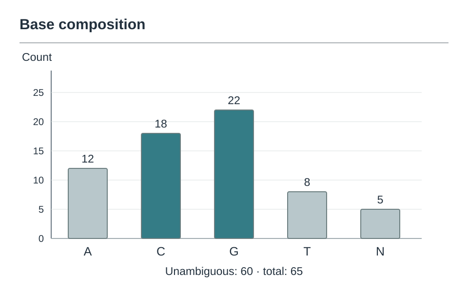

# M15-L1 – Sequence data and databases {#L1}

**Course area:** M15 – Bioinformatics and Data Analysis

**Level:** Bachelor

**Prerequisites:** [M6-L1](M6-L1.md): DNA; [M1-L4](M1-L4.md): literature research.

**Learning objective:** Identify sequence records, distinguish reference sequences from measurements and document database queries reproducibly.

## Introduction {#S1}

Bioinformatics combines biological questions with algorithmic data processing. A sequence record includes more than a string: organism, origin, molecule type, revision and annotation determine what can be inferred. GenBank, ENA and DDBJ exchange archived nucleotide sequences; RefSeq provides selected reference records. UniProt focuses on proteins and their annotation. Databases are neither complete nor error-free.

## Principles and model {#S2}

### Identity and provenance

An accession identifies a record. The accession and version suffix together specify a sequence revision; annotation changes do not necessarily cause a new sequence version. Therefore record the retrieval date, database release, organism, reference assembly and relevant feature coordinates. A gene name alone can be ambiguous. Functional annotation may be supported experimentally or predicted computationally; distinguish these evidence types.

### Formats and simple metrics

FASTA contains an identifier header and one or more sequence lines. FASTQ additionally stores position-specific read quality values. A read is a measurement, whereas an assembly is a reconstructed sequence. GC fraction is the proportion of G and C among defined A, C, G and T bases. With ambiguous symbols such as N, explicitly define the denominator. GC content alone identifies neither a species nor a function.

*Figure: A 12, C 18, G 22, T 8, N 5.*

## Application {#S3}

A wholly artificial teaching dataset contains A = 12, C = 18, G = 22, T = 8 and N = 5. Of 65 positions, 60 are unambiguous. GC fraction among unambiguous bases is 40/60 = 66.67%. Relative to all positions it would be 40/65 = 61.54%. The figure shows the counts. Two versions of a record require separate identifiers even if their GC fractions agree.

## Self-assessment {#S4}

### Exercises

1. Calculate GC fraction among unambiguous bases for A = 30, C = 20, G = 20, T = 30, N = 10.
2. Why is the gene name insufficient as a record identifier?
3. What distinguishes a predicted annotation from an experimentally supported one?

::: {.lc-solutions data-lc-section="S4"}
1. 40/100 = 40%.
2. Names can differ among species, databases and releases or occur more than once.
3. Prediction relies on a model or similarity finding, whereas experimental evidence relies on a documented observation; both have limitations.
:::

## Assumptions and limitations {#S5}

The numbers are fictional. No clinical or personal data are used. A version suffix alone does not guarantee full reproducibility of a database query.

## Summary and transition {#S6}

Documented sequence identity underpins comparison in M15-L2.

**Continue:** [M15-L2](M15-L2.md)

## Sources {#S7}

- [NCBI – Sample GenBank Record](https://www.ncbi.nlm.nih.gov/genbank/samplerecord/) · ACCESSION, VERSION, FEATURES and sequence fields; indexed documentation · Last accessed: 2026-11-25
- [NCBI – SRA File Format Guide](https://www.ncbi.nlm.nih.gov/sra/docs/submitformats/) · Sequence and alignment formats; indexed documentation · Last accessed: 2026-11-25

