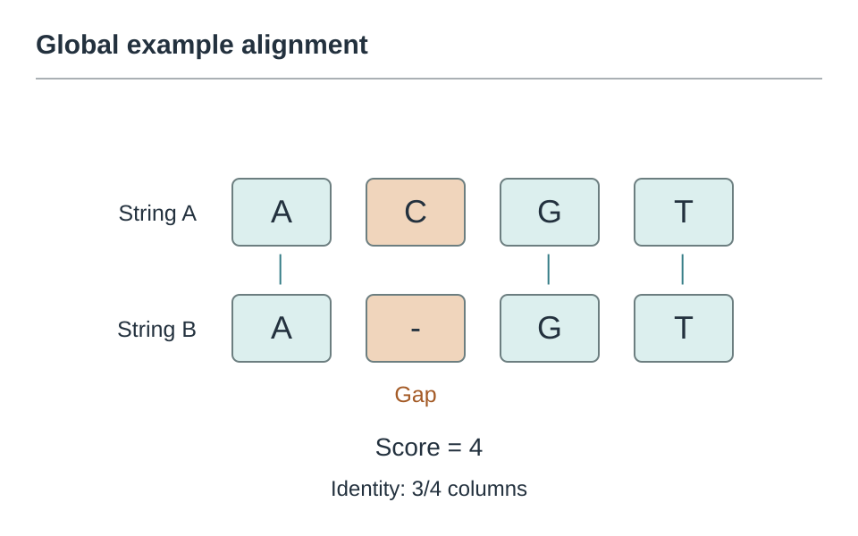

# M15-L2 – Alignments and homology {#L2}

**Course area:** M15 – Bioinformatics and Data Analysis

**Level:** Bachelor

**Prerequisites:** [M15-L1](M15-L1.md): sequence data; [M13-L4](M13-L4.md): homology.

**Learning objective:** Distinguish global and local alignments, calculate alignment scores and interpret similarity as evidence for homology.

## Introduction {#S1}

An alignment assigns positions in two sequences to corresponding sites. Matches, substitutions and gaps are weighted by a scoring model. Gaps represent a hypothesis about insertions or deletions, not their historical direction. Homology means common evolutionary ancestry and is not a percentage; sequence identity is a measurable fraction of identical symbols.

## Principles and model {#S2}

### Optimisation objective

Global alignments consider both sequences across their full lengths, while local alignments search for a particularly similar segment. Needleman–Wunsch and Smith–Waterman use dynamic programming. In a simple global model with match value m, mismatch value s and gap value g, the recurrence is $F_{ij}=\max(F_{i-1,j-1}+w_{ij},F_{i-1,j}+g,F_{i,j-1}+g)$. Boundary values are $F_{i0}=ig$ and $F_{0j}=jg$. Tracing back through the matrix returns an optimal alignment, potentially several in the case of ties. Real models often distinguish opening and extending a gap.

### Database search

BLAST is a heuristic search method. An E value indicates the expected number of chance hits scoring at least as highly under the search model. It is not a probability of homology. Database size, sequence length, composition and search settings influence the result. Functional interpretation also requires coverage, domain architecture and independent evidence.

*Figure: ACGT and A-GT: three matches, one gap.*

## Application {#S3}

Two invented symbol strings are aligned as `ACGT` and `A-GT`. With +2 per match, −1 per mismatch and −2 per gap, the score is 3 × 2 − 2 = 4. Identity across all four alignment columns is 3/4 = 75%, but among the three jointly occupied columns it is 100%. The figure highlights the difference. This example illustrates algorithms only, not functional annotation.

## Self-assessment {#S4}

### Exercises

1. Determine the score of `ACGT` against `ATGT` under the same model.
2. Why can a local alignment have low overall coverage?
3. Does an E value of 0.01 imply a 99% probability of homology?

::: {.lc-solutions data-lc-section="S4"}
1. Three matches and one mismatch: 6 − 1 = 5.
2. It scores only a matching region, not necessarily the complete sequences.
3. No. The E value is an expected count of chance hits under the model.
:::

## Assumptions and limitations {#S5}

Short artificial sequences and simple scores are teaching models. Neither function nor ancestry should be asserted from a single comparison without evidence.

## Summary and transition {#S6}

Alignments provide comparable characters for phylogenetic analysis in M15-L3.

**Continue:** [M15-L3](M15-L3.md)

## Sources {#S7}

- [EMBL-EBI – Pairwise sequence alignment](https://www.ebi.ac.uk/training/online/courses/guide-to-sequence-analysis-tools/sequence-alignment/pairwise-sequence-alignment/) · Global and local alignment; indexed training text · Last accessed: 2026-11-25
- [NCBI – BLAST Glossary](https://www.ncbi.nlm.nih.gov/books/NBK62051/) · E value and alignment terminology; indexed documentation · Last accessed: 2026-11-25

