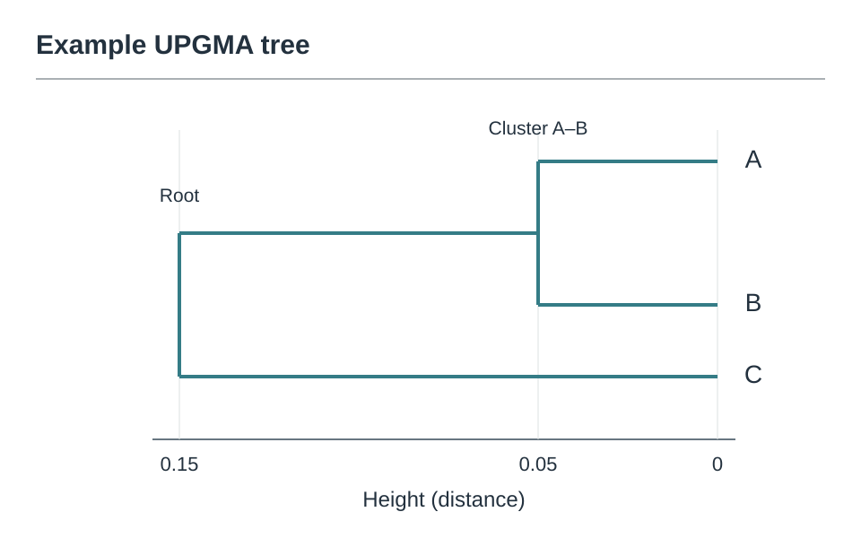

# M15-L3 – Principles of computational phylogenetics {#L3}

**Course area:** M15 – Bioinformatics and Data Analysis

**Level:** Bachelor

**Prerequisites:** [M13-L5](M13-L5.md): tree interpretation; [M15-L2](M15-L2.md): alignments.

**Learning objective:** Calculate sequence distances, trace a simple distance method and assess its assumptions.

## Introduction {#S1}

Phylogenetic inference translates differences in homologous characters into a hypothesis about ancestry. Comparable sequences are first selected and aligned. Unreliably aligned regions can bias the analysis. A gene tree describes the history of the gene segment considered and may differ from a species tree because of gene duplication, gene flow or incomplete lineage sorting.

## Principles and model {#S2}

### Distances and clustering

The p-distance is the fraction of differing positions among jointly evaluated sites. At high divergence, multiple substitutions can affect a single site, so observed p-distance underestimates the actual number of changes. Substitution models account for such multiple events. UPGMA first joins the units with smallest distance and updates cluster distance as the mean of all pairwise distances across clusters. For a temporally interpretable reconstruction it assumes equal evolutionary rates. Neighbor-joining uses a different selection criterion and does not require a strict molecular clock.

### Model-based methods

Maximum likelihood compares the probability of the data under a tree and model. Bayesian approaches additionally incorporate prior distributions. Both depend on model and data. Bootstrap support from M13-L5 quantifies stability under resampling; it does not guarantee the true tree.

*Figure: A and B join at 0.05, C at 0.15.*

## Application {#S3}

Three fictional aligned strings have 100 comparable positions each. A and B differ at 10 sites, A and C at 30, and B and C at 30. Their p-distances are 0.10, 0.30 and 0.30. UPGMA joins A and B at height 0.05; the distance from their cluster to C is (0.30 + 0.30)/2 = 0.30. The root is at height 0.15. The figure shows the ultrametric example tree; units are modelled distance, not years.

## Self-assessment {#S4}

### Exercises

1. Calculate p-distance for 12 differences across 80 evaluated sites.
2. A cluster contains two units at distances 0.2 and 0.4 from C. Calculate the mean distance.
3. Why can two genes yield different trees?

::: {.lc-solutions data-lc-section="S4"}
1. 12/80 = 0.15.
2. (0.2 + 0.4)/2 = 0.3.
3. For example, because of gene duplication or different genealogical histories.
:::

## Assumptions and limitations {#S5}

The data are fictional. A tree with three tips does not allow reliable evaluation of complex evolutionary models; branch lengths depend on the distance definition.

## Summary and transition {#S6}

Sequence-based trees are statistically testable hypotheses, not direct observations of the past.

**Continue:** [M15-L4](M15-L4.md)

## Sources {#S7}

- [Yang and Rannala (2012), Molecular phylogenetics: principles and practice](https://doi.org/10.1038/nrg3186) · Distance, likelihood, parsimony and Bayesian inference; indexed abstract · Last accessed: 2026-11-25
- [EMBL-EBI – Pairwise sequence alignment](https://www.ebi.ac.uk/training/online/courses/guide-to-sequence-analysis-tools/sequence-alignment/pairwise-sequence-alignment/) · Global and local alignment; indexed training text · Last accessed: 2026-11-25

