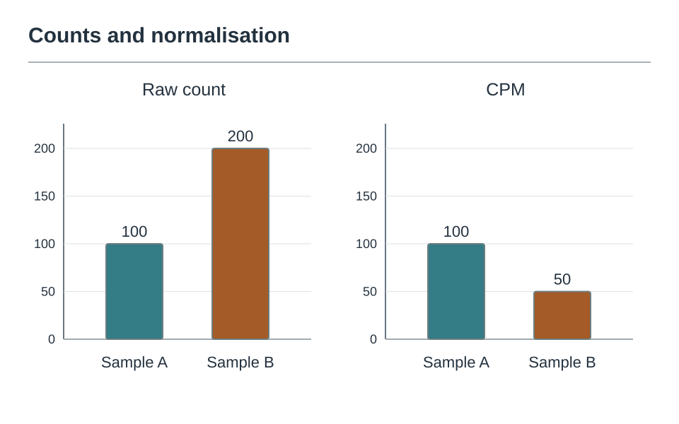

# M15-L4 – Omics data types {#L4}

**Course area:** M15 – Bioinformatics and Data Analysis

**Level:** Bachelor

**Prerequisites:** [M5-L1](M5-L1.md): proteins; [M6-L3](M6-L3.md): RNA; [M2-L4](M2-L4.md): inference.

**Learning objective:** Distinguish omics layers and interpret normalised abundances and logarithmic effect sizes.

## Introduction {#S1}

Genomics examines DNA content, transcriptomics RNA amounts, proteomics proteins and metabolomics small metabolic molecules. Epigenomics examines, for example, chromatin accessibility and DNA modifications. These layers measure different states: RNA amount is not automatically protein amount or enzyme activity. Time, tissue and cell composition influence every layer.

## Principles and model {#S2}

### Measurement matrix and normalisation

A typical data matrix has features as rows and samples as columns. Raw RNA sequencing counts also depend on the number of captured fragments. A simple relative measure is $CPM=10^6 c/N$ for feature count c and total count N under the chosen filtering definition. It adjusts for total count but not every compositional bias. For statistical tests, DESeq2 models raw counts using estimated size factors and dispersion. Biological replicates are needed to assess biological variation; technical repetitions do not replace them.

### Effect and uncertainty

A logarithmic effect size $\log_2(B/A)$ is +1 for doubling and −1 for halving; zeros require model-appropriate handling. Testing many genes in parallel requires control of the false discovery rate. Significance alone does not indicate biological relevance. Batch effects can generate apparent group effects, especially when batch and group are completely confounded.

*Figure: Raw counts 100 and 200; CPM 100 and 50.*

## Application {#S3}

In two artificial samples, feature X has 100 and 200 reads out of 1 and 4 million total reads, respectively. CPM values are 100 and 50. The raw ratio is 2, the CPM ratio is 0.5 and its log2 value is −1. The figure shows that raw counts and relative abundances convey different information. A single sample per group does not permit a reliable differential expression test.

## Self-assessment {#S4}

### Exercises

1. Calculate CPM for 150 reads out of 3 million total reads.
2. Calculate log2(B/A) for B = 80, A = 20.
3. Why can RNA increase without a protein increase?

::: {.lc-solutions data-lc-section="S4"}
1. 50 CPM.
2. log2(4) = 2.
3. For example, because of translational regulation or increased protein degradation.
:::

## Assumptions and limitations {#S5}

All values are fictional. CPM is no substitute for appropriate normalisation and statistical modelling; no diagnostic interpretation is intended.

## Summary and transition {#S6}

Omics data become biologically interpretable through documented measurement and analytical models.

**Continue:** [M15-L5](M15-L5.md)

## Sources {#S7}

- [EMBL-EBI – Methods and resources for omics studies](https://www.ebi.ac.uk/training/online/courses/methods-and-resources-for-omics-studies/) · Omics data types; indexed course overview · Last accessed: 2026-11-25
- [Love, Huber and Anders (2014), Moderated estimation of fold change and dispersion for RNA-seq data with DESeq2](https://doi.org/10.1186/s13059-014-0550-8) · Count models, size factors and dispersion; indexed article text · Last accessed: 2026-11-25

