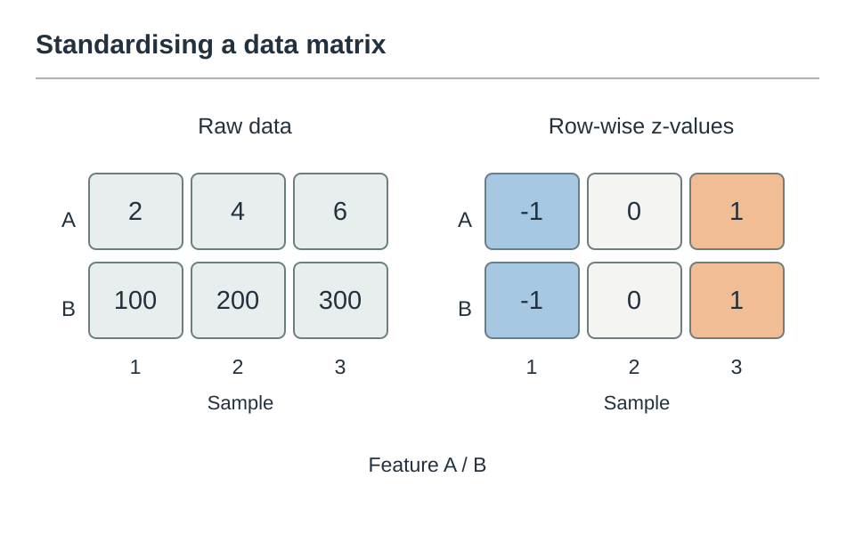

# M15-L5 – Visualization and analysis workflows {#L5}

**Course area:** M15 – Bioinformatics and Data Analysis

**Level:** Bachelor

**Prerequisites:** [M2-L6](M2-L6.md): reproducible data analysis; [M15-L4](M15-L4.md): omics.

**Learning objective:** Design a traceable analysis workflow and assess visualisations for scale, uncertainty and bias.

## Introduction {#S1}

A workflow links input data, transformations and results. Raw data remain unchanged; derived tables receive distinct names. Reproducible analysis documents data revisions, software versions, settings, exclusion rules and random seeds. A directed acyclic graph (DAG) can describe dependencies between processing steps. A step is executed only when its inputs are available. Workflow systems facilitate repetition and automation but do not replace scientific checks.

## Principles and model {#S2}

### Appropriate visualisation

A scatter plot shows relationships between two variables, a heatmap represents a matrix through colour coding and a boxplot summarises a distribution. Individual observations, sample size and uncertainties remain important. In a standardised heatmap each row is often centred and scaled separately: $z=(x-\bar{x})/s$. Colour then shows relative deviation within a feature, not its absolute abundance. A constant row has s = 0 and must not be divided by zero. PCA projects data onto orthogonal directions of maximum variance; it does not automatically provide biological groups or causal explanations.

### FAIR and traceability

FAIR calls for findable, accessible, interoperable and reusable research objects. Accessibility can include legitimate access restrictions. Metadata, standardised formats, licensing and provenance aid reuse. Checksums help detect changes to files; they do not establish scientific correctness. A documented workflow should be checked with small test inputs and known results.

*Figure: Two features with different raw values yield identical z-values −1, 0, +1.*

## Application {#S3}

For fictional feature A three measurements are 2, 4, 6; for B they are 100, 200, 300. Sample standard deviations are 2 and 100. Both rows yield the same z-values −1, 0, +1. Therefore the standardised colour pattern in the figure is identical despite different absolute values. A separate raw-data panel or table prevents misinterpretation.

## Self-assessment {#S4}

### Exercises

1. Calculate z-values for 5, 10, 15 with sample standard deviation 5.
2. Why does PCA separation not prove a treatment effect?
3. Name three pieces of information needed to repeat a workflow.

::: {.lc-solutions data-lc-section="S4"}
1. Mean 10; z = −1, 0, +1.
2. Batch, technical factors or other differences may also explain the variance.
3. For example, input revision, software versions and settings; random seed where relevant.
:::

## Assumptions and limitations {#S5}

The data are fictional. Standardisation and filtering may change structure; sensitive data should not be made public merely to satisfy FAIR.

## Summary and transition {#S6}

Reproducible workflows combine transparent processing with critical interpretation of visualisations.

**Continue:** [M15-L6](M15-L6.md)

## Sources {#S7}

- [Wilkinson et al. (2016), The FAIR Guiding Principles for scientific data management and stewardship](https://doi.org/10.1038/sdata.2016.18) · Findability, accessibility, interoperability and reusability; indexed article text · Last accessed: 2026-11-25
- [Love, Huber and Anders (2014), Moderated estimation of fold change and dispersion for RNA-seq data with DESeq2](https://doi.org/10.1186/s13059-014-0550-8) · Count models, size factors and dispersion; indexed article text · Last accessed: 2026-11-25

