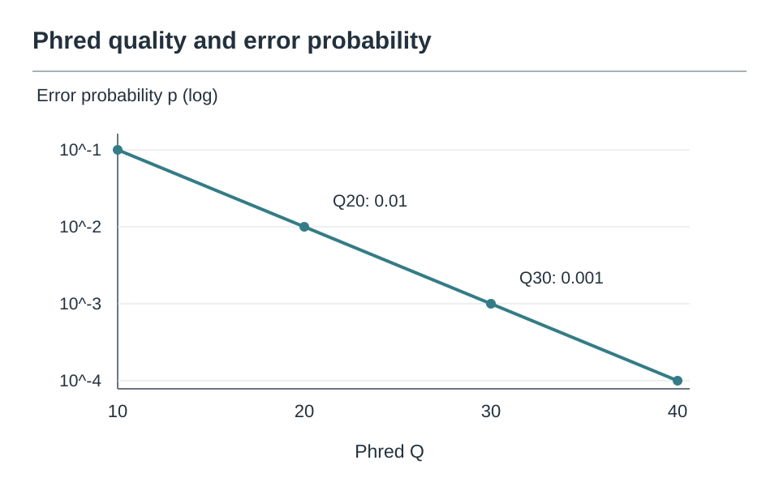

# M15-L6 – Programming, file formats and data quality {#L6}

**Course area:** M15 – Bioinformatics and Data Analysis

**Level:** Bachelor

**Prerequisites:** [M15-L1](M15-L1.md): sequence formats; [M15-L5](M15-L5.md): workflows.

**Learning objective:** Distinguish basic bioinformatics file formats, quantify data quality and program a simple validation step.

## Introduction {#S1}

A data format defines how information is serialised. FASTA stores sequences, FASTQ adds quality characters, SAM/BAM represent aligned reads, VCF describes variants relative to a reference and GFF3 annotates features. CSV and TSV tables are common for metadata. Format, reference version, coordinate conventions and character encoding must agree. For instance, GFF3 coordinates are 1-based and inclusive, while BED intervals are 0-based and half-open. A GFF3 interval 11–20 corresponds to BED [10,20), each spanning ten positions.

## Principles and model {#S2}

### Quality and validation

In FASTQ the Phred value $Q=-10\log_{10}(p)$ corresponds to an estimated error probability p for an individual base call. Q20 means p = 0.01, Q30 means p = 0.001. Quality scores are not guarantees. The expected number of errors in a read is the sum of the position-specific error probabilities; independence is not required for this. Data quality also includes completeness, unique identifiers and plausible metadata. A program should not silently repair invalid inputs.

### Small programming test

The following Python code checks an artificial list of already decoded Phred scores. It accepts only nonnegative integers, uses no real sequences and calculates an expected error count.

```python
scores = [20, 30, 20, 40]
assert all(type(q) is int and q >= 0 for q in scores)
expected_errors = sum(10 ** (-q / 10) for q in scores)
print(f"{expected_errors:.4f}")
```

Real file formats require established parsers, tests with malformed records and documented edge cases. A parser must also verify that sequence and quality string lengths agree.



*Figure: Q10 to Q40 correspond to error probabilities 0.1 to 0.0001.*

## Application {#S3}

The output is 0.0211, because 0.01 + 0.001 + 0.01 + 0.0001 = 0.0211. The figure shows the logarithmic relationship between Q and p. The expected number is not identical to the probability of at least one error. The latter depends on the joint distribution.

## Self-assessment {#S4}

### Exercises

1. Calculate the expected error count for 100 positions with Q30.
2. Convert the inclusive interval 5–9 to a 0-based half-open interval.
3. Why is successful file conversion not enough to establish quality?

::: {.lc-solutions data-lc-section="S4"}
1. 100 × 0.001 = 0.1.
2. [4,9), five positions.
3. Reference, metadata and biological meaning may be incorrect despite syntactically valid output.
:::

## Assumptions and limitations {#S5}

The examples are purely educational and contain no real genetic data. Quality scores must be correctly decoded according to format. Estimated error probabilities may be systematically miscalibrated.

## Summary and transition {#S6}

Validation, documented conventions and small tests establish a sound basis for further data analysis.

**Continue:** [M16-L1](M16-L1.md)

## Sources {#S7}

- [NCBI – SRA File Format Guide](https://www.ncbi.nlm.nih.gov/sra/docs/submitformats/) · Sequence and alignment formats; indexed documentation · Last accessed: 2026-11-25
- [NYU Core Bioinformatics – Quality scores](https://learn.gencore.bio.nyu.edu/intro/quality_scores.html) · Phred score and FASTQ quality string; indexed teaching text · Last accessed: 2026-11-25
- [Wilkinson et al. (2016), The FAIR Guiding Principles for scientific data management and stewardship](https://doi.org/10.1038/sdata.2016.18) · Findability, accessibility, interoperability and reusability; indexed article text · Last accessed: 2026-11-25

