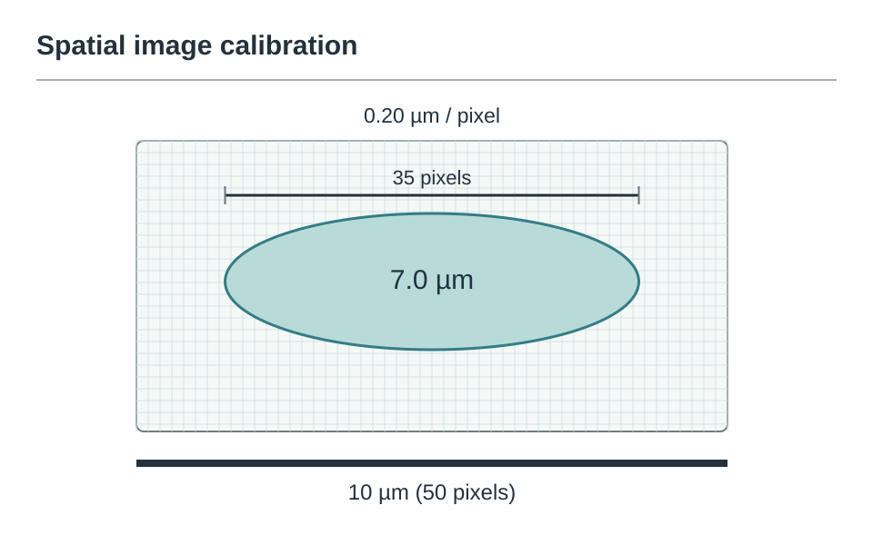

# M16-L1 – Light and fluorescence microscopy {#L1}

**Course area:** M16 – Laboratory, Field and Research Practice

**Level:** Bachelor

**Prerequisites:** [M3-L4](M3-L4.md): optics; [M7-L1](M7-L1.md): plant tissues.

**Learning objective:** Distinguish resolution from magnification, calibrate spatial image data and assess quantitative fluorescence signals critically.

## Introduction {#S1}

A microscopy image is a measurement mediated by optics, illumination and a detector. Its meaning depends on more than the specimen. For example, a seemingly bright nucleus may reflect different exposure, background light or the amount of labelled molecule. Metadata and controls are as important as sharp images for comparability.

## Principles and model {#S2}

### Image formation and resolution limits

Brightfield microscopy uses differences in transmission and absorption. Phase contrast converts phase shifts caused by transparent structures into intensity differences. Fluorescence microscopy spectrally separates excitation and emission light; in a typical epi-illumination system a dichroic beamsplitter directs excitation towards the specimen and transmits longer-wavelength emission towards the detector. Filters suppress unwanted wavelengths. Confocal systems reduce out-of-focus signals using a spatial pinhole.

The lateral Rayleigh criterion for an ideal diffraction-limited system is $d=0.61\lambda/NA$, where $\lambda$ is wavelength and numerical aperture $NA=n\sin\theta$. Increased magnification alone does not improve resolution. Digital sampling may impose a further limit: a feature should be represented across several pixels rather than a single pixel. Axial resolution differs from lateral resolution.

### From pixels to biological quantities

Spatial calibration assigns a length in the specimen plane to each pixel. Intensity measurements require a detector operating in its linear range. Saturated pixels lose information. Photobleaching, autofluorescence, uneven illumination, non-specific labelling and channel overlap can distort results. In a simple model the background signal can be subtracted from mean object intensity. Segmentation determines which pixels belong to an object; different thresholds can therefore change its measured area. Several cells from one specimen are not automatically independent biological replicates.

*Figure: Schematic 35-pixel feature at 0.20 µm per pixel; 10 µm scale bar.*

## Application {#S3}

A fictional image has a calibration of 0.20 µm/pixel. A feature spanning 35 pixels measures 7.0 µm; a 50-pixel distance corresponds to 10 µm. At $\lambda=550$ nm and $NA=1.25$, theoretical lateral resolution is 268.4 nm. Mean object intensities of 120 and 90 digital units yield background-corrected values of 100 and 70 with a common background of 20. Their ratio is approximately 1.43 if acquisition and calibration are comparable. The figure shows length calibration schematically, not an actual micrograph.

## Self-assessment {#S4}

### Exercises

1. Calculate the length of 48 pixels at 0.15 µm/pixel.
2. Why does higher zoom alone not separate two closely spaced features?
3. Two images have different exposures and saturated pixels. Can their mean fluorescence be compared directly?

::: {.lc-solutions data-lc-section="S4"}
1. 7.2 µm.
2. Zoom also magnifies diffraction blur; optical resolution and sampling impose limits.
3. No. Intensities are not directly comparable, and saturated values lack reliable information on original signal magnitude.
:::

## Assumptions and limitations {#S5}

The numbers are simulated. The Rayleigh model applies under idealised conditions and is not an instrument certification. Fluorescence intensity is not an absolute molecule count without a validated relationship. Actual instruments, dyes and specimens require supervised training and safety assessment.

## Summary and transition {#S6}

Calibration, controls and documented measurement conditions are essential for quantitative imaging and the molecular measurement concepts in M16-L2.

**Continue:** [M16-L2](M16-L2.md)

## Sources {#S7}

- [Senft et al. (2023), A biologist’s guide to planning and performing quantitative bioimaging experiments](https://doi.org/10.1371/journal.pbio.3002167) · Quantitative acquisition, spatial calibration, saturation and analysis; indexed article · Last accessed: 2026-11-25
- [Nikon MicroscopyU – Introduction to Fluorescence Microscopy](https://www.microscopyu.com/techniques/fluorescence/introduction-to-fluorescence-microscopy) · Fluorescence optics and filters; indexed teaching text · Last accessed: 2026-11-25

