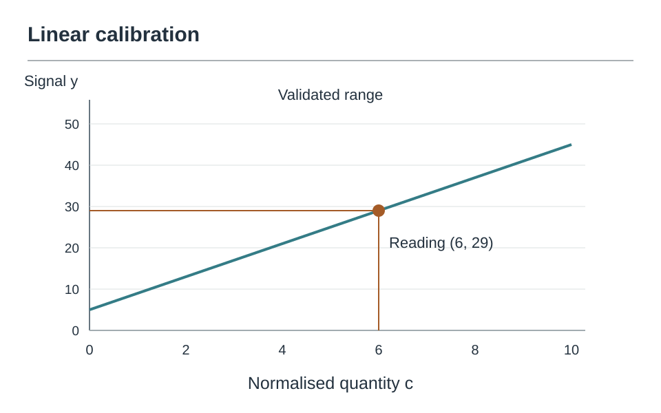

# M16-L2 – Molecular biology measurement concepts {#L2}

**Course area:** M16 – Laboratory, Field and Research Practice

**Level:** Bachelor

**Prerequisites:** [M6-L3](M6-L3.md): RNA; [M3-L5](M3-L5.md): measurement uncertainty; [M15-L4](M15-L4.md): omics.

**Learning objective:** Distinguish molecular measurement signals from target quantities and assess calibration, controls and uncertainties using existing data.

## Introduction {#S1}

Molecular biology measurements usually observe an indirect signal rather than the desired number of molecules directly. An optical reading, band or fluorescence curve must be interpreted through a measurement model. This applies to nucleic acids and proteins alike.

## Principles and model {#S2}

### Measurement models and controls

Absorbance measurements use the relation $A=\varepsilon lc$ between absorbance, extinction coefficient, path length and concentration in the ideal linear range. Scattering, impurities and operation outside the linear range violate its assumptions. Electrophoretic separation produces bands according to molecular properties; band position and intensity answer different questions. Immunological binding signals depend on affinity, specificity and background as well as target quantity.

Quantitative PCR records fluorescence during nucleic acid amplification. Quantification cycle Cq is a signal-related measurement, not an absolute copy number. MIQE 2.0 emphasises reporting efficiency-corrected target quantities, prediction intervals, detection limits and validated measurement ranges. This module analyses only existing fictional measurements and does not describe molecular laboratory protocols.

### Calibration curves and measurement ranges

A linear calibration function $y=a+bc$ describes signal $y$ at reference quantity $c$. Intercept $a$ represents an offset in the model, while slope $b$ represents sensitivity. Blank, negative and positive controls answer distinct questions: background, unintended response and detectability. A zero signal can also arise from measurement failure. The detection limit concerns whether a signal can be recognised; the quantification limit concerns whether it can be quantified sufficiently reliably. Both depend on the method and validation. Calibration parameter uncertainty and variation among new observations contribute to uncertainty in the inferred quantity.

*Figure: Fictional calibration line y = 5 + 4c over the range 0 to 10.*

## Application {#S3}

A fictional measurement unrelated to any specific biological target has linear calibration $y=5+4c$, where $c$ is a normalised quantity from 0 to 10. A reading of 29 corresponds to $c=(29-5)/4=6$. Readings from 27 to 31 imply a range of 5.5 to 6.5 from that variation alone. This range is not a statistical confidence interval. A signal of 53 lies outside the validated range (maximum 45) and cannot simply be reported as a reliable quantity of 12.

## Self-assessment {#S4}

### Exercises

1. Determine $c$ for $y=21$ within the validated range.
2. What does a positive signal from a negative control tell you?
3. Why is a high calibration correlation coefficient insufficient for quantifying arbitrary samples?

::: {.lc-solutions data-lc-section="S4"}
1. $(21-5)/4=4$.
2. It indicates background, non-specific signals or another disturbance; the cause must be clarified.
3. The sample may be outside the measurement range or exhibit matrix effects; calibration uncertainty and model deviations must also be considered.
:::

## Assumptions and limitations {#S5}

The numerical example is an abstract measurement model, not a real assay or an implementation or optimisation guide. One measurement establishes neither biological function nor a clinical finding. Real laboratory methods require qualified supervision.

## Summary and transition {#S6}

M16-L3 applies the distinction between signal and biological target quantity to detection methods.

**Continue:** [M16-L3](M16-L3.md)

## Sources {#S7}

- [MIQE 2.0 (2025), Revision of the Minimum Information for Publication of Quantitative Real-Time PCR Experiments Guidelines](https://doi.org/10.1093/clinchem/hvaf043) · Efficiency-corrected quantities, uncertainty, dynamic range and reporting; indexed article · Last accessed: 2026-11-25

