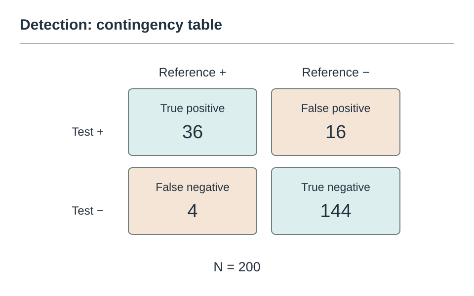

# M16-L3 – Overview of culture and detection methods {#L3}

**Course area:** M16 – Laboratory, Field and Research Practice

**Level:** Bachelor

**Prerequisites:** [M9-L1](M9-L1.md): microorganisms; [M2-L2](M2-L2.md): conditional probability.

**Learning objective:** Compare culture-dependent and culture-independent detection principles and interpret sensitivity, specificity and predictive values.

## Introduction {#S1}

The biological entities counted by a detection method depend on its measurement principle. A culturable unit, visible object, chemical signal and molecular marker are not equivalent. Particularly in complex communities, each method reveals a different part of reality.

## Principles and model {#S2}

### Detection principles

Culture-dependent methods detect organisms that grow detectably under the conditions of a validated method. They can miss viable but non-culturable cells; several attached cells may appear as one unit. Direct microscopy records visible objects and often cannot distinguish living from dead cells without further evidence. Indirect optical measurements are aggregate signals also influenced by particles and cell size. Molecular detection measures particular target structures; detection does not automatically demonstrate viability. Immunological tests detect binding signals that may exhibit cross-reactivity.

### Classification performance

Comparison of binary detection results with an appropriate reference standard gives true positives (TP), false positives (FP), true negatives (TN) and false negatives (FN). Sensitivity $Se=TP/(TP+FN)$ is the fraction detected among truly positive cases; specificity $Sp=TN/(TN+FP)$ is the fraction correctly classified among truly negative cases. Positive predictive value $PPV=TP/(TP+FP)$ and negative predictive value $NPV=TN/(TN+FN)$ also depend on the proportion of positive cases. With an imperfect reference standard, agreement measures are often more appropriate than supposedly absolute performance metrics. Thresholds, case selection and uncertainty in estimated proportions should be documented.

*Figure: Synthetic contingency table: TP 36, FP 16, FN 4, TN 144.*

## Application {#S3}

A purely synthetic test dataset for an abstract marker contains 200 cases, of which 40 are positive according to an idealised reference standard. TP=36, FN=4, FP=16 and TN=144. Sensitivity and specificity are both 90%. PPV is $36/52=69.23\,\%$, while NPV is $144/148=97.30\,\%$. At 10% positive cases, unchanged performance and 1000 cases, there would be 90 TP and 90 FP: PPV would be only 50%. This is a statistical illustration, not a clinical or microbiological test.

## Self-assessment {#S4}

### Exercises

1. Calculate sensitivity and specificity for TP=18, FN=2, FP=8, TN=72.
2. Why can a molecular marker be detected without demonstrating living organisms?
3. Why must PPV not be transferred uncritically between populations?

::: {.lc-solutions data-lc-section="S4"}
1. $18/20=90\,\%$ and $72/80=90\,\%$.
2. Target molecules can be present independently of viability; the detection measures the target structure.
3. PPV depends on the proportion of truly positive cases and on whether test performance generalises.
:::

## Assumptions and limitations {#S5}

All data are synthetic. This lesson contains no culture conditions, identification workflows, practical detection protocols or recommendations for real specimens. It replaces neither biosafety training nor medical diagnosis. Uncertain or unknown biological samples are unsuitable for unsupervised self-study experiments.

## Summary and transition {#S6}

Detection principles and reference standards determine the interpretation of biological observations; field studies additionally depend on the selection of observation locations.

**Continue:** [M16-L4](M16-L4.md)

## Sources {#S7}

- [FDA – Statistical Guidance on Reporting Results from Studies Evaluating Diagnostic Tests](https://www.fda.gov/regulatory-information/search-fda-guidance-documents/statistical-guidance-reporting-results-studies-evaluating-diagnostic-tests-guidance-industry-and-fda) · Sensitivity, specificity and reference standards; indexed guidance · Last accessed: 2026-11-25
- [OpenStax – Microbiology, 9.1 How Microbes Grow](https://openstax.org/books/microbiology/pages/9-1-how-microbes-grow) · Conceptual differences between direct and indirect cell measurements; indexed teaching text · Last accessed: 2026-11-25

