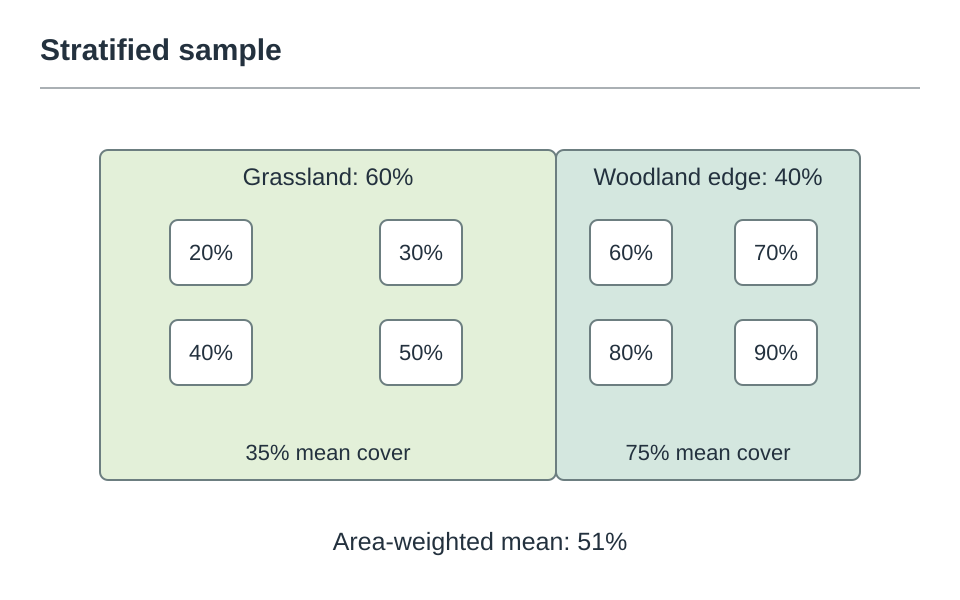

# M16-L4 – Field surveys and sampling plans {#L4}

**Course area:** M16 – Laboratory, Field and Research Practice

**Level:** Bachelor

**Prerequisites:** [M14-L5](M14-L5.md): monitoring; [M2-L5](M2-L5.md): sampling design.

**Learning objective:** Define target population, sampling unit and observation metric, and analyse stratified field samples transparently.

## Introduction {#S1}

Field research examines systems varying over space and time. An easily accessible plot is not necessarily representative of a landscape. Decisions about which locations to include already influence subsequent conclusions.

## Principles and model {#S2}

### Design before observation

The target population must be defined spatially, temporally and biologically. Quadrats or sample plots define area units; transects link observation points along a line. Density is count per area, cover a proportion of area, and frequency the proportion of units where presence is recorded. These quantities are not interchangeable. Random selection reduces systematic site selection bias; systematic selection may improve spatial coverage but can be biased by periodic patterns. Stratified random sampling divides heterogeneous areas into groups and randomly selects within each. Stratum weights must represent the target population, not automatically the proportions of collected samples.

### Spatial dependence and data quality

Neighbouring plots may correlate more strongly than distant plots due to shared environmental conditions. Repeat surveys of the same plot are temporally dependent. Statistical analysis should account for this structure rather than treating every observation as independent replication. Observer changes, season, weather and survey effort affect detection probability. Survey definitions, zero observations, missing data and site metadata belong in the documentation. Exact locations of sensitive species may need protection.

*Figure: Two area strata with four symbolic sample plots each and a weighted overall estimate.*

## Application {#S3}

In a simulated study area, grassland occupies 60% and woodland edges 40% of the area. Four equal-sized plots in each stratum yield grassland cover values of 20, 30, 40 and 50%, and woodland-edge values of 60, 70, 80 and 90%. Means are 35% and 75%. The area-weighted overall estimate is $0.6\cdot35+0.4\cdot75=51\,\%$. The unweighted mean of all eight observations would be 55%. Area weighting matters for the overall estimate. The figure shows schematic stratification, not actual locations.

## Self-assessment {#S4}

### Exercises

1. Calculate the overall estimate for weights 0.7 and 0.3 and means of 30% and 80%.
2. How do density and frequency differ?
3. Why are four subplots of one site not automatically four independent landscapes?

::: {.lc-solutions data-lc-section="S4"}
1. $0.7\cdot30+0.3\cdot80=45\,\%$.
2. Density measures count per area; frequency measures the fraction of plots in which presence was recorded.
3. They share site conditions and may be spatially correlated; the independent unit depends on the research question.
:::

## Assumptions and limitations {#S5}

This example supports design and data analysis. A confidence interval for the overall estimate requires additional information about the sampling design and variance structure. Real surveys must respect ownership, conservation rules and local hazards; no collection of organisms is required for this self-study exercise.

## Summary and transition {#S6}

A good sampling design becomes auditable through traceable records and error documentation (M16-L5).

**Continue:** [M16-L5](M16-L5.md)

## Sources {#S7}

- [National Park Service – What Are Transects, and Why Are They Important for Monitoring Natural Resources?](https://www.nps.gov/articles/000/what-are-transects.htm) · Transects, quadrats, vegetation monitoring; indexed field-method overview · Last accessed: 2026-11-25

