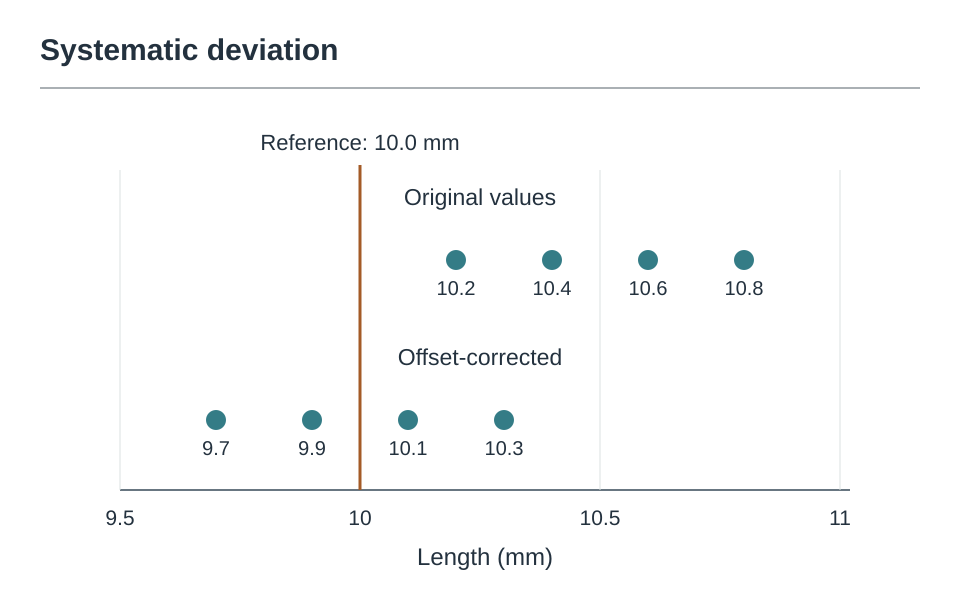

# M16-L5 – Laboratory notebooks and error sources {#L5}

**Course area:** M16 – Laboratory, Field and Research Practice

**Level:** Bachelor

**Prerequisites:** [M1-L5](M1-L5.md): reproducibility; [M3-L5](M3-L5.md): error analysis; [M15-L5](M15-L5.md): workflows.

**Learning objective:** Assess a traceable research record, distinguish random from systematic deviations and evaluate documented corrections.

## Introduction {#S1}

A laboratory notebook connects question, measurement, analysis and interpretation into an auditable history. It should record not only successful results but also deviations, failed measurements and reasons for decisions. Without these details even correctly calculated results cannot be interpreted reliably.

## Principles and model {#S2}

### Contents of a research record

An entry needs a unique identifier, time, responsible person or role, research question, reference to the applicable method, sample and instrument identifiers, relevant measurement conditions, raw data location, deviations and provisional interpretation. Raw data, derived data and reports should remain distinguishable. Filenames alone provide insufficient provenance: version, checksum, software environment and processing steps can be documented as well. Changes must be dated and justified without concealing original observations. Electronic laboratory notebooks can support access controls, versioning and audit trails but cannot replace careful documentation.

### Measurement errors, bias and quality assurance

Random deviations cause scatter; systematic effects shift results in a particular direction. Repeated technical measurements can reduce random uncertainty but do not automatically correct systematic calibration errors. Sample mean $\bar x$ and sample standard deviation $s$ describe location and scatter. Under independent identically distributed measurements, $s/\sqrt n$ estimates the standard error of the mean. This formula does not capture unknown systematic deviations. A documented correction requires justification from a measurement model and should account for its own uncertainty. Outliers are not removed simply because they contradict a hypothesis.

*Figure: Four original readings and the same four after hypothetical offset correction; scatter is unchanged.*

## Application {#S3}

Four fictional repeat measurements of a reference length yield 10.2, 10.4, 10.6 and 10.8 mm. The mean is 10.5 mm and sample standard deviation approximately 0.258 mm. Under independence, the standard error is 0.129 mm. The known reference is 10.0 mm; mean deviation is +0.5 mm. A hypothetical offset correction of −0.5 mm yields 9.7, 9.9, 10.1 and 10.3 mm with unchanged scatter and a mean of 10.0 mm. This is illustrative only; a real correction requires independent calibration. The figure shows original and corrected values without treating them as two independent datasets.

## Self-assessment {#S4}

### Exercises

1. Calculate the mean of 8, 10 and 12; what is the sample standard deviation?
2. What should remain available after a retrospective change to a raw data entry?
3. Why does a small standard error not establish accuracy?

::: {.lc-solutions data-lc-section="S4"}
1. Mean 10, sample standard deviation 2.
2. Original entry, time, reason for change, responsible role and link to the corrected version.
3. Under model assumptions it describes uncertainty of the mean due to random scatter, not unknown systematic deviations.
:::

## Assumptions and limitations {#S5}

The examples are fictional. Retention, access and handling of personal or protected data are governed by institutional rules. Checksums can establish byte identity, not scientific correctness or completeness. Technical repetitions of an object do not replace biological replicates.

## Summary and transition {#S6}

M16 combines methodological foundations with auditable research documentation. The following bachelor electives apply these principles to specialised biological questions.

**Continue:** [M17-L1](M17-L1.md)

## Sources {#S7}

- [Harvard Medical School – Electronic Laboratory Notebooks (ELNs) Guidelines](https://ari.hms.harvard.edu/electronic-laboratory-notebooks-elns-guidelines) · Record keeping and institutional responsibilities; indexed guidance · Last accessed: 2026-11-25
- [National Cancer Institute – Guide for Keeping Laboratory Records](https://techtransfer.cancer.gov/investigators/inventions/guide-lab-records) · Traceable laboratory records and electronic record management; indexed guidance · Last accessed: 2026-11-25

