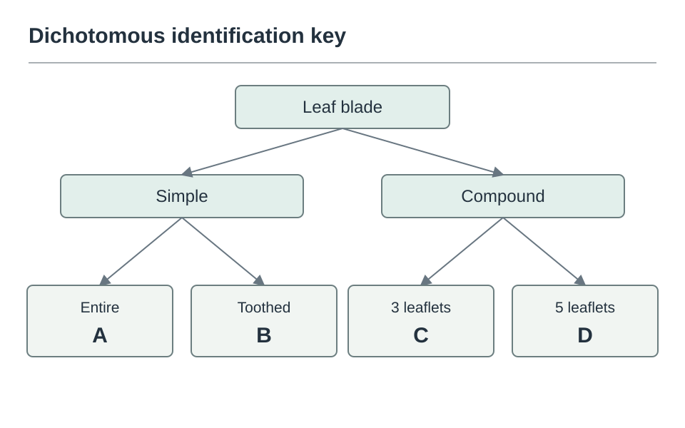

# M17-L1 – Identification and comparative morphology {#L1}

**Course area:** M17 – Organismal and Ecological Electives

**Level:** Bachelor

**Prerequisites:** [M7-L3](M7-L3.md): systematics; [M13-L4](M13-L4.md): character analysis.

**Learning objective:** Apply a dichotomous key, compare morphological characters quantitatively and distinguish identification from evolutionary relationships.

## Introduction {#S1}

Species identification links observations to a bounded set of taxonomic hypotheses. A key to native woody plants may misclassify an exotic houseplant even if every decision is formally correct. The scope of the key is therefore part of the result.

## Principles and model {#S2}

### Characters and decision paths

Morphological characters are observable properties of form and structure, such as leaf arrangement, segment number or joint structure. A discrete character has distinguishable states; a metric variable such as leaf length is continuous. Characters require operational definitions: leaf length may exclude or include the petiole, but the definitions must not be mixed inadvertently. Developmental stage, sex, damage and environment influence character expression.

A dichotomous key consists of paired decisions whose alternatives should be unambiguous and exhaustive within its scope. Each decision leads to another pair or a taxon. An uncertain alternative should not be guessed; both paths may initially remain open. A traceable identification records the key version, observed states, photographs or permitted vouchers and residual uncertainty. The final identification should be checked against an independent description.

### Comparison and homology

Similarity of shape may reflect common ancestry or convergent adaptation. Mammalian forelimbs contain homologous skeletal elements despite different functions. Conversely, streamlined shape alone does not establish close relatedness. A key may use practical characters that are not synapomorphies. Phylogenetic analysis instead requires justified homology hypotheses and suitable outgroups.

Ratios such as $r=b/l$, width $b$ divided by length $l$, describe shape independently of purely uniform scaling. Under allometric growth this ratio may itself vary systematically with body size. Overlapping distributions among species limit the diagnostic power of a single measurement.

*Figure: Fictional decision key for four leaf types A to D.*

## Application {#S3}

A fictional key to four leaf types begins with simple versus compound blades. Simple leaves are separated into entire (A) and toothed (B), compound leaves into three (C) or five leaflets (D). A simple toothed leaf leads to B, not a named real species. Two specimens measuring 60 × 24 mm and 80 × 32 mm both have $r=0.40$. A third measuring 60 × 36 mm has $r=0.60$. The third is relatively wider, but these ratios alone do not establish species membership.

## Self-assessment {#S4}

### Exercises

1. Which type has a compound leaf with five leaflets?
2. Calculate $r$ for length 75 mm and width 30 mm.
3. A damaged leaf margin cannot be assessed confidently. How should you proceed?

::: {.lc-solutions data-lc-section="S4"}
1. Type D.
2. $30/75=0.40$.
3. Record the margin as unknown, examine both branches and consult additional suitable material or an independent description.
:::

## Assumptions and limitations {#S5}

The key is a simulation and does not apply to real plants. Do not use it to identify edible or toxic organisms or for medical purposes. Measurements are fictional. Identification quality depends on taxon coverage, characters and reference material.

## Summary and transition {#S6}

Identification keys organise diagnostic evidence; they do not replace phylogenetic analysis. Subsequent lessons address the ecological distribution of identified organisms.

**Continue:** [M17-L2](M17-L2.md)

## Sources {#S7}

- [University of Florida IFAS – How to Use a Dichotomous Key](https://ask.ifas.ufl.edu/publication/EP510) · Paired morphological alternatives, scope and variable characters; indexed teaching text · Last accessed: 2026-11-25
- [OpenStax Biology 2e – 18.1 Understanding Evolution](https://openstax.org/books/biology-2e/pages/18-1-understanding-evolution) · Comparative anatomy and homology; indexed teaching text · Last accessed: 2026-11-25

