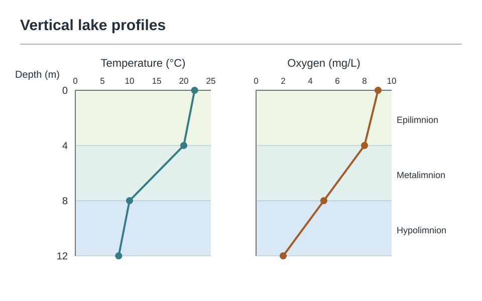

# M17-L2 – Aquatic ecology and limnology {#L2}

**Course area:** M17 – Organismal and Ecological Electives

**Level:** Bachelor

**Prerequisites:** [M14-L3](M14-L3.md): ecosystem budgets; [M10-L2](M10-L2.md): photosynthesis.

**Learning objective:** Explain aquatic zonation and thermal stratification, and interpret oxygen profiles and nutrient dynamics quantitatively.

## Introduction {#S1}

A lake may be oxygen-rich at the surface while oxygen is scarce in deeper layers. Limnology investigates such spatial and temporal differences in inland waters, connecting physical, chemical and biological processes.

## Principles and model {#S2}

### Habitats and stratification

Standing waters differ from flowing waters in residence time and current, among other features. The littoral zone often has light reaching the bottom and aquatic plants; the pelagic zone comprises the open water and the benthic zone the bottom. The euphotic zone receives sufficient light for appreciable photosynthesis; its depth depends on turbidity and is not identical to the thermal boundary.

Many deep temperate freshwater lakes develop a warm epilimnion above a colder hypolimnion in summer. Temperature changes steeply with depth in the metalimnion. Density differences inhibit vertical exchange. Cooling and wind may produce turnover. Not all lakes follow the same seasonal pattern; depth, salinity, climate and inflows alter the regime.

### Oxygen and nutrients

Gas exchange and photosynthesis contribute oxygen; respiration and organic matter decomposition consume it. During stratification, deep-water consumption can exceed supply. Local minima can also occur in the metalimnion. Under suitable conditions nutrient inputs promote primary production and subsequent oxygen demand during decomposition. High nutrient concentrations alone do not guarantee an algal bloom; light, temperature, nutrient ratios and grazing influence the response.

Oxygen mass in an assumed homogeneous layer is $m=C V$, provided concentration and volume use compatible units. $1$ mg/L equals $1$ g/m³. Lake calculations must account for layer volumes; a simple average of measurements at different depths may distort the total mass.

*Figure: Simulated temperature and oxygen profiles with steep temperature change between 4 and 8 m.*

## Application {#S3}

A fictional lake has temperatures of 22, 20, 10 and 8 °C at depths of 0, 4, 8 and 12 m, with oxygen concentrations of 9, 8, 5 and 2 mg/L. The steepest temperature drop is 10 °C over 4 m, or 2.5 °C/m between 4 and 8 m. A simplified homogeneous deep layer of 5000 m³ at 2 mg/L contains 10 kg of dissolved oxygen. A net loss of 2 kg lowers concentration to 1.6 mg/L if volume and homogeneity remain constant. A snapshot cannot establish the process causing the loss.

## Self-assessment {#S4}

### Exercises

1. What is the oxygen mass in 3000 m³ at 4 mg/L?
2. Why need the thermocline not coincide with the euphotic boundary?
3. What additional data help assess the causes of oxygen decline?

::: {.lc-solutions data-lc-section="S4"}
1. 12 kg.
2. Light attenuation depends on turbidity and pigments, among other factors; stratification depends on temperature and density.
3. Time series of temperature, oxygen and light, plus information on mixing, organic matter, inflows and biological production or respiration.
:::

## Assumptions and limitations {#S5}

The profile is simulated. It does not assess regulatory thresholds for an actual water body. Oxygen solubility and saturation depend on temperature, pressure and salinity; real budget models require exchange and spatial heterogeneity.

## Summary and transition {#S6}

Limnological profiles show coupled gradients. The next lesson examines plant distributions along terrestrial environmental gradients.

**Continue:** [M17-L3](M17-L3.md)

## Sources {#S7}

- [OpenStax Biology 2e – 44.4 Aquatic Biomes](https://openstax.org/books/biology-2e/pages/44-4-aquatic-biomes) · Freshwater systems, zones and seasonal turnover; indexed teaching text · Last accessed: 2026-11-25
- [USGS – Temperature explains the formation of a metalimnetic oxygen minimum in a deep mesotrophic lake](https://www.usgs.gov/publications/temperature-explains-formation-a-metalimnetic-oxygen-minimum-a-deep-mesotrophic-lake) · Observed oxygen minima and depth-dependent depletion; indexed research summary · Last accessed: 2026-11-25

