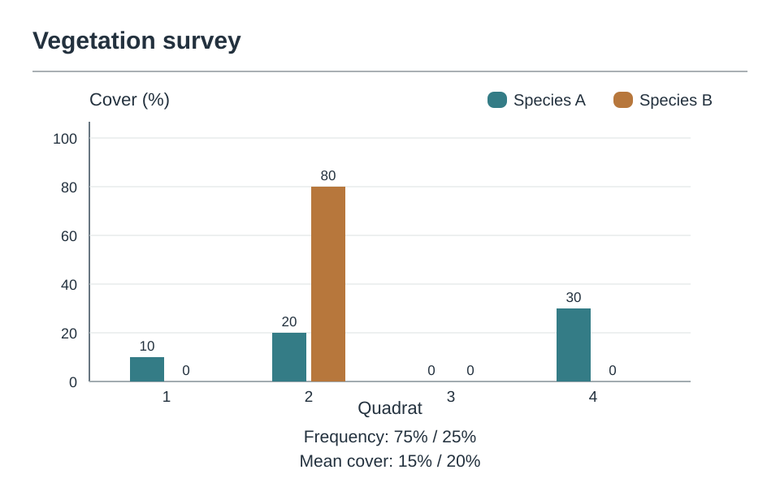

# M17-L3 – Geobotany and vegetation analysis {#L3}

**Course area:** M17 – Organismal and Ecological Electives

**Level:** Bachelor

**Prerequisites:** [M14-L2](M14-L2.md): community ecology; [M16-L4](M16-L4.md): sampling design.

**Learning objective:** Explain geobotanical distribution patterns and distinguish frequency, cover and density in vegetation surveys.

## Introduction {#S1}

A low-growing meadow species may occur almost everywhere while covering little area. Another may occur rarely but occupy a large area where present. Geobotany connects such local patterns with climate, soils, land use, dispersal and biogeographical history.

## Principles and model {#S2}

### Vegetation gradients and plots

Floristic composition describes which species are present. Vegetation structure additionally describes features such as layering, height and spatial cover. Environmental gradients in soil moisture, pH, light and elevation may be associated with continuous changes in species assemblages. Historical land use and dispersal limitation may produce equally strong signals. Potential natural vegetation is a hypothetical reference under specified conditions, not a certain prediction of the actual future community.

Vegetation surveys use defined plots and standardised observations. Random, systematic or stratified placement must suit the question. Comparable plot sizes are essential for frequency comparisons. Nested plots or multiple subplots within one site require attention to dependence among observations.

### Three distinct metrics

Frequency $f=k/n$ is the proportion of plots in which a species occurs. Density $D=N/A$ counts individuals per surveyed area; defining an individual is difficult for clonal plants. Cover describes the projected area of a species relative to the plot. Point-intercept methods estimate cover using hit proportions; with multiple contacts in different layers, species-specific covers may sum to more than 100%. The Braun-Blanquet method uses ordered cover or abundance classes; the version and class boundaries must be specified. Ordinal classes should not be treated as metric measurements without justification.

*Figure: Cover of two fictional species across four equal plots.*

## Application {#S3}

Four equal fictional quadrats of 1 m² each have species A covers of 10, 20, 0 and 30%. Species B has 0, 80, 0 and 0%. A has frequency 3/4 = 75% and mean cover 15%; B has frequency 25% and mean cover 20%. B covers more area on average despite A being more widespread. If twelve clearly distinguishable individuals of A are counted, observed density is 3 individuals/m². The same counting rule may be inappropriate for clonal species.

## Self-assessment {#S4}

### Exercises

1. A species occurs in six out of ten quadrats. What is its frequency?
2. Calculate mean cover for 0, 10, 20 and 50% on equal plots.
3. Why does greater cover in moist plots not directly establish a causal effect of moisture?

::: {.lc-solutions data-lc-section="S4"}
1. 60%.
2. 20%.
3. Soil chemistry, land use or shade may covary with moisture; controlled comparisons or justified statistical models are needed.
:::

## Assumptions and limitations {#S5}

Fictional data. Results depend on plot size, season, observer and survey method. Rare species are easily overlooked. Surveys in protected areas require compliance with access and conservation rules.

## Summary and transition {#S6}

Frequency, density and cover describe different properties of vegetation. Recording them separately enables meaningful geobotanical comparisons.

**Continue:** [M17-L4](M17-L4.md)

## Sources {#S7}

- [Open University – Practising science: 2.4 Collecting quantitative data](https://www.open.edu/openlearn/science-maths-technology/geology/practising-science-reading-the-rocks-and-ecology/content-section-2.4) · Quadrats, frequency and cover; indexed teaching text · Last accessed: 2026-11-25
- [University of Minnesota Duluth – Sampling Plants](https://wormwatch.d.umn.edu/research/research-methods/sampling-plants) · Cover classes and vegetation plots; indexed methods overview · Last accessed: 2026-11-25

