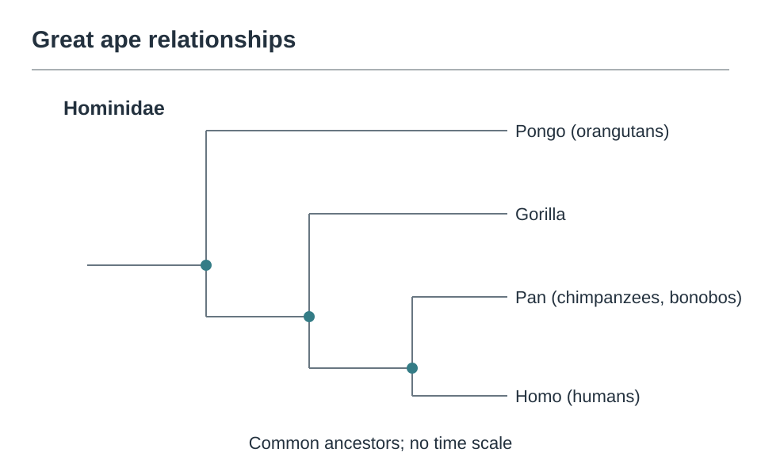

# M17-L4 – Anthropology and primate evolution {#L4}

**Course area:** M17 – Organismal and Ecological Electives

**Level:** Bachelor

**Prerequisites:** [M8-L4](M8-L4.md): evolutionary history; [M13-L5](M13-L5.md): phylogenetic trees.

**Learning objective:** Place humans phylogenetically, distinguish fossil and character evidence, and explain limitations of reconstruction.

## Introduction {#S1}

Biological anthropology investigates human evolution, variation and interactions between biology and environment. Its questions connect palaeontology, anatomy, genetics and behavioural research. Humans are primates, not a comparison group outside the animal kingdom.

## Principles and model {#S2}

### Primates and common ancestry

Primates include strepsirrhines and haplorhines. The latter include apes. Within apes, humans belong to Hominidae; the genus Pan, containing chimpanzees and bonobos, is the living sister group to the human lineage. Humans did not descend from modern chimpanzees. A common ancestor was neither a modern human nor a modern chimpanzee.

Primates display different combinations of grasping ability, vision, brain organisation and locomotion. Regular bipedalism in the human lineage can be investigated using the pelvis, knee, foot and position of the foramen magnum, among other features. Individual traits may have multiple functions, so evidence from several body regions matters. Traits arose at different times; such mosaic evolution contradicts a linear sequence of supposedly increasingly advanced forms.

### Fossils, variation and uncertainty

Fossils provide direct anatomical information but rarely complete skeletons. Stratigraphy and appropriate dating methods constrain age and context; a fossil age is not the exact date of origin of a species. Morphological characters, molecular data and archaeological traces answer different questions. Species boundaries and specific ancestor relationships among extinct hominins remain partly debated. A tree depicts a hypothesis of branching relationships, not a ranking of living organisms.

Human variation overlaps and is often geographically gradual. Population history, gene flow, selection, drift and environment affect trait distributions. Individual anatomical measurements do not justify assigning abilities or social worth; research involving human remains and genetic data requires particular ethical care.

*Figure: Reduced genus-level tree of living Hominidae with Pan and Homo as sister lineages.*

## Application {#S3}

A fictional character dataset includes 30 skeletal finds, of which 18 have an assessable pelvis. Twelve of these 18 show a character pattern relevant to regular bipedalism. The observed proportion among assessable finds is 12/18 = 66.7%. Across all 30 finds the proportion with the character lies between 12/30 = 40% and 24/30 = 80% while missing cases remain unknown. This is a logical range, not a statistical confidence interval or an estimate of frequency in a past population. The figure shows a reduced tree of living Hominidae without fossil side branches.

## Self-assessment {#S4}

### Exercises

1. Which living genus is the sister group to the human lineage?
2. Ten of twenty finds are assessable; six show a character. Calculate the assessable proportion and logical bounds across all finds.
3. Why is an older fossil not automatically a direct ancestor of a younger one?

::: {.lc-solutions data-lc-section="S4"}
1. Pan (chimpanzees and bonobos).
2. 60%; across all finds, 30–80%.
3. Age alone does not establish direct ancestry. Fossils may belong to coexisting side branches; character and contextual evidence are required.
:::

## Assumptions and limitations {#S5}

The counting example is fictional and not attributed to a real hominin species. Missing fossil characters may be systematically associated with preservation conditions. The figure has no time-calibrated branch lengths. Human diversity must not be interpreted as a biological hierarchy.

## Summary and transition {#S6}

Primate evolution is a branching history. In the next lesson biomechanical models help test functional hypotheses about anatomical forms.

**Continue:** [M17-L5](M17-L5.md)

## Sources {#S7}

- [Smithsonian Human Origins Program – Introduction to Human Evolution](https://humanorigins.si.edu/education/introduction-human-evolution) · Fossils, shared ancestry and mosaic evolution; indexed educational text · Last accessed: 2026-11-25
- [Smithsonian Human Origins Program – Human Fossils](https://humanorigins.si.edu/evidence/human-fossils) · Fragmentary fossil record and uncertainty of branching relationships; indexed educational text · Last accessed: 2026-11-25

