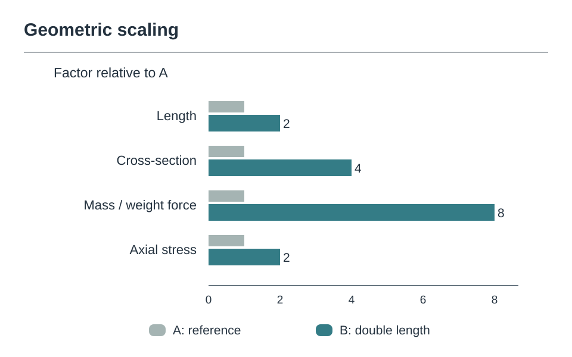

# M17-L5 – Biomechanics and functional adaptation {#L5}

**Course area:** M17 – Organismal and Ecological Electives

**Level:** Bachelor

**Prerequisites:** [M8-L2](M8-L2.md): levers; [M11-L2](M11-L2.md): muscular work.

**Learning objective:** Derive mechanical loading, geometric scaling and allometric relations and assess their biological limitations.

## Introduction {#S1}

A large animal is not simply an enlarged small animal. Under geometric similarity mass grows faster than load-bearing cross-sectional areas. Organisms may compensate for this mechanical challenge through body shape, posture, material properties and movement.

## Principles and model {#S2}

### Scaling under geometric similarity

If all lengths change by a factor $s$, areas grow as $s^2$ and volumes as $s^3$. At equal density, mass $m\propto L^3$ and cross-sectional area $A\propto m^{2/3}$. A simple axial mechanical stress is $\sigma=F/A$, with force in newtons and area in square metres. If $F$ is proportional to body weight, these assumptions imply $\sigma\propto m^{1/3}$. An idealised relationship between maximal muscle force and physiological muscle cross-section is plausible; actual force also depends on fibre architecture, activation and contraction velocity.

A general allometric relationship $Y=a m^b$ can be written for positive values as $\log Y=\log a+b\log m$. Exponent $b$ describes scaling. A theoretical exponent is a reference hypothesis, not a universal constant. Empirical estimates require suitable samples and uncertainty intervals. In species comparisons related species need not be statistically independent.

### Mechanics, posture and adaptation

Bending loads on bones depend on force, moment arm and cross-sectional geometry; axial stress alone is insufficient. More upright limb posture may reduce some external joint moments while other loads remain. Tendons store and return elastic energy; locomotor economy nevertheless depends on muscular work, speed and gait. An observed character can support a functional hypothesis but does not by itself prove its evolutionary cause. Comparative data and mechanical models must be assessed together.

*Figure: Doubling length increases cross-section fourfold, weight force eightfold and axial stress twofold.*

## Application {#S3}

A geometrically similar model B has twice the length of A. Mass and weight increase eightfold, load-bearing area fourfold. Model A has axial force 100 N and area 100 mm². Stress is 1 N/mm² = 1 MPa. Model B bears 800 N on 400 mm², or 2 MPa. To achieve 1 MPa in the same simplified model, B would need 800 mm² of load-bearing area. The figure compares dimensionless scaling factors, not actual bone measurements.

## Self-assessment {#S4}

### Exercises

1. By which factor does mass increase when length triples at equal density?
2. By which factor does axial stress increase under geometric similarity and proportional weight force?
3. Why does departure from the exponent 2/3 for muscle cross-section not automatically demonstrate a particular adaptation?

::: {.lc-solutions data-lc-section="S4"}
1. $3^3=27$.
2. $27/9=3$.
3. Body shape, fibre architecture, sample composition, phylogenetic dependence and measurement method may influence the departure. Alternative explanations must be tested.
:::

## Assumptions and limitations {#S5}

The static model assumes geometric similarity, equal density and purely axial loading. It ignores dynamic forces, material heterogeneity and fatigue. Do not infer engineering or clinical load limits from the model values.

## Summary and transition {#S6}

Scaling provides testable reference models for functional anatomy. This concludes the organismal and ecological elective; additional bachelor electives complement it with molecular and cellular perspectives.

**Continue:** [M18-L1](M18-L1.md)

## Sources {#S7}

- [How scaling approaches can reveal fundamental principles in physiology and biomechanics (2023)](https://pubmed.ncbi.nlm.nih.gov/37021681/) · Scaling approaches and interpretation; indexed review abstract · Last accessed: 2026-11-25
- [Predictive musculoskeletal simulations reveal the mechanistic link between speed, posture and energetics among extant mammals (2024)](https://www.nature.com/articles/s41467-024-52924-z) · Geometric similarity assumptions and simulated locomotor mechanics; indexed research article · Last accessed: 2026-11-25

