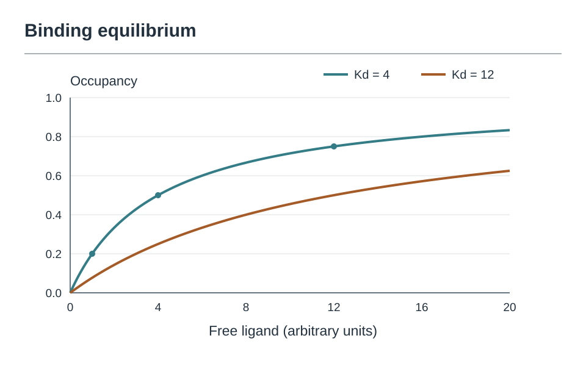

# M18-L1 – Biophysics and molecular interactions {#L1}

**Course area:** M18 – Molecular and Applied Electives

**Level:** Bachelor

**Prerequisites:** [M3-L2](M3-L2.md): equilibrium; [M5-L2](M5-L2.md): enzyme kinetics.

**Learning objective:** Describe molecular binding equilibria quantitatively and distinguish affinity, occupancy and biological response.

## Introduction {#S1}

A signalling molecule may bind to a protein without producing an equally large biological response. Biophysics therefore separates molecular states from observed system properties. A simple equilibrium model is a starting point, not a complete description of a cell.

## Principles and model {#S2}

### Interactions and affinity

Hydrogen bonds, electrostatic forces, van der Waals interactions and the hydrophobic effect contribute to binding. Binding free energy also depends on entropy, solvent and conformational changes. A single strong interaction therefore does not guarantee high affinity. Spatial and chemical complementarity between the partners is crucial.

For a receptor R and ligand L with one binding site, equilibrium is described by $R+L \rightleftharpoons RL$. The dissociation constant is $K_d=[R][L]/[RL]$. Concentrations refer to free reactants and the complex. With $[R]_T=[R]+[RL]$, dimensionless occupancy is $\theta=[RL]/[R]_T=[L]/(K_d+[L])$. At $[L]=K_d$, half the sites are occupied. A smaller $K_d$ corresponds to higher affinity in the same model under comparable conditions.

### Binding and response

An equilibrium value does not describe binding duration. Two systems can have identical affinity yet differ in association and dissociation rates. Downstream signal amplification, multiple sites and allosteric coupling may also alter the relationship between occupancy and response. A half-maximal functional response is therefore not necessarily half-maximal binding. Measurements may observe binding directly or indirectly; signals must always be interpreted against appropriate references.

*Figure: Two occupancy curves with different dissociation constants.*

## Application {#S3}

A fictional protein has $K_d=4$ in an arbitrary concentration unit. Free ligand concentrations of 1, 4 and 12 give occupancies of $1/5=0.20$, $4/8=0.50$ and $12/16=0.75$. A second protein with $K_d=12$ reaches only $4/16=0.25$ at 4 units. This illustrates affinity, not drug efficacy.

## Self-assessment {#S4}

### Exercises

1. Calculate occupancy for $K_d=4$ and $[L]=16$.
2. What does a smaller $K_d$ mean under comparable conditions?
3. Why can a functional response differ from occupancy?

::: {.lc-solutions data-lc-section="S4"}
1. $16/(4+16)=0.80$.
2. Higher affinity in the simple equilibrium model.
3. For example, because of signal amplification, coupling or different receptor states.
:::

## Assumptions and limitations {#S5}

The model assumes one independent binding site, equilibrium and a known free ligand concentration. It ignores cooperativity and nonspecific binding. All values are illustrative, not clinical concentrations or laboratory settings.

## Summary and transition {#S6}

The occupancy curve connects chemical equilibrium with molecular function. The next lesson examines functional evidence at genome scale.

**Continue:** [M18-L2](M18-L2.md)

## Sources {#S7}

- [NCBI Bookshelf – Molecular Biology of the Cell: Protein Function](https://www.ncbi.nlm.nih.gov/books/NBK26911/) · Reversible ligand binding and equilibrium; indexed text · Last accessed: 2026-11-25
- [NCBI Bookshelf – Analyzing Kinetic Binding Data](https://www.ncbi.nlm.nih.gov/books/NBK569501/) · Simple bimolecular binding and equilibrium occupancy; indexed text · Last accessed: 2026-11-25

