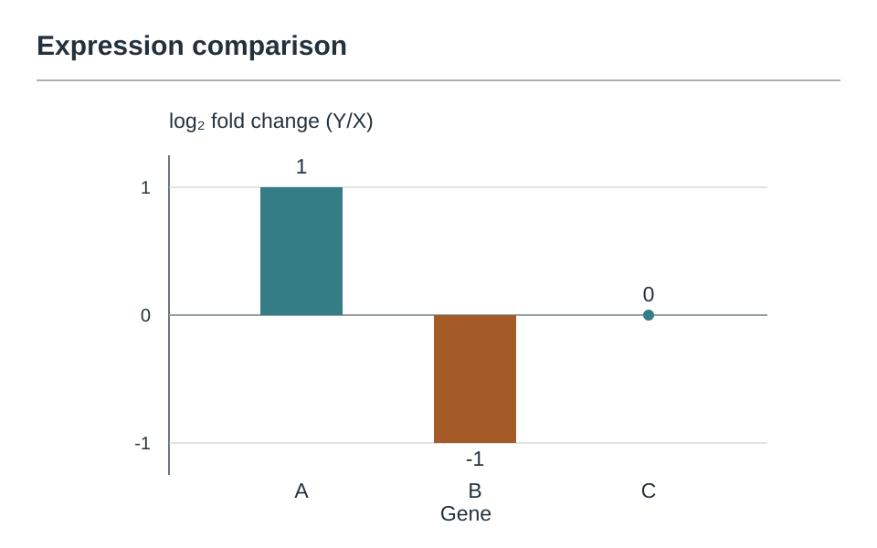

# M18-L2 – Genome analysis and functional genetics {#L2}

**Course area:** M18 – Molecular and Applied Electives

**Level:** Bachelor

**Prerequisites:** [M6-L5](M6-L5.md): variation; [M15-L4](M15-L4.md): omics data.

**Learning objective:** Distinguish genomic associations from functional hypotheses and evaluate different layers of evidence.

## Introduction {#S1}

Knowing a sequence alone rarely explains gene function. Functional genetics links variation to measurable properties; genomics also considers relationships among many elements and their regulation. Robust conclusions emerge from converging, preferably independent evidence.

## Principles and model {#S2}

### From sequence to function

Sequence comparisons may reveal conserved regions and putative homologous genes. Annotations remain hypotheses of varying confidence: similarity to a characterised gene does not establish identical function. Genome-wide association studies statistically link variants to phenotypes. Correlation may arise through linkage of neighbouring variants, population structure or environmental differences. An associated region is therefore not automatically the cause of a trait.

Expression data show where and under which conditions RNA or protein is detectable. Expression changes may be causes, consequences or correlates of a changed state. Functional evidence additionally considers observed phenotypes in naturally occurring variants or controlled model conditions. Complementary evidence from several data types increases the plausibility of a hypothesis when shared systematic errors are considered.

### Analysis and interpretation

In a comparison between two groups, fold change describes the ratio of normalised means. Log fold change $\log_2(b/a)$ is symmetric for doubling and halving. It is undefined at zero values without additional modelling. Effect size, sampling uncertainty and multiple-testing correction address distinct questions. Biologically meaningful effects may be statistically uncertain; statistical significance does not prove causation. Transparent reporting documents data sources, annotation, comparison groups, uncertainty and alternative explanations.

*Figure: Simulated logarithmic expression changes for genes A, B and C.*

## Application {#S3}

In a simulated dataset, normalised signal for gene A is 40 in group X and 80 in Y. Gene B changes from 100 to 50. For A, $\log_2(80/40)=1$; for B, $\log_2(50/100)=-1$. Gene C has 60 in both groups, giving 0. Without replicates there is no reliable conclusion about statistical uncertainty. The three values alone establish neither causation nor direct molecular interaction.

## Self-assessment {#S4}

### Exercises

1. Calculate log fold change for 25 and 100.
2. Why is an association with a genomic region not necessarily causal?
3. Name another layer of evidence besides RNA expression.

::: {.lc-solutions data-lc-section="S4"}
1. $\log_2(100/25)=2$.
2. Linkage, population structure or other confounders may explain it.
3. For example, protein measurement or an independently observed phenotype.
:::

## Assumptions and limitations {#S5}

The data are fictional and already normalised. No individual genetic risk interpretation is intended. No sequences, experimental interventions or molecular working protocols are supplied.

## Summary and transition {#S6}

Functional genetics integrates different layers of evidence. Applications in agriculture and industrial biology are considered next.

**Continue:** [M18-L3](M18-L3.md)

## Sources {#S7}

- [NHGRI – Functional Analysis Program](https://www.genome.gov/10000612/functional-analysis-program) · Functional genomic elements and RNA/protein expression; indexed text · Last accessed: 2026-11-25
- [NHGRI – Genetics vs. Genomics Fact Sheet](https://www.genome.gov/about-genomics/fact-sheets/Genetics-vs-Genomics) · Genetics and genome-wide analysis; indexed text · Last accessed: 2026-11-25

